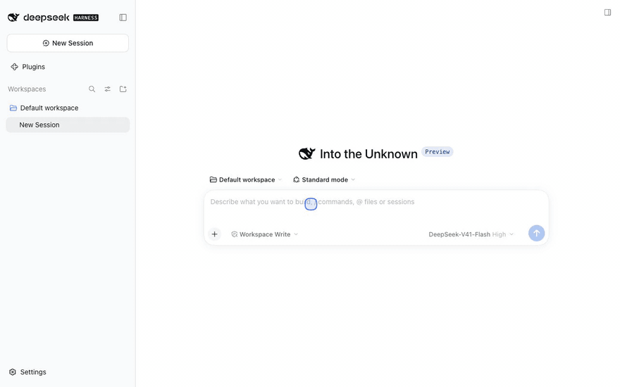

# Installation media / 安装引导图集

Bilingual light-mode installation and onboarding screenshots and GIFs for [Install and start](../../en/guides/installation.md) and [安装与启动](../../zh-CN/guides/installation.md). [Media index](../README.md)

## Recordings / 录制

| Flow / 流程 | English | 简体中文 |
|---|---|---|
| Install and enable / 安装并启用 | [install.gif](./en/install.gif) | [install.gif](./zh-CN/install.gif) |
| First memory / 第一条记忆 | [first-memory.gif](./en/first-memory.gif) | [first-memory.gif](./zh-CN/first-memory.gif) |

## Screens / 截图

| Step / 步骤 | English | 简体中文 |
|---|---|---|
| Add an API key / 添加 API Key | [install-02-api-key](./en/install-02-api-key.jpg) | [install-02-api-key](./zh-CN/install-02-api-key.jpg) |
| Add plugin / 添加插件 | [install-04-add](./en/install-04-add.jpg) | [install-04-add](./zh-CN/install-04-add.jpg) |
| Installed / 已安装 | [install-05-installed](./en/install-05-installed.jpg) | [install-05-installed](./zh-CN/install-05-installed.jpg) |
| Status / 状态页 | [install-07-status](./en/install-07-status.jpg) | [install-07-status](./zh-CN/install-07-status.jpg) |
| First reply and turn bar / 回复与回合记忆栏 | [first-01-reply](./en/first-01-reply.jpg) | [first-01-reply](./zh-CN/first-01-reply.jpg) |
| Runtime memory entry / 运行时记忆条目 | [first-02-runtime](./en/first-02-runtime.jpg) | [first-02-runtime](./zh-CN/first-02-runtime.jpg) |
| Incompatible version refusal / 版本不兼容提示 | [trouble-incompatible](./en/trouble-incompatible.jpg) | [trouble-incompatible](./zh-CN/trouble-incompatible.jpg) |
| Starter disabled / Starter 停用状态 | [trouble-starter-off](./en/trouble-starter-off.jpg) | [trouble-starter-off](./zh-CN/trouble-starter-off.jpg) |
