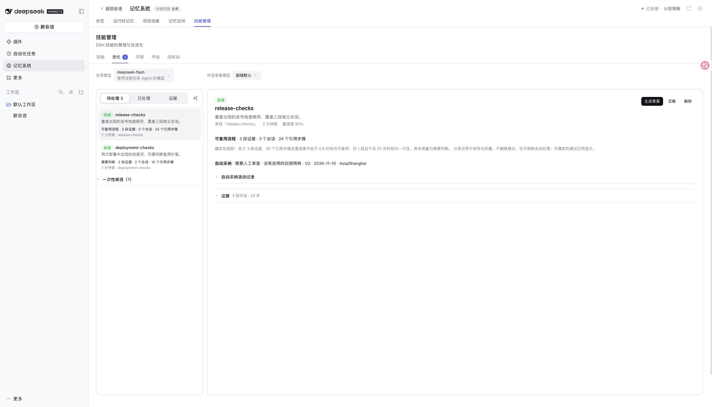
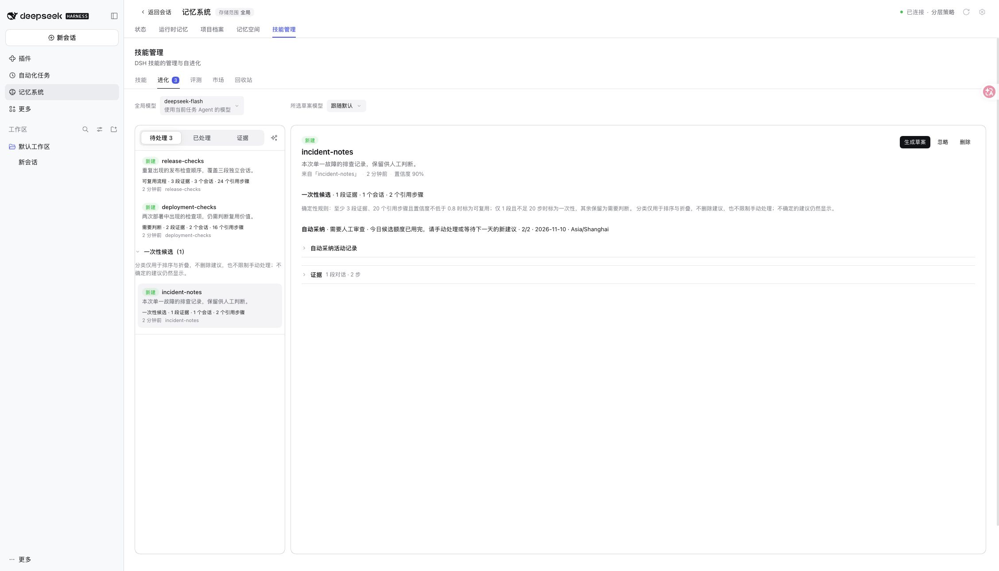
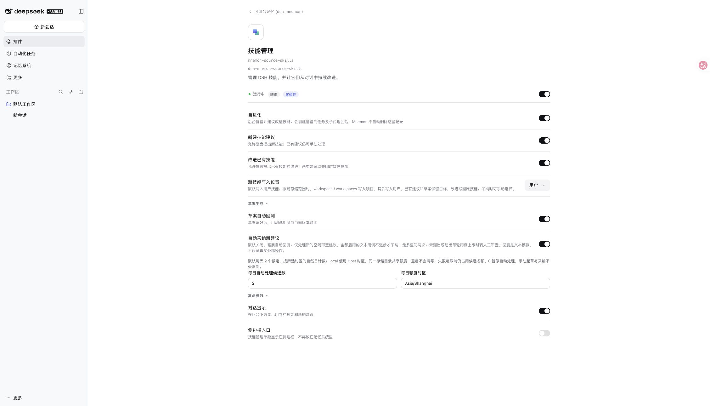

# Issue #598: bounded automatic adoption and suggestion triage

## 验收 / Acceptance

正式 DSH 0.2.2-rc.1 的隔离 WebUI，2026-11-10。本地模型桩、虚构会话与技能，不使用真实密钥。使用 `node scripts/serve-e2e.mjs --skill-budget-triage` 重现；可用 `MNEMON_E2E_DSH` 指定已安装的正式 DSH 可执行文件。

Published DSH 0.2.2-rc.1 in an isolated WebUI on 2026-11-10, with synthetic sessions and skills and a loopback model. Reproduce with `node scripts/serve-e2e.mjs --skill-budget-triage`; use `MNEMON_E2E_DSH` to select an installed published DSH executable.

- 可复用流程优先显示；需要判断的建议继续显示；一次性候选默认折叠，可展开后手动处理。
- 第三个候选被真实 Source 预算接口拒绝，显示 `2/2`、日期与时区；手动生成草案按钮仍可用。
- 技能配置显示每日 2 个候选、`Asia/Shanghai`。将额度改为 0 并应用，重新加载后仍保留 0。
- Durable suggestions sort first, uncertain suggestions remain visible, and one-off candidates can be expanded and handled manually.
- The real Source reservation API rejects the third candidate, displaying `2/2`, the date and time zone while retaining the manual drafting button.
- Settings show a limit of 2 and `Asia/Shanghai`. Saving 0 and reloading preserves the paused automatic budget.

## 验证边界 / Verification boundary

截图中的额度记录由可复现的 Source fixture 生成，未运行真实付费模型。根集成测试另外验证自动入队前预留、零额度不启动 Agent、手动起草和采纳仍成功。Source 测试覆盖并发共享、重启、删除后去重、跨日、变更时区、旧记录迁移、损坏账本、提交时预留匹配。完整 `pnpm run verify` 通过，根测试 2674 passed / 8 条件跳过。

The reproducible fixture records quota results through the real Source API; screenshots do not claim a paid model run. Root integration tests separately cover pre-draft reservation, no agent dispatch with a zero quota, and successful manual drafting/adoption. Source tests cover concurrent instances, restarts, deletion-resistant deduplication, day boundaries, time-zone changes, legacy migration, corrupt ledgers and reservation binding at commit. Full `pnpm run verify` passed with 2674 root tests passing and 8 conditional skips.

分诊只使用已校验的证据段、引用步骤和置信度；不采信模型的 `signals` 标签。中间态保持可见并标为需要判断，不新增模型调用。它不声称能替代人工质量判断，也不改变自动采纳的资格判断。

Triage uses admitted evidence windows, cited steps and confidence, ignoring model `signals` labels. Intermediate cases remain visible as uncertain, without an additional model call. This does not replace human quality judgment or change automatic-adoption eligibility.
