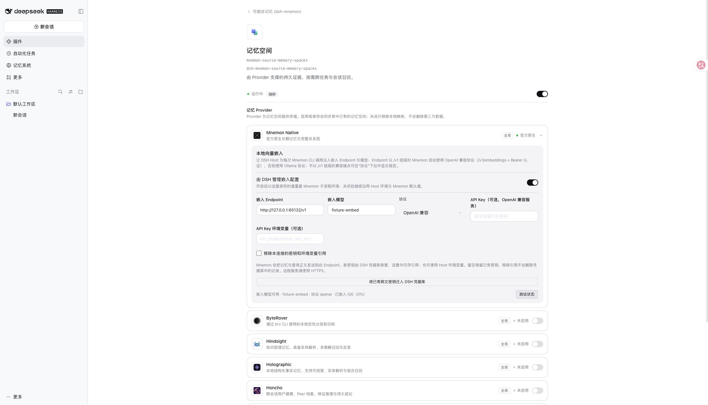
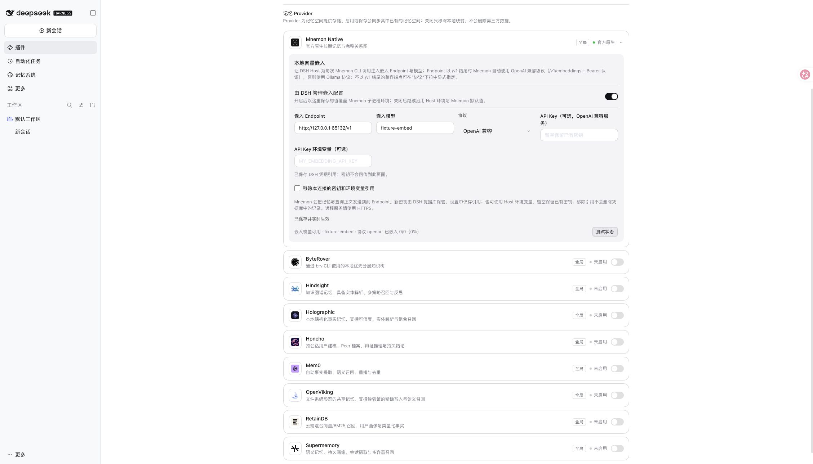
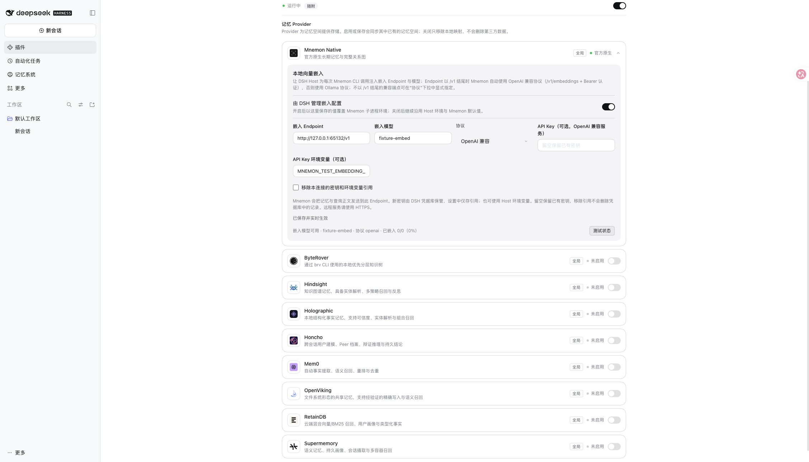
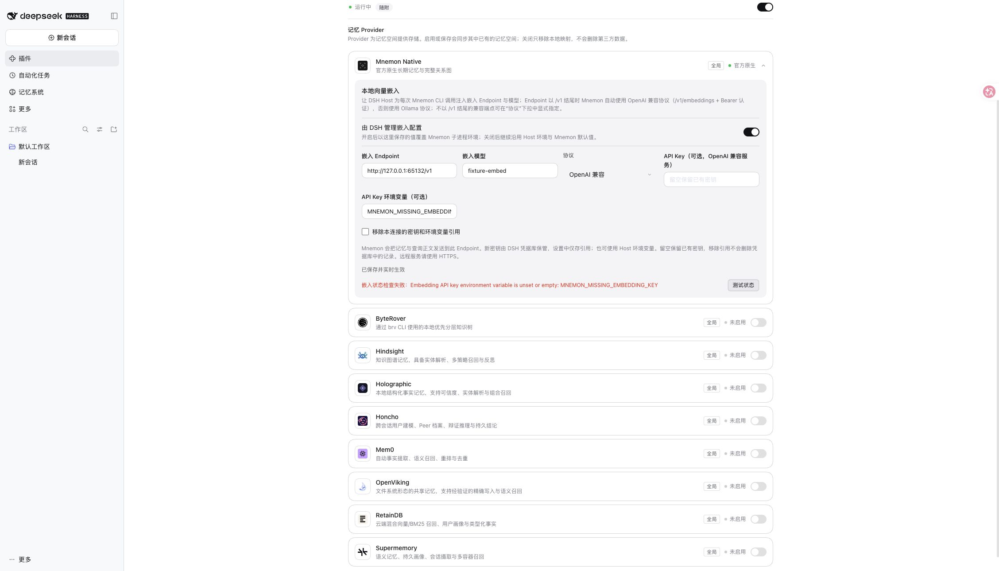
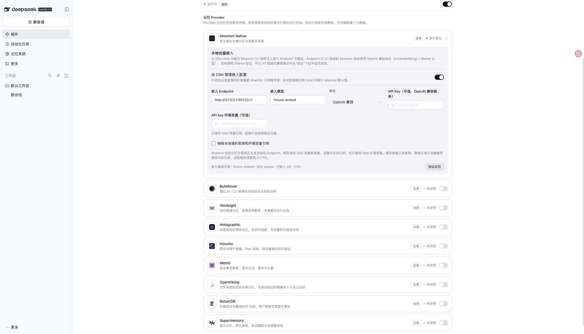
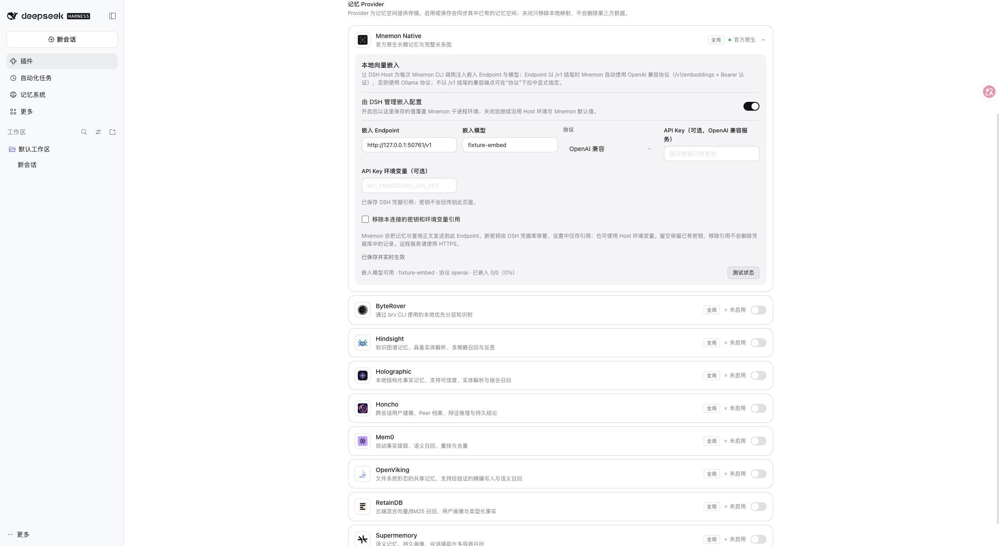

# Issue #599: embedding credentials

## 验收 / Acceptance

2026-11-10，正式 DSH 0.2.2-rc.1、0.2.1-rc.5，Mnemon CLI 0.2.13。通过 `node scripts/serve-e2e.mjs --embedding-credentials` 启动隔离 Profile。该 fixture 仅使用公开的虚构测试密钥、要求 Bearer 认证的 loopback 嵌入服务和确定性向量；未使用真实密钥、私人记忆或付费模型。

Validated on 2026-11-10 with published DSH 0.2.2-rc.1 and 0.2.1-rc.5, and Mnemon CLI 0.2.13. Reproduce with `node scripts/serve-e2e.mjs --embedding-credentials`. The isolated profile uses only a public synthetic fixture key, a Bearer-authenticated loopback service and deterministic vectors, with no private memories or paid model.

- 旧明文配置升级后仍可完成真实 CLI 嵌入探测；页面密码框为空，提供迁移入口。
- 迁移后 DSH 凭据库保存记录，`cordis.patch.yml` 中测试密钥消失，只剩引用；真实 CLI 探测成功。
- `apiKeyEnv` 保存后能从 Host 进程环境取值并认证；不存在的变量会明确报错，没有空密钥请求。
- 新密钥保存后，密码输入框清空；重启 DSH Host 后，已保存凭据仍可读取，CLI 探测成功。
- DSH 0.2.1-rc.5 同样完成迁移和已认证探测。
- Legacy inline configuration still completes the real CLI probe after upgrading; its key is absent from the editor, with a migration action available.
- After migration, the profile contains a reference and no fixture key, and the real CLI probe succeeds through DSH credentials.
- `apiKeyEnv` authenticates from the Host environment. A missing variable produces a specific error without an empty-key request.
- Saving a new key clears the password field. After restarting the Host, the saved reference still resolves and the CLI probe succeeds.
- DSH 0.2.1-rc.5 also passes migration and authenticated probing.

## 自动验证与边界 / Automated verification and limits

完整 `pnpm run verify` 通过：根测试 2680 passed / 8 条件跳过，组件、类型、构建、Headless 与包检查通过；Source 定向测试 53 项通过。

Full `pnpm run verify` passed: 2680 root tests passed with 8 conditional skips, plus component tests, type checks, builds, Headless and package checks. Focused Source suites passed 53 tests.

设置桥接回归覆盖新凭据写入/读回、三个 readback 区域脱敏、旧配置迁移、无凭据服务、失败回滚、并发修订冲突、Endpoint 绑定与显式清除。恢复原 settings bridge 时，7 个新增回归断言失败。Source 定向测试覆盖延迟解析、环境变量优先级、缺失/错误记录、CLI 错误脱敏、旧明文和非托管环境兼容，以及 UI 密钥清空与旧 Starter 行为。

Settings regressions cover write/readback, all three public descriptor sections, legacy migration, missing credentials service, rollback, concurrent revision conflicts, endpoint binding and explicit removal. Restoring the original settings bridge makes seven new regressions fail. Focused Source tests cover lazy resolution, environment precedence, missing/invalid grants, redacted CLI errors, legacy and unmanaged environments, cleared UI passwords and older Starter behavior.

测试未验证付费服务、Windows 桌面窗口或操作系统钥匙串加密。凭据存储由 DSH 负责。迁移不会改写只读/继承的基础文件或历史备份；移除配置引用不会删除凭据记录。回滚到不识别引用的旧插件前，需要安排已有的 CLI 环境变量方案或恢复适用配置，见[操作指南](../../en/guides/operations.md#embedding-credentials)。

These checks do not claim paid-provider, Windows desktop-window or OS-keychain encryption coverage. DSH owns credential storage. Migration does not rewrite inherited/read-only base files or old backups, and unlinking does not delete credential records. Before rolling back to a plugin that does not understand references, prepare the existing CLI-environment route or restore suitable configuration; see the [operations guide](../../en/guides/operations.md#embedding-credentials).
