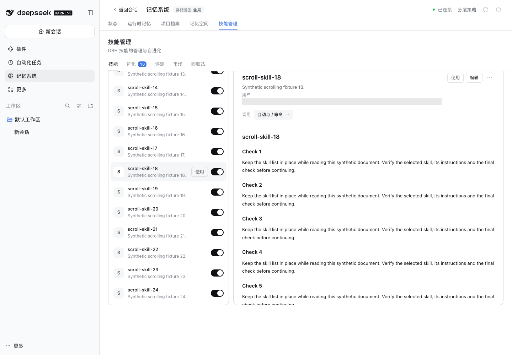
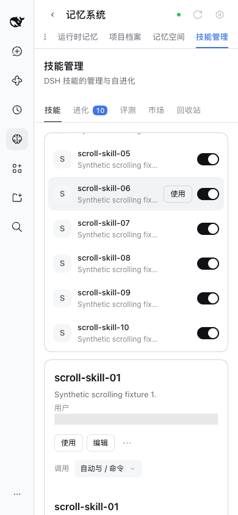

# Skills scrolling acceptance / 技能滚动验收

Issue #553, based on main `54cca5fc2e552483ae13e68565564149fd03a1df`.

The screenshots run this PR's built Skills Source in DSH `0.2.1-rc.5` WebUI and Chrome `156.0.8078.80`, with isolated DSH state, 24 synthetic skills and no model calls. The skill path is masked. The user Desktop profile and ambient browser were not used.

截图运行本 PR 构建后的技能 Source，使用 DSH `0.2.1-rc.5` WebUI 和 Chrome `156.0.8078.80`，隔离 DSH 数据并生成 24 个合成技能，不调用模型。技能路径已遮盖，未使用用户 Desktop 数据和现有浏览器。

| Check / 检查 | Observed result / 实测结果 |
| --- | --- |
| Desktop / 桌面 1440 × 1000 | Before: both columns were 4608px tall; wheeling over detail moved the outer canvas by 440px. After: each column is 678px tall; detail moves 440px and list moves 360px independently, with canvas at 0. / 修复前两栏高 4608px，详情滚轮带动外层 440px；修复后各栏高 678px，可分别滚动，外层不动。 |
| Selection / 切换技能 | Selecting skill 18 preserves list scrollTop 745 and resets detail from 440 to 0. / 切换技能 18 后列表保留在 745，详情从 440 回到 0。 |
| Boundaries and keyboard / 边界及键盘 | Wheel events at either column's end do not move the other column or canvas. PageDown moves only the focused detail. / 两栏到末尾后不带动另一栏和外层；PageDown 只滚动焦点所在详情。 |
| Narrow / 窄屏 390 × 844 | List clientHeight is 358px. Detail keeps its natural height, and Check 45 is reachable through the outer canvas. Canvas scrollWidth equals clientWidth (334px). / 列表内部高 358px，详情保持自然高度，可通过外层滚动读到 Check 45；无横向溢出。 |
| Adjacent behavior / 相邻行为 | Search, editor open/cancel and Evolution list/detail independent scrolling pass. / 搜索、打开及取消编辑，以及进化页独立滚动通过。 |
| Authorization / 权限 | Regression tests pass with writable true and false; editing and invocation switches remain disabled in read-only mode. / 回归测试覆盖可写与只读，编辑和调用开关在只读模式仍禁用。 |

Reproduce / 复现：build the root and workspace packages, then run `pnpm e2e:serve --skills-scroll --evolution-scroll`; open Memory System → Skills and test both viewport sizes. Expand the long rationale of `scroll-check-03` on Evolution before checking its detail scrolling. See [metrics.json](./metrics.json) for measured positions.

构建根包和工作区包后，运行 `pnpm e2e:serve --skills-scroll --evolution-scroll`，打开记忆系统 → 技能管理，在两种窗口尺寸下验证。验证进化页时先展开 `scroll-check-03` 的长说明。具体位置见 [metrics.json](./metrics.json)。

Validation / 验证：`pnpm run verify` passed: 2463 root tests and 751 component tests, with 7 root and 3 component conditional skips; type checks, reproducible build, isolated Headless activation and package checks passed. The new regression failed twice before the fix and passed for both writable states afterward. Independent code review found no P1/P2 issue.

`pnpm run verify` 通过：根测试 2463 项、组件测试 751 项通过，分别条件跳过 7 项和 3 项；类型检查、可复现构建、隔离 Headless 激活及包检查通过。新增回归修复前两项失败，修复后可写和只读两条路径均通过。独立代码审查未发现 P1/P2 问题。

Packed validation / 打包验证：after allowing the filesystem-backed UI read to settle under concurrent package tests, `verify-plugin-artifacts.mjs --skip-build --keep` passed for all 18 independent repositories and 19 artifacts on Node 24.22.2. / 为并行包测试中的真实文件读取留出加载时间后，Node 24.22.2 下 18 个独立仓库和 19 个打包制品全部通过验证。

Platform limit / 平台范围：tested on macOS Chrome WebUI; no Windows-native Desktop run was performed. / 实测环境为 macOS Chrome WebUI，未运行 Windows 原生桌面端。
