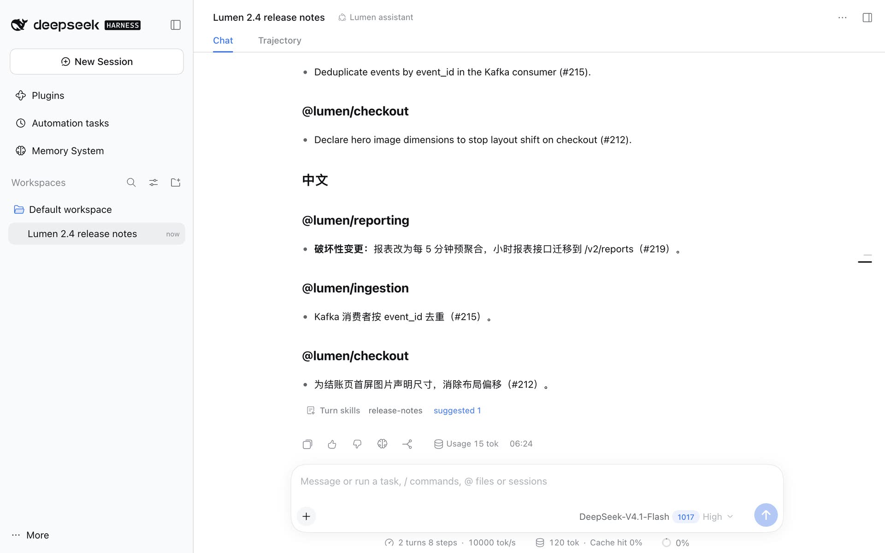

# Skills media / 技能管理图集

Bilingual light-mode screenshots of Skills management, evolution, backtesting, and market browsing on the seeded fictional Lumen project, for [Skills (EN)](../../en/guides/skills.md) and [技能管理 (中文)](../../zh-CN/guides/skills.md). Regenerate with `node scripts/serve-e2e.mjs --docs-demo` (or `--docs-demo=en`). [Media index](../README.md)

## Screens / 截图

| Surface / 场景 | English | 简体中文 |
|---|---|---|
| Turn skills bar / 回合技能栏 | [chat-skills](./en/chat-skills.jpg) | [chat-skills](./zh-CN/chat-skills.jpg) |
| Skills library / 技能库 | [skills-library](./en/skills-library.jpg) | [skills-library](./zh-CN/skills-library.jpg) |
| Pending suggestion / 待处理建议 | [skills-suggestion](./en/skills-suggestion.jpg) | [skills-suggestion](./zh-CN/skills-suggestion.jpg) |
| Draft, backtest, and diff / 草案、回测与差异 | [skills-draft](./en/skills-draft.jpg) | [skills-draft](./zh-CN/skills-draft.jpg) |
| Recorded evidence / 复盘证据 | [skills-evidence](./en/skills-evidence.jpg) | [skills-evidence](./zh-CN/skills-evidence.jpg) |
| Eval cases and results / 评测用例与结果 | [skills-evals](./en/skills-evals.jpg) | [skills-evals](./zh-CN/skills-evals.jpg) |
| Market search / 技能市场 | [skills-market](./en/skills-market.jpg) | [skills-market](./zh-CN/skills-market.jpg) |
| Market preview / 安装预览 | [skills-market-preview](./en/skills-market-preview.jpg) | [skills-market-preview](./zh-CN/skills-market-preview.jpg) |
| Skill sources / 技能来源 | [skills-sources](./en/skills-sources.jpg) | [skills-sources](./zh-CN/skills-sources.jpg) |
| Composition board row / 记忆组合中的技能行 | [plugin-skills-row](./en/plugin-skills-row.jpg) | [plugin-skills-row](./zh-CN/plugin-skills-row.jpg) |
| Skills settings page / 技能设置页 | [plugin-skills](./en/plugin-skills.jpg) | [plugin-skills](./zh-CN/plugin-skills.jpg) |
