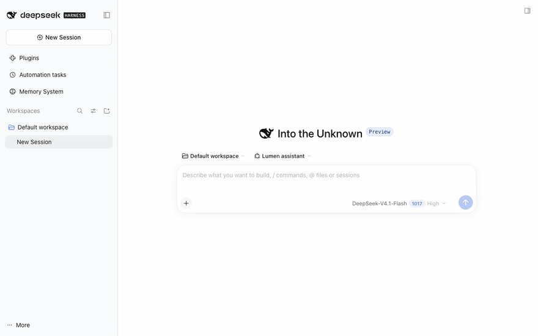

# WebUI media / WebUI 图集

Bilingual light-mode screenshots and recordings captured from a real DSH WebUI on the seeded fictional Lumen project, used across `README.md`, `README.zh-CN.md`, [UI guide](../../en/guides/ui-guide.md), and [界面使用指南](../../zh-CN/guides/ui-guide.md). Regenerate with `node scripts/serve-e2e.mjs --docs-demo --live-model` (or `--docs-demo=en --live-model`). [Media index](../README.md)

## Recordings / 录制

| Flow / 流程 | English | 简体中文 |
|---|---|---|
| Recall / 召回 | [recall.gif](./en/recall.gif) | [recall.gif](./zh-CN/recall.gif) |
| Save to memory / 存入记忆 | [save.gif](./en/save.gif) | [save.gif](./zh-CN/save.gif) |
| Correct / 纠正 | [correct.mp4](./en/correct.mp4) | [correct.mp4](./zh-CN/correct.mp4) |
| Memory System / 记忆系统 | [memory.gif](./en/memory.gif) | [memory.gif](./zh-CN/memory.gif) |
| Plugins / 插件配置 | [plugins.gif](./en/plugins.gif) | [plugins.gif](./zh-CN/plugins.gif) |
