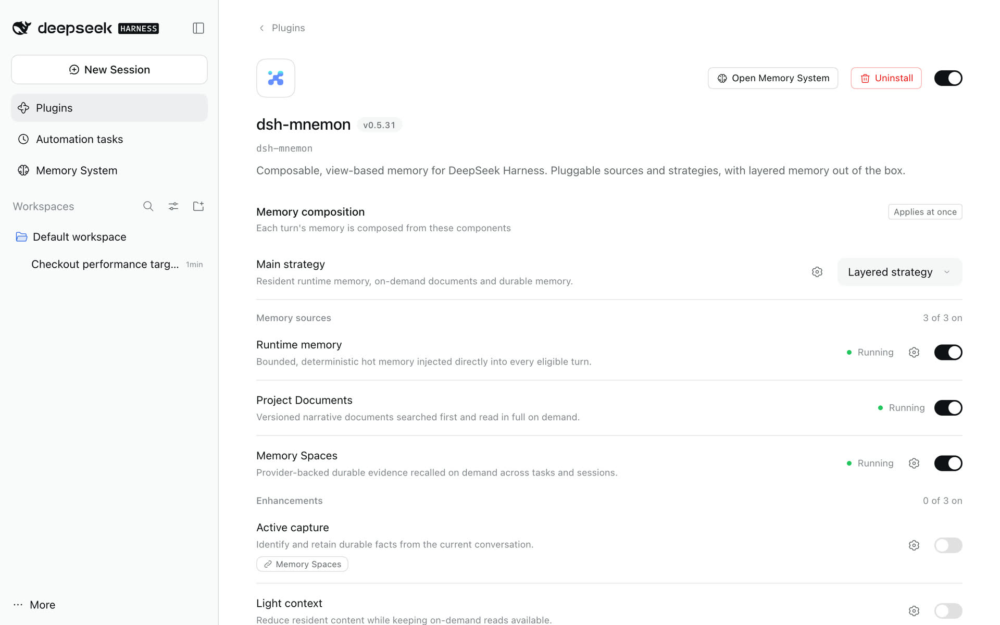

# Documentation

[简体中文](../zh-CN/README.md) | **English** | [Project home](../../README.md)

dsh-mnemon gives DeepSeek Harness three kinds of memory: **runtime memory** in every turn, **Project Documents** searched when a question needs them, and **Memory Spaces** for durable evidence on the Provider you choose. A main strategy decides how they take part in each turn; you pick it, and any enhancements, on the Plugins page. Start with the default Layered strategy; you never need to manage plugins to use it.

## Use the system

| Task | Guide |
|---|---|
| Install from scratch on the web, the desktop app or the command line, through to the first memory | [Install and start](./guides/installation.md) |
| Store and use the first memories | [Getting started](./guides/getting-started.md) |
| Find your way around the conversation, the Memory System and the Plugins page | [UI guide](./guides/ui-guide.md) |
| Understand what each component and strategy does | [Capability map](./guides/capabilities.md) |
| Choose and connect a long-term backend | [Providers](./guides/memory-providers.md) |
| Manage skills, let them improve from conversations, test them and install more | [Skills](./guides/skills.md) |
| Back up, move storage or troubleshoot | [Operations](./guides/operations.md) |
| Upgrade an existing installation | [Compatibility and upgrades](./reference/compatibility.md) |

## Look up a contract

| Question | Reference |
|---|---|
| Which settings exist, where are they edited and saved? | [Configuration](./reference/configuration.md) |
| What is stored where, shared or archived? | [Storage model](./reference/storage-model.md) |
| When do reads, writes and maintenance run? | [Workflows](./reference/workflows.md) |
| Which tools, commands, RPC channels and UI regions are exposed? | [Interfaces](./reference/interfaces.md) |

## Build an extension

| Task | Developer guide |
|---|---|
| Understand Source, Strategy, View, ownership and the UI regions | [Architecture](./development/architecture.md) |
| Create a Source, Strategy, enhancement or Provider | [Plugin development](./development/extensions.md) |
| Adapt a skin to Mnemon backgrounds and transparency | [Skin development](./development/skin-integration.md) |
| Build, test and capture a real WebUI | [Development and verification](./development/README.md) |
| Version and release independent packages | [Release process](./development/releasing.md) |
| Contribute: the rules and verification scripts | [CONTRIBUTING](../../CONTRIBUTING.md) · [Scripts](../../scripts/README.md) |

## What is new

- [v0.5.56](https://github.com/omdsh-dev/dsh-mnemon/releases/tag/v0.5.56) · Uses DSH tooltips across the Mnemon Web UI and gives Runtime memory calls actionable missing-field errors.
- [v0.5.55](https://github.com/omdsh-dev/dsh-mnemon/releases/tag/v0.5.55) · Shrinks browser bundles, lets idle review wait up to 24 hours, and keeps frozen session snapshots stable across routine changes to Project Documents and Memory Spaces.
- [v0.5.51](https://github.com/omdsh-dev/dsh-mnemon/releases/tag/v0.5.51): independent global sharing for Project Documents and Memory Spaces, optional BM25 index recall, and idle-review stability fixes.
- [v0.5.50](https://github.com/omdsh-dev/dsh-mnemon/releases/tag/v0.5.50): reorganized settings hierarchy, improved narrow-window layouts and Memory Spaces graph rendering, and fewer repeated reads in Skills.
- [v0.5.49](https://github.com/omdsh-dev/dsh-mnemon/releases/tag/v0.5.49): on-demand memory recall, silent managed idle reviews on DSH 0.2.2-rc.5, and watermark retry recovery.
- [v0.5.48](https://github.com/omdsh-dev/dsh-mnemon/releases/tag/v0.5.48): optional strategy activation and Cordis root compatibility fixes, quieter background tasks, and optional 3D memory overview.

[Changelog](../../CHANGELOG.md) · [Release history](./releases/README.md) · [Roadmap](./roadmap.md)

Guides describe the current release. Product media lives under [docs/assets](../assets/README.md) ([WebUI](../assets/webui/README.md), [Skills](../assets/skills/README.md), [Installation](../assets/install/README.md)). Internal Host RPCs are not an external plugin SDK.
