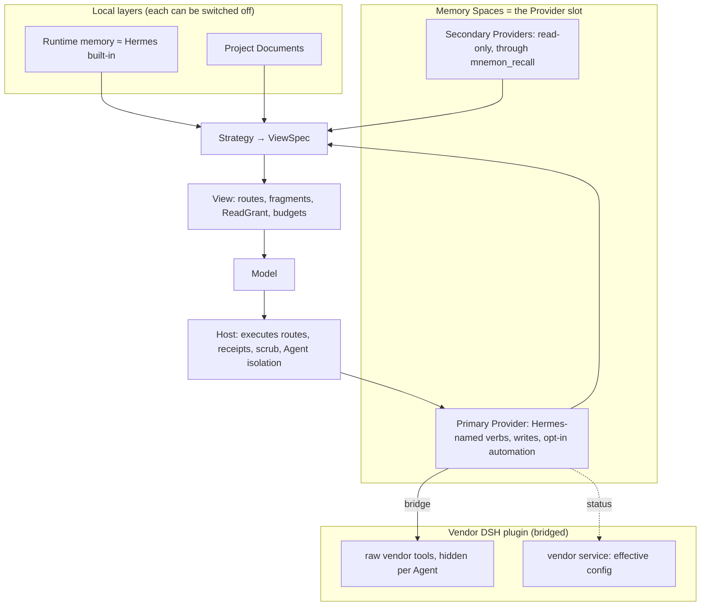

# Hermes-aligned memory providers

## Aim

Memory Spaces can run nine Providers at once. Every Provider's capabilities are flattened into ten
shared `mnemon_*` tools, and recall ranks all of them on one score scale. Four OpenViking reports in
October 2026 come from that shape:

- [#452](https://github.com/omdsh-dev/dsh-mnemon/issues/452): there is no exact-text search.
- [#453](https://github.com/omdsh-dev/dsh-mnemon/issues/453): images and attachments cannot be stored.
- [#454](https://github.com/omdsh-dev/dsh-mnemon/issues/454): score bands drop the right answer when scales differ.
- [#455](https://github.com/omdsh-dev/dsh-mnemon/issues/455): a request field that OpenViking 0.5 rejects breaks every write.

Hermes Agent, whose Provider list ours mirrors, handles third-party memory differently. The user
experience should match it while the three layers keep working: Runtime memory, Project Documents and
Memory Spaces, with Sources, Strategies and the View between them. Existing features may change if the
experience gets better.

## How Hermes handles third-party providers

These notes are read from `NousResearch/hermes-agent` at `cb757fac59` (MIT). The main sources are
`agent/memory_manager.py`, `agent/memory_provider.py`, `agent/memory_context.py`,
`hermes_cli/memory_setup.py`, and the user and developer guides on memory providers.

- **Built-in plus one.** MEMORY.md (2,200 characters) and USER.md (1,375 characters) are always on.
  At most one external provider can be added; `MemoryManager.add_provider` rejects a second one "to
  prevent tool schema bloat and conflicting backends". Our Runtime memory is the same design as the
  built-in memory.
- **Native verbs.** Each provider brings its own tools and none are flattened, for example:
  - OpenViking: `viking_search`, `viking_read`, `viking_browse`, `viking_remember`,
    `viking_forget`, `viking_add_resource`;
  - Hindsight: `hindsight_retain`, `hindsight_recall`, `hindsight_reflect`;
  - Mem0: `mem0_search`, `mem0_add`, `mem0_update`, `mem0_delete`.

  A provider's `system_prompt_block()` teaches its own tools. OpenViking's block says to run one or
  two focused searches, read the strongest URIs, and stop when results repeat.
- **Lifecycle owned by the host.**
  - A prefetch runs before each turn, in the background with an 8-second timeout. A stuck provider
    is skipped.
  - `sync_turn` runs on one background worker after each turn.
  - Extraction runs at session end.
  - Built-in memory writes are mirrored to the provider (`on_memory_write`, with the replaced entry).
- **Recall presentation.** Recall is wrapped in `<memory-context>` with a note that it is recalled
  memory, not user input. Repeated lines are dropped, and the fence is scrubbed from output. A line
  such as "🧠 Provider — recalled 3 memories" shows the user that memory was used.
- **Isolation and egress.**
  - A delegated subagent has no provider session; the parent observes the result (`on_delegation`).
  - An `agent_context` of `subagent` or `cron` tells providers not to write.
  - Everything sent to a provider passes a secret scrub first.
- **Setup.** `hermes memory setup` offers one picker: the installed providers plus "Built-in only",
  the default.
  - It asks only for required fields, and secrets go to `.env` with a link to where to get them.
  - `hermes memory status` lists what is missing.
  - The desktop panel is generated from the provider's own config schema.
- **Ecosystem.** Providers moved to their maintainers' repositories and are published through a plugin
  catalog that pins each provider's repository and commit. Upgrades install the catalog plugin for
  users who already name the provider. The provider name, its config section, its data directory and
  its tool names are the contract with users.

## Decisions (2026-10-23)

1. **One primary Provider, read-only secondaries.** One Provider holds the native verbs, the writes and
   any automation. Other Providers can stay connected for read-only recall.
2. **Hermes tool names.** Tools use Hermes' names and meanings (`viking_search`, …) wherever a
   Provider exposes native verbs.
3. **Bridge the vendor's own DSH plugin.** Where a vendor publishes a compatible DSH plugin, it is
   the data plane. We bridge to it rather than calling the vendor service ourselves.
4. **Automation off by default.** Prefetch, turn sync and mirroring are opt-in, bounded, and only
   for the primary Agent. This follows the hook-free default: recall stays tool-driven.

## Design

### The Provider slot

- **The primary Provider.** Memory Spaces holds exactly one primary Provider per storage scope:
  - its native verbs enter the View, replacing the ten generic Memory Spaces tools;
  - Save to memory and the task Agents write there by default;
  - opt-in automation applies only to it.

  Its namespaces stay discovered spaces, and activating spaces still sets the recall scope.
  Hermes has no equivalent of that, so it stays.
- **Secondary Providers.** These are optional and read-only. They are searched only through
  `mnemon_recall`, in their own result blocks. They get no native verbs, no automation and no
  writes, except one the user names explicitly.
- **The default.** Mnemon Native is the default primary. With no Mnemon CLI and no other Provider, the
  Memory Spaces layer is off and every other layer keeps working, as the layer-robustness direction
  of 2026-10-08 requires.

### Native verbs with Hermes names

A Provider declares its native routes in the Memory Spaces Source. The Strategy chooses which routes
the View shows, Core validates them, and the Host runs them under the View's ReadGrant and returns
Source receipts. Each route has a compact schema, and one Provider's routes stay under about 6 KB.
For reference, the ten generic Memory Spaces tools measure 8,640 bytes, and OpenViking's raw MCP
tools 15,261 bytes on server v0.4.21.

| Provider | Routes (Hermes names) | Data plane |
|---|---|---|
| OpenViking | `viking_search`, `viking_read`, `viking_browse`, `viking_remember`, `viking_forget`, `viking_add_resource`, plus `viking_grep` | Bridged vendor plugin; Mnemon's adapter as fallback |
| Mem0 | `mem0_search`, `mem0_add`, `mem0_update`, `mem0_delete` | Bridge candidate for search and add; the adapter for update and delete |
| Honcho | `honcho_profile`, `honcho_search`, `honcho_context`, `honcho_reasoning`, `honcho_conclude` | Adapter: the vendor plugin's peers stop at DSH 0.2.0-rc.1 |
| Hindsight | `hindsight_retain`, `hindsight_recall`, `hindsight_reflect` | Adapter |
| Holographic | `fact_store`, `fact_feedback` | Adapter |
| RetainDB, ByteRover, Supermemory | Hermes' names for each | Adapter |
| Mnemon Native | today's recall, related, link and graph verbs | Native CLI |

### Bridged Providers

A bridge uses the vendor's published DSH plugin for all I/O, so the vendor keeps its connection,
authentication and server-version handling. The vendor's own tools and skill stay out of the model's
view, and the user sees one place to configure and inspect it. A 2026-10-23 spike on DSH 0.2.1-rc.2
with `@openviking/dsh-memory-plugin@0.5.29` and OpenViking v0.4.21 proved every mechanism below with
public DSH APIs.

1. **Routes.** `viking_search` runs
   `ctx.tools.execute({ callId, name: 'mcp__openviking__find', arguments, signal })` without
   `agent`. Execution resolves in the global view, so the raw tool runs even though it is hidden
   from the Agent.
2. **Hiding.** The vendor mounts its MCP tools whatever `mcpEnabled` says: version 0.5.29 never reads
   that key. They are therefore denied per Agent:
   - On `agent/created`, `agent.ctx.inject(['tools', 'skills'], scoped => scoped.tools.restrict({ deny }))`
     denies every registered `mcp__openviking__*` tool.
   - The same runs again, coalesced, on `tools/change`, because the MCP bridge registers its tools
     after the Agent starts.
   - Names are recorded before `restrict` runs. `restrict` announces `tools/change` itself, and the
     spike hung in a CPU-bound loop until it recorded first.
3. **Skill shadowing.** The vendor's `openviking-memory` skill names the raw tools. An Agent-scoped
   runtime skill with the same name replaces it: scoped layers win over the global layer. A runtime
   skill needs a `source`; without one, loading it fails with `source must be a string`.
4. **Effective configuration.** The vendor service `openvikingMemory` exposes its resolved
   configuration. Status reads only its non-secret fields (`autoRecall`, `autoCapture`,
   `skipSubagentSessions`, endpoint, account, user).

   The Host sets the vendor entry's configuration with DSH's `configEditor`, as it already does for
   Mnemon's own entries: tools only, subagent sessions skipped. A `plugin` section in the user's
   `~/.openviking/ovcli.conf` outranks that host input, so Status compares the effective values with
   the intended ones and says which file wins.

Writes through a bridge keep Mnemon's receipts:

- `viking_remember` runs the raw `write` with `mode: create` and `wait: true`.
- It parses the server's answer ("Wrote N bytes to `<uri>` … `vector=<state>`").
- It reads the file back through the raw `read`.
- It returns a Source receipt whose id is the URI.

The Content page, Direct search, Status and a new Resources view read through the same raw tools, so
Mnemon never holds the vendor's credentials.

Each bridge is described in data: package and version range, DSH range, raw-tool mapping and argument
shaping, the configuration keys for tools only, the skills to shadow, the service fields for status,
and how namespaces map to spaces. When the vendor plugin is missing or outside its range, the
Provider falls back to Mnemon's adapter, which serves the same route names it can honour.

### Recall grouped by Provider

Results stay in their Provider's own order, one block per Provider, each naming its Provider. The
blocks are fenced and deduplicated in the Hermes manner. Score bands are removed for Providers whose
scores are not calibrated (#454). Three things remain:

- the Provider's own rank;
- the Agent's own judgment;
- in simple mode, Jev's yes/rank signals.

A short line in the conversation shows which spaces were used: "🧠 Lab machines (OpenViking) · 3".

### Automation

| Hermes hook | Place in Mnemon | Default | Bound |
|---|---|---|---|
| `system_prompt_block` | A Provider fact rendered in a Strategy slot as short usage guidance | on | fixed length |
| `prefetch` at session start | "Start with a Provider overview" enhancement | off | once per session, character budget |
| `prefetch` per turn | "Prefetch each turn" enhancement, run by the Host | off | timeout, character budget, cadence |
| `sync_turn`, `on_session_end` | "Sync the conversation to the Provider" enhancement, in the background after the scrub | off | one per turn, primary Agent only |
| `on_memory_write` | Runtime memory receipts mirrored to the primary Provider, deterministically, with no LLM | off | one per write |
| `on_delegation`, `agent_context` | Task Agents never get a Provider session or trigger capture | enforced | — |

Sync stays off by default. On 2026-10-23 OpenViking's server-side extraction rewrote a saved
preference from Chinese to English after an unrelated resource upload, and it turned plain
questions and answers into new memories. Turning sync on also turns on a Provider Changes view: it
reads `memory_diff.json` for OpenViking and the history API for Mem0, and offers undo where the
Provider allows it.

### Setup and status

- **The Status page** opens with one line: "Memory Provider: OpenViking ✓ available · 3 spaces", with
  a gear. The gear opens a single-choice list whose first entry is "Mnemon Native (default)".
- **Choosing a Provider.** Only the required fields are asked for, and secrets are masked with a link
  to where they come from.
  - OpenViking can reuse `~/.openviking/ovcli.conf`.
  - "Import from Hermes" reads `memory.provider` and the matching environment keys from `~/.hermes`,
    but only after the user confirms.
  - Spaces are discovered, and the line turns to ✓ or names what is missing.
- **When the Provider has a bridge,** the same flow offers to install the vendor plugin through
  Mnemon's existing plugin installation. It then writes the tools-only configuration.
- **Secondaries** sit in an "Additional Providers (read-only)" block, off until switched on.

### Migration

No data moves. After the upgrade, the first visit picks a primary from the existing spaces;
it is automatic when only one external Provider has spaces. The other Providers become secondaries,
and switching back is one choice. Smart Provider placement is removed: new spaces are created in the
primary. The choice between a named target and an Agent decision on Save to memory stays.

## Layer invariants

| Invariant | How it holds | How it is tested |
|---|---|---|
| The layers are independent | Runtime and Documents never depend on the slot. An empty slot turns Memory Spaces off, and a full MEMORY.md archives locally | Layer-combination matrix at capacity, with no Provider and with no space |
| The View is the only door | Native verbs are Source routes. Vendor tools are hidden per Agent and their skills shadowed | Tool-inventory snapshot tests; a warning when a vendor plugin runs without the bridge |
| Per-turn cost is bounded | The primary's routes replace the generic tools. Secondaries share one route, and automation has timeouts, budgets and cadence | Request-size ceilings in tests and in the lab |
| Receipts mean stored | Writes keep exact readback. Asynchronous server-side extraction appears only in Provider Changes | Receipt tests against a real server |
| Task Agents stay isolated | No prefetch, sync, mirror or vendor session for task Agents | Server-side check that no task-Agent session exists |
| Strategies stay pure | Strategies declare budgets; the Host runs them | Existing Strategy contract tests |
| Data stays within its boundary | Pack and Git sync still carry only official components | Existing Pack and sync tests |

## Expected files

- `plugins/dsh-mnemon-source-memory-spaces/src/provider-sdk.ts`: native routes, the bridge
  descriptor and optional lifecycle facts in the Provider contract.
- `plugins/dsh-mnemon-source-memory-spaces/src/service.ts`, `source.ts`: the slot (primary and
  secondaries), recall blocks, management operations for the slot.
- `plugins/dsh-mnemon-source-memory-spaces/src/recall-quality/policies.ts`: no score bands for
  uncalibrated Providers.
- `plugins/dsh-mnemon-source-memory-spaces/src/client/overview-page.tsx`, `provider-settings.tsx`,
  `settings.tsx`: the picker, status line, secondaries and Provider Changes.
- `plugins/dsh-mnemon-provider-openviking/src/bridge.ts` (new), `driver.ts`, `descriptor.ts`: the
  OpenViking bridge and the adapter fallback.
- `src/host/vendor-bridge.ts` (new): per-Agent hiding, skill shadowing, route execution, vendor
  configuration through `configEditor`.
- `src/host/memory-tools.ts`, `src/host/subagent.ts`: routes in the View and in task Agents'
  allowlists.
- `plugins/dsh-mnemon-strategy-default-three-tier/src/guidance.ts`: the Provider guidance slot.
- The opt-in automation goes into the existing enhancement mechanism; no new package unless a
  gate requires one.
- `docs/{en,zh-CN}/guides/memory-providers.md`, `docs/{en,zh-CN}/reference/configuration.md`.
- Tests: `tests/vendor-bridge.spec.ts`, Provider slot and recall-block tests, the layer matrix.

## Non-goals

- A second memory engine or a rewrite of the retrieval engine; mnemon (Go) stays the engine.
- Calling vendor services from Mnemon where a compatible vendor DSH plugin exists.
- Bundling vendor plugins in the Starter. They are installed when the user chooses them.
- Automation on by default, or for any Agent other than the primary one.
- Changing what Pack and Git sync carry.
- Supporting several primary Providers.

## Over-engineering risk

Rules:

- Each phase must close a reported problem or a measured gap before the next one starts.
- Bridges are data, one per vendor. Write a shared helper only when a second vendor needs it.
- Keep the adapter fallback to the routes it already serves; no new adapter features without a
  report.

Warning signals:

- a general plugin-proxy layer;
- a registry of bridges with more than one level of indirection;
- schema translation beyond renaming and narrowing arguments;
- re-implementing a vendor feature that its plugin already provides.

Complexity budget:

- the bridge runtime in `src/host/vendor-bridge.ts`: about 300 lines;
- one bridge descriptor: about 150 lines;
- the slot and recall blocks in Memory Spaces: about 400 lines changed;
- UI changes: about 600 lines.

Exceeding any of these by half means stopping to ask.

## Stop and ask

- Hiding or shadowing needs a DSH change, or does not work on DSH 0.2.0-rc.2.
- A vendor plugin cannot be held to tools only (automation that cannot be turned off).
- Recall blocks lose accuracy against today's federated recall: non-inferiority −2 points.
- Bridged turns cost more than 1.25× the adapter's on the same questions.
- A migration step would move, rewrite or delete existing memory.

## Build order and gates

0. **Adapter fixes, behavior-preserving.** These ship before the rest, one pull request each.
   - #455: no `timeout` field in OpenViking writes. Tested against a server that rejects unknown
     fields and against v0.4.21.
   - #452: an exact-text channel through `/api/v1/search/grep` for keyword search.
   - #454: no bands for scores a Provider does not calibrate.

   Gate: each fix is proven on a real server or a contract test, and every untouched route stays
   byte-identical.
1. **Bridge runtime and the OpenViking bridge** behind an off-by-default switch.
   Gate:
   - spike parity on DSH 0.2.1-rc.2 and 0.2.0-rc.2;
   - the same answers as the adapter on the lab questions, at ≤ 1.25× cost;
   - no `mcp__openviking__*` tool visible to any Agent;
   - no task-Agent session on the server.
2. **The Provider slot and recall blocks.**
   Gate: the layer matrix passes; the #454 case is answered with OpenViking plus Hindsight;
   non-inferiority on the lab set.
3. **Setup, status and migration** in the WebUI.
   Gate: before-and-after recordings; the first-run steps for OpenViking are counted; the copy and
   presentation baselines are updated.
4. **Automation enhancements** (overview, prefetch, sync, mirror, Provider Changes).
   Gate: each is off by default; per-turn cost is within its bound; extraction-driven rewrites are
   shown and can be undone.
5. **More bridges** (Mem0 next; Honcho once its plugin accepts current DSH), each with its own gate
   from step 1.

## Progress

- [x] Research: how Hermes handles third-party providers
- [x] Lab: the official OpenViking plugin beside dsh-mnemon (coexistence, side effects, costs)
- [x] Spike: Hermes-named routes over the vendor plugin, per-Agent hiding, skill shadowing, effective configuration
- [ ] 0. #455 adapter fix
- [ ] 0. #452 adapter fix
- [ ] 0. #454 adapter fix
- [ ] 1. Bridge runtime and the OpenViking bridge
- [ ] 2. Provider slot and recall blocks
- [ ] 3. Setup, status and migration
- [ ] 4. Automation enhancements
- [ ] 5. Mem0 bridge

## Evidence

Lab of 2026-10-23: DSH 0.2.1-rc.2 headless with real DeepSeek turns, OpenViking v0.4.21 with
synthetic data, and request bodies recorded on loopback.

| Question set | Mnemon's adapter | Vendor tools exposed raw | Bridged, Hermes names |
|---|---:|---:|---:|
| Find Docker Engine 29.8.137 among 200 near-identical hosts (input tokens) | 46,111 | 141,584 | 49,266 |
| OpenViking tool schemas per request (bytes) | — | 15,261 (15 tools) | 916 (3 routes) |
| Correct answers | all | all | all |

With the vendor plugin's defaults (automatic recall and capture), the Q1–Q3 questions cost 3.4×
the adapter's tokens. One answer came in English because a rewritten preference was recalled, and
every short session was committed for extraction, task Agents included. The tools-only
configuration with subagent sessions skipped captured nothing.
