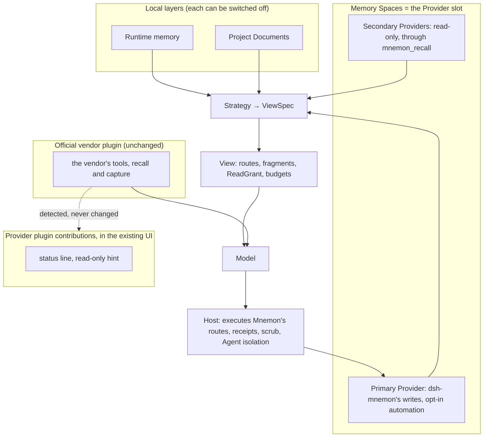

# Memory Provider strategy

## Aim

Memory Spaces can run nine Providers at once. Every Provider's capabilities are flattened into ten
shared `mnemon_*` tools, and recall ranks all of them on one score scale. Four OpenViking reports in
October 2026 come from that strategy:

- [#452](https://github.com/omdsh-dev/dsh-mnemon/issues/452): there is no exact-text search.
- [#453](https://github.com/omdsh-dev/dsh-mnemon/issues/453): images and attachments cannot be stored.
- [#454](https://github.com/omdsh-dev/dsh-mnemon/issues/454): score bands drop the right answer when scales differ.
- [#455](https://github.com/omdsh-dev/dsh-mnemon/issues/455): a write field that OpenViking 0.5 rejects breaks every write.

Several vendors now publish their own DeepSeek Harness integrations, too. This plan updates the
strategy:

- **One primary Provider** receives dsh-mnemon's own writes, and other Providers stay read-only.
- **Official vendor plugins run as their vendors ship them.** Their tools, recall and capture are the
  real experience for that vendor, and dsh-mnemon does not adapt or override them.
- **The presentation and interaction model stays.** dsh-mnemon keeps showing every Provider's memory
  in one Memory System as it does today. This round adjusts the read and write mechanisms underneath.
- **Reads and writes follow dsh-mnemon's layered write strategy only.**
- **Recall stays grouped by Provider, and automation is opt-in and bounded.**

Runtime memory, Project Documents and Memory Spaces keep their roles, and so do the Sources,
Strategies and View between them. Existing features may change where the experience gets better.

## Reference: Hermes Agent

Hermes Agent also integrates these eight third-party memory providers, and it follows a different
strategy. As a mature implementation it is one of the references for this plan. The notes below come
from `NousResearch/hermes-agent` at `cb757fac59` (MIT).

How Hermes handles them:

- **One external provider beside built-in memory.** MEMORY.md and USER.md are always on, and at most
  one external provider runs beside them; `MemoryManager.add_provider` rejects a second one.
- **Native tools.** Each provider brings its own tools, such as OpenViking's `viking_search`,
  `viking_read`, `viking_browse`, `viking_remember`, `viking_forget` and `viking_add_resource`. Each
  also brings a short usage note for those tools.
- **A host-owned lifecycle.** The host runs these steps:
  - a prefetch before each turn, in the background, with an 8-second timeout;
  - a background sync after each turn;
  - extraction at session end;
  - mirroring of built-in memory writes to the provider.
- **Fenced recall.** Recall arrives wrapped and marked as recalled, not as user input, and the user
  sees a line naming what was used.
- **Isolation and egress.** Delegated subagents get no provider session, and everything sent to a
  provider passes a secret scrub first.
- **Setup.** Setup is one picker that asks only for required fields, and status lists what is
  missing.
- **Maintainers own the providers.** Providers live in their maintainers' repositories. The
  provider's name, settings and tool names are kept as the contract with users.

How it compares:

- **The strategies differ.**
  - Hermes makes the external provider the memory backend and runs it automatically every turn.
  - Mnemon composes Runtime memory, Project Documents and Memory Spaces through a View. It keeps
    several discovered spaces per Provider and reports a write only after the exact text reads back.
    Recall is tool-driven by default, so prefetch and sync are opt-in.
  - Hermes providers are packages written for Hermes. Where a vendor ships its own DSH plugin, Mnemon
    leaves that plugin as it is and adds presentation and layered writes beside it.
- **Some decisions coincide.** These are one primary Provider at a time, no Provider session for
  delegated Agents, and a scrub of what leaves the machine. They are made here for the reasons in the
  Aim, #452–#455, and for the lab's findings. They are not made to match Hermes.

## Decisions (2026-10-23, revised 2026-10-24)

1. **One primary Provider, read-only secondaries.** One Provider receives dsh-mnemon's writes and
   any of its automation. Other Providers can stay connected for read-only recall.
2. **Official DSH plugins stay as shipped.** dsh-mnemon makes no forced-compatibility change to a
   vendor's plugin:
   - it does not hide its tools or shadow its skills;
   - it does not rewrite its configuration;
   - it does not route its own reads and writes through the plugin's tools.
3. **The existing presentation and interaction model stays.** This round changes read and write
   mechanisms. An official plugin adds one line of fact to its Provider's existing status. The
   layered-write suggestion is one sentence beside the space's Read-only choice. Views for a vendor's
   characteristics are deferred.
4. **Layered writes only.** dsh-mnemon's reads and writes follow its layers and per-space write policy
   (#434). An active official plugin can lead to a suggestion, such as marking a space read-only for
   dsh-mnemon's automatic writes to avoid duplicates beside the plugin's own capture. It never leads to
   an automatic change.
5. **Automation off by default.** dsh-mnemon's prefetch, turn sync and mirroring are opt-in and
   bounded, and run only for the primary Agent. Recall stays tool-driven by default. A vendor plugin's
   own automation is the vendor's and the user's choice.

Decisions 2–4 replace a "bridge the vendor plugin" decision made earlier the same day. The spike
behind it showed that bridging is possible; the user chose not to modify official plugins at all. On
2026-10-24 the user kept the existing presentation and interaction model for this round. Official
plugins therefore appear as a status line and a hint, and vendor views wait.

## Design

### The Provider slot

**The primary Provider.** Memory Spaces holds exactly one primary Provider per storage scope:

- Save to memory and the task Agents write there by default;
- dsh-mnemon's opt-in automation applies only to it.

Its namespaces stay discovered spaces, and activating spaces still sets the recall scope.

**Secondary Providers.** These are optional and read-only. They are searched only through
`mnemon_recall`, in their own result blocks. They get no automation and no writes, except a write the
user names explicitly.

**The default.** Mnemon Native is the default primary. With no Mnemon CLI and no other Provider, the
Memory Spaces layer is off and every other layer keeps working, as the layer-robustness direction of
2026-10-08 requires.

**Per-space write policy (#434).** A space is either writable (the default) or read-only for
dsh-mnemon. Read-only spaces stay readable for recall, related, browse and search, and every mutation
path refuses them before any Provider call. Secondaries are built on this policy.

### Official DSH plugins

Vendors that publish their own DSH integration for a Provider dsh-mnemon supports:

| Provider | Official integration | Lab notes |
|---|---|---|
| OpenViking | `@openviking/dsh-memory-plugin` (bundle; MCP tools, recall, capture, skills) | Captures every session by default, task Agents included, unless `skipSubagentSessions` is set; server-side extraction can rewrite memories |
| Mem0 | `@mem0/deepseek-plugin` (Cordis plugin; `search_memory`, `add_memory`, recall, capture) | Mem0 Platform only; no subagent skip; telemetry on unless `MEM0_TELEMETRY=false` |
| Hindsight | `@vectorize-io/hindsight-coding-agents install dsh` (Cordis row; native tools) | Skips subagents; settings in the shared `~/.hindsight/coding-agent.json`; about 7 KB of fixed tool guide |
| agentmemory (#168) | `npx @agentmemory/agentmemory connect dsh` (home-level MCP row; optional hooks bridge) | Writes are lost while its server is down; the cold first start downloads more than 300 MB |
| Honcho | `@honcho-ai/dsh-honcho` | Does not install on the supported DSH releases (peers stop at 0.2.0-rc.1) |

RetainDB, ByteRover and Supermemory publish no DSH integration, and Holographic is local, so these
keep only dsh-mnemon's Provider.

What dsh-mnemon does with an official plugin:

- **Detects it, read-only.** It reports the package, the version, and the effective automation the
  plugin itself exposes (for OpenViking, its `openvikingMemory` service). It changes nothing.
- **Shows it in the existing UI.** Its Provider's existing status gets one line of fact, such as
  "OpenViking official plugin 0.5.29 detected; it also saves to this space automatically". There is
  no separate card or view.
- **Suggests, through the layered write strategy.** When a plugin captures into a namespace that a
  dsh-mnemon space also writes, one sentence beside the space's Read-only choice suggests it. The user
  decides.

What dsh-mnemon does not do:

- hide, rename or wrap the plugin's tools;
- shadow its skills;
- write its configuration;
- call its tools for dsh-mnemon's own reads and writes.

The plugin's tools reach the model as the vendor registered them.

### Views for each vendor's characteristics (deferred)

These were deferred on 2026-10-24. This round keeps the existing presentation and interaction model,
and the display side of #453 waits with them; #453 stays open. The candidates below are kept for a
later round. Each would be contributed by its Provider plugin, would have to fit the existing model,
and would land only with a report or a measured gap behind it.

| Provider | Candidate views |
|---|---|
| OpenViking | the `viking://` hierarchy; Resources, with images and attachments the server holds (the display side of #453); Provider Changes, from `memory_diff.json` of committed sessions |
| Hindsight | banks, and the bank's graph and reflections where the server provides them |
| Mem0 | a memory's history across updates, and its categories |
| agentmemory (#168) | sessions and observations, which needs a dsh-mnemon Provider for presentation (REST on 3111) |
| Honcho | peers and their representations |

### Recall grouped by Provider

Results stay in their Provider's own order, one fenced and deduplicated block per Provider, each
naming its Provider.

Score bands are kept only for scores Mnemon computes itself (#454). Rows from other Providers keep
their Provider's order. The Agent judges them, with Jev's yes/rank signals in simple mode.

A short line in the conversation shows which spaces were used, such as "Memory used: Lab machines
(OpenViking) · 3".

### Automation

| Behavior | Place in Mnemon | Default | Bound |
|---|---|---|---|
| A Provider's usage note | A Provider fact rendered in a Strategy slot | on | fixed length |
| An overview at session start | "Start with a Provider overview" enhancement | off | once per session, character budget |
| A prefetch each turn | "Prefetch each turn" enhancement, run by the Host | off | timeout, character budget, cadence |
| A sync of the conversation | "Sync the conversation to the Provider" enhancement, in the background after the scrub | off | one per turn, primary Agent only |
| Mirroring of Runtime memory writes | Runtime memory receipts mirrored to the primary Provider, deterministically, with no LLM | off | one per write |
| Task Agent isolation | Task Agents never get a dsh-mnemon Provider session or trigger capture | enforced | — |

Sync stays off by default. On 2026-10-23, OpenViking's server-side extraction rewrote a saved
preference from Chinese to English after an unrelated resource upload, and it turned plain questions
and answers into new memories. Provider Changes makes such rewrites visible, whoever triggered them.

### Setup and status

- **The status line.** The Status page opens with one line, such as "Memory Provider: OpenViking ✓
  available · 3 spaces", and a gear beside it.
- **The picker.** The gear opens a single-choice list whose first entry is "Mnemon Native (default)".
- **Choosing a Provider.** Only the required fields are asked for. Secrets are masked, with a link to
  where they come from. OpenViking can reuse `~/.openviking/ovcli.conf`.
- **Official plugins.** A detected plugin adds one line to its Provider's status, as described above.
  Nothing about the plugin is changed from Mnemon.
- **Importing settings.** An existing setup in another agent's configuration, such as `~/.hermes`, can
  be imported after the user confirms.
- **Finishing.** Spaces are discovered, and the status line turns to ✓ or names what is missing.
- **Secondaries.** They sit in an "Additional Providers (read-only)" block, off until switched on.

### Migration

No data moves.

- On the first visit after the upgrade, a primary Provider is chosen from the existing spaces. The
  choice is automatic when only one external Provider has spaces.
- The other Providers become secondaries, and switching back is one choice.
- Smart Provider placement is removed, and new spaces are created in the primary Provider.
- Save to memory keeps its choice between a named target and an Agent decision.

## Layer invariants

| Invariant | How it holds | How it is tested |
|---|---|---|
| The layers are independent | Runtime and Documents never depend on the slot. An empty slot turns Memory Spaces off, and a full MEMORY.md archives locally | Layer-combination matrix at capacity, with no Provider and with no space |
| Mnemon's tools go through the View | Mnemon's own reads and writes are Source routes under the View. Official plugins' tools are the vendor's and stay unchanged | Tool-inventory snapshot tests with and without an official plugin |
| Official plugins are not modified | Detection reads only what a plugin exposes. No configuration write, tool restriction or skill registration targets a vendor plugin | Tests that the vendor's tools, configuration and skills are byte-identical with dsh-mnemon on and off |
| Per-turn cost is bounded | Secondaries share one route. Automation has timeouts, budgets and cadence | Request-size ceilings in tests and in the lab |
| Receipts mean stored | Writes keep exact readback. Asynchronous server-side extraction appears only in Provider Changes | Receipt tests against a real server |
| Task Agents stay isolated | No prefetch, sync or mirror from dsh-mnemon for task Agents | Host tests |
| Strategies stay pure | Strategies declare budgets, and the Host runs them | Existing Strategy contract tests |
| Data stays within its boundary | Pack and Git sync still carry only official components | Existing Pack and sync tests |

## Expected files

- `plugins/dsh-mnemon-source-memory-spaces/src/*`:
  - the per-space write policy;
  - the slot (primary and secondaries) and recall blocks;
  - the management operations for both;
  - the read-only lookup and the integration report that Provider plugins use to detect official
    plugins.
- `plugins/dsh-mnemon-provider-<id>/src/*`: each Provider's read-only detection of its vendor's
  official plugin.
- `plugins/dsh-mnemon-source-memory-spaces/src/client/*`: the picker, the status line, secondaries, and
  the per-space write choice with its hint.
- `plugins/dsh-mnemon-strategy-default-three-tier/src/guidance.ts`: the Provider usage-note slot.
- The opt-in automation goes into the existing enhancement mechanism. A new package is added only if
  a gate requires one; the agentmemory presentation Provider (#168) is the expected exception.
- `docs/{en,zh-CN}/guides/memory-providers.md` and `docs/{en,zh-CN}/reference/configuration.md`.
- Tests:
  - per-space write policy tests;
  - Provider slot and recall-block tests;
  - the official-plugin byte-identity tests;
  - the layer matrix.

## Non-goals

- A second memory engine or a rewrite of the retrieval engine. mnemon (Go) stays the engine.
- A copy of another agent's memory system.
- Any change to an official vendor plugin's tools, skills, configuration or behavior.
- Re-implementing a vendor feature that its official plugin already provides to the model.
- Bundling vendor plugins in the Starter; they are installed when the user chooses them.
- Automation on by default, or for any Agent other than the primary one.
- Changing what Pack and Git sync carry.
- Supporting several primary Providers.

## Over-engineering risk

Rules:

- Each step must close a reported problem or a measured gap before the next one starts.
- Vendor-specific code lives in that vendor's Provider plugin. The core only offers contribution points.
- A characteristic view reuses the unified scheme's components. A new component is added only when two
  vendors need it.

Warning signals:

- per-vendor branches in the core;
- a view that needs credentials dsh-mnemon does not already hold;
- detection that does more than read.

Complexity budget:

| Part | Budget |
|---|---|
| Per-space write policy | about 300 lines |
| Official-plugin detection in the core (lookup, report, status line, hint) | about 200 lines |
| One vendor's detection | about 150 lines |
| Slot and recall blocks in Memory Spaces | about 400 lines changed |

Exceeding any of these by half means stopping to ask.

## Stop and ask

- Any step would change an official plugin's tools, skills, configuration or behavior.
- A characteristic view needs vendor credentials or a vendor service that dsh-mnemon does not
  already reach through its own Provider.
- Recall blocks lose accuracy against today's federated recall (non-inferiority −2 points).
- A migration step would move, rewrite or delete existing memory.

## Build order and gates

0. **Adapter fixes.** These ship first, one pull request each:
   - #455: OpenViking writes carry only the fields every server release declares;
   - #452: keyword search gains an exact-text channel through `/api/v1/search/grep`;
   - #454: Hindsight scores above 1 count as 1, and OpenViking's rows keep OpenViking's order in a
     search mixed with another Provider;
   - #447: Holographic maps importance onto its trust scale;
   - RetainDB: importance on RetainDB's 0–1 scale, and memory types RetainDB Server accepts.

   Gate: each fix is proven on a real server or a contract test, and every untouched route stays
   byte-identical.
1. **Per-space write policy (#434).**
   Gate: no mutation path reaches a Provider for a read-only space, and default behavior is
   byte-identical.
2. **Official-plugin detection, starting with OpenViking.** This step covers read-only detection,
   one line in the Provider's existing status, and the hint beside the Read-only choice.
   Gate:
   - the vendor plugin's tools, configuration and behavior are byte-identical with dsh-mnemon on;
   - before-and-after screenshots of the line and the hint on a real server.
3. **The Provider slot, recall blocks, setup, status and migration.**
   Gate:
   - the layer matrix passes;
   - the #454 case is answered correctly with OpenViking plus Hindsight;
   - non-inferiority holds on the lab set;
   - before-and-after recordings exist.
4. **Automation enhancements:** overview, prefetch, sync and mirror.
   Gate: each is off by default, and per-turn cost stays within its bound.
5. **The other official plugins.** Mem0 and Hindsight get the same detection. agentmemory gets its own
   Provider (#168), which uses the existing Memory Spaces UI, and detection of its MCP row. Honcho's
   plugin does not install on current DSH releases, so it gets nothing yet.

## Progress

- [x] Research: how other agents handle third-party memory providers (Hermes Agent)
- [x] Lab: the official OpenViking plugin beside dsh-mnemon (coexistence, side effects, costs)
- [x] Survey: the official DSH integrations of Mem0, Hindsight, Honcho and agentmemory
- [ ] 0. #455, #452, #454, #447 and RetainDB adapter fixes
- [ ] 1. Per-space write policy (#434)
- [ ] 2. Official-plugin detection, starting with OpenViking
- [ ] 3. Provider slot, recall blocks, setup, status and migration
- [ ] 4. Automation enhancements
- [ ] 5. Mem0, Hindsight and agentmemory (#168)

## Evidence

The lab ran on 2026-10-23: DSH 0.2.1-rc.2 headless with real DeepSeek turns, OpenViking v0.4.21 with
synthetic data, and request bodies recorded on loopback.

With the OpenViking plugin's defaults, which recall and capture automatically:

- the Q1–Q3 questions cost 3.4× the tokens of Mnemon's adapter;
- one answer came in English, because a preference rewritten by server-side extraction was recalled;
- every short session was committed for extraction, task Agents included.

A spike the same day showed that dsh-mnemon could hide a vendor plugin's tools per Agent, shadow its
skills and route compact calls through its tools with public DSH APIs. That cut the OpenViking tool
schemas in a request from 15,261 to 916 bytes. A second lab showed the same for Mem0, Hindsight and
agentmemory on DSH 0.2.1-rc.2 and 0.2.0-rc.2.

This strategy deliberately does not use those mechanisms. Official plugins stay as their vendors ship
them, and the findings above inform the status line and the layered-write suggestion.
