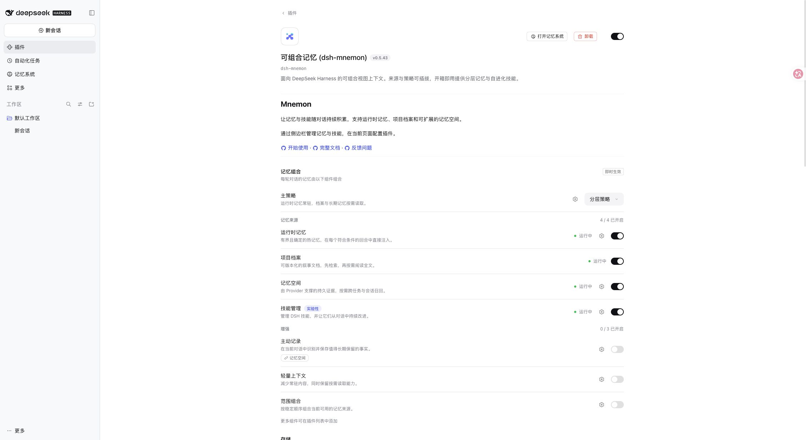

# Compact plugin settings introduction

[中文](./README.zh-CN.md)

2026-11-10, based on main `e9da7d1d717737defc088ac9afd32c4ca99ff9ef`. Verified with the published DSH 0.2.2-rc.1 package in an isolated Web profile on macOS arm64 / Node 24.22.2. The profile installs packed candidates; the final wording was refreshed from the candidate locale files before restarting. No credentials, model calls or personal Desktop data were used.

The supported locale `meta.detail` field selects `locale/detail.zh.md` or `locale/detail.en.md`. The package README files are unchanged. The introduction contains two short paragraphs and absolute HTTPS links to getting started, documentation and issues; the existing configuration is immediately below it. No Host, Client runtime, storage or permission logic changes.

Validation:

- `pnpm run verify` passes: 2671 root tests pass, 8 conditional skips; workspace tests, typecheck, builds, Headless and package checks pass.
- Packaging explicitly requires and permits both Markdown files: 71 packed files, public entries and package lint pass.
- The actual published `@deepseek-ai/dsh-plugin-detail` reader selects Chinese for `zh-CN`, English for `en-US`, and English for the `fr` fallback.
- The real Plugins page displays the short introduction and the normal settings beneath it. Hosts without this detail override continue to have the unchanged README available.

