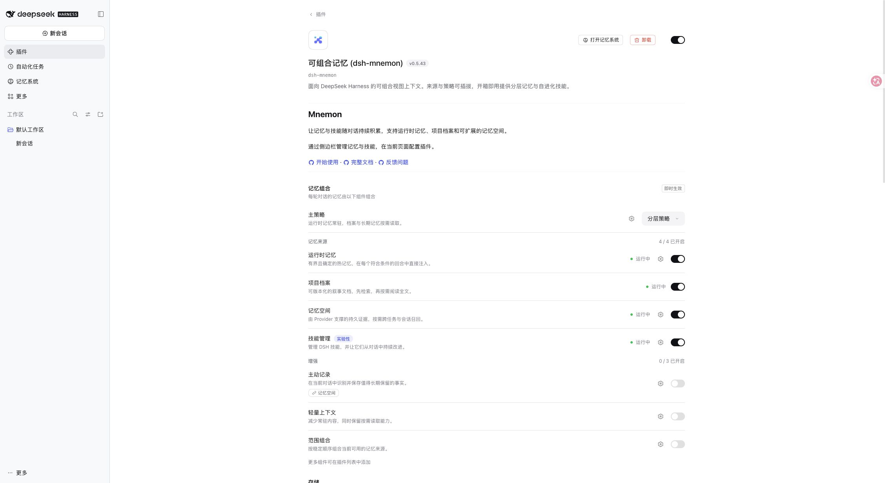

# 插件设置页的简短介绍

[English](./README.md)

2026-11-10，基于 main `e9da7d1d717737defc088ac9afd32c4ca99ff9ef`。在 macOS arm64 / Node 24.22.2 上使用已发布 DSH 0.2.2-rc.1 的隔离 Web 配置验证。先安装打包候选，最终文字从候选 locale 文件更新后重启。未使用凭据、模型请求或个人 Desktop 数据。

通过正式 locale `meta.detail` 字段选择 `locale/detail.zh.md` 或 `locale/detail.en.md`。完整 README 保持不变；简短介绍包含两段文字以及指向入门、完整文档和 issue 的 HTTPS 绝对链接，原有配置紧随其后。不修改 Host、Client 运行逻辑、存储或权限。

验证结果：

- `pnpm run verify` 通过：根测试 2671 项通过、8 项条件跳过，工作区测试、类型检查、构建、Headless 及包检查通过。
- 打包清单明确要求和允许两个 Markdown 文件：共 71 个文件，公开入口及包 lint 通过。
- 已发布 `@deepseek-ai/dsh-plugin-detail` 的真实读取器对 `zh-CN` 选择中文，对 `en-US` 选择英文，对 `fr` 回退到英文。
- 真实插件页显示简短说明及其下方的正常配置。不识别此覆盖机制的 Host 仍可读取原有完整 README。

