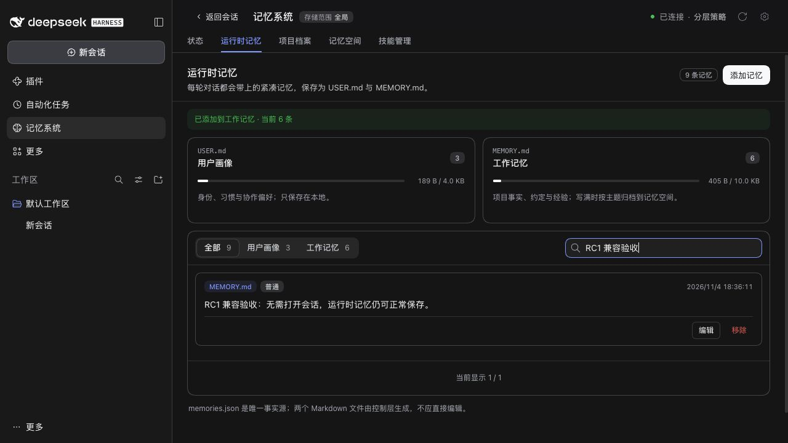

# Published DSH 0.2.2 RC1 acceptance

**English** | [简体中文](./README.zh-CN.md)

## Package and compatibility boundary

Verified on 2026-11-04 using the official npm package `@deepseek-ai/dsh@0.2.2-rc.1`, Node 24.22.2 and isolated synthetic data. The npm `next` tag resolves to RC1; `latest` remains `0.2.1-rc.5` and `alpha` remains `0.2.2-alpha.3`. The RC Host requires Node >=24.9.0. Its CLI package integrity is:

```text
sha512-ijR9UEVYkG15Q/Q79JzvzLBzQOQfc63VLr9n6flpwHPhr5IKn2UxthnSoto/P9l7qGd7pPvI1Ra6TW7LH3oKpg==
```

RC1 retains `agents.roots()` / `isOwnedBy()`, subagent provider enumeration, the nested activation `request`, and hidden standalone task creation. It differs from the unversioned source build reported in #554. The unmerged source-only adapter, speculative ownership probes and deliberate standalone-management refusal have been removed from PR #556. Production Host code matches main; neither features nor authority checks are weakened. The supported version range and pinned RC5 development dependencies are unchanged.

The root patch changeset covers the bilingual README shipped in the package. It documents the RC and its Node.js requirement; no production implementation, configuration or stored-data format changes.

## Regression evidence

- Real RC standalone workflows: **7 passed** with **zero live conversation Agents**, using a configured fixed synthetic model. Save to memory, Runtime maintenance, Skills delegation, evidence answers, metadata proposals, Document creation/archive and Provider selection all complete. The real Agent registry is empty before and after every task; ACP continues to list only the ordinary completed conversation. Document content and its actual archive index remain readable. Removing both the live conversation fallback and configured route makes all seven fail with `no default provider/model`; configuring the explicit route makes all seven pass.
- Real RC ownership tests: **10 passed**. Root adoption, spawn/fork tool restrictions, direct-creator isolation, cancellation, cleanup, structured results, and zero model calls on failed guard/persona installation.
- Matching Loader regression: the unmodified main fixture fails **5/5** plugin-manager tests on RC1; resolving Loader from the actual Host and observing its `commit`/`write` persistence method passes **5/5**. No Host or production-code patch is involved.
- Historical Session tests keep exact descriptor data, idempotent copy repair and invalid-data rejection. The Host's public validator determines whether it already supports a valid legacy descriptor.

| Check | Result |
|---|---|
| Pinned baseline `pnpm run verify` | 2478 root tests passed / 7 conditional skips; 751 component tests passed / 3 conditional skips. Types, builds, docs, Headless and package checks passed. |
| Installed RC1 full root suite, Node 24.22.2 | 2478 passed / 7 conditional skips; 167 files passed / 2 skipped. |
| Installed 0.2.0-rc.2, 0.2.1-rc.3, 0.2.1-rc.5 and 0.2.2-alpha.3 | 166/166 targeted regressions passed on each: standalone tasks, ownership, plugin manager and historical Session repair. |
| RC1 packed acceptance | 18 independent plugin repositories and 19 tarballs passed, including the external SDK consumer, upgrade from 0.5.29 with data retention, settings save/restart, disabled Starter and three optional strategies. |
| Independent review | The zero-live-Agent coverage gap was corrected and rerun; no production regression found. |

Conditional skips are existing opt-in real-model/CLI/Windows integration checks, not skipped RC compatibility paths. The scripted models establish orchestration and data effects, not answer quality or live cloud-account conformance.

## Real Web acceptance

The published RC Web profile loaded Status, Runtime memory, Memory Spaces, Skills and plugin composition settings. A synthetic Runtime memory was added without opening a conversation and remained after reload. Disabling Documents in the live settings hid its tab after the update settled; re-enabling it restored the tab. Native memory-space data and the graph loaded, and the Save to memory dialog reported its task Agent ready. The seven actual task executions are covered by the real-Host tests above.



The existing `serve-e2e.mjs` harness deliberately disables subprocess/Shell services. RC1 therefore reports four dependent upstream entries as pending in this isolated Web fixture; Mnemon's Sources and optional strategies activate normally. This is a fixture restriction, not a product change. Native Desktop installation and its OS-specific integrations were not exercised.

## Reproduction

Install the Host outside the workspace. `DSH_HOST_ROOT` must be its physical package path, and `RC_NODE` must name a Node 24.22.2 executable. Build all workspace packages before installed-Host tests.

```sh
npm install --prefix <isolated-prefix> @deepseek-ai/dsh@0.2.2-rc.1 --no-audit --no-fund
pnpm run verify
env -u NODE_PATH DSH_HOST_ROOT=<physical-host-package> "$RC_NODE" node_modules/vitest/vitest.mjs run --config scripts/installed-dsh.config.ts
env -u NODE_PATH PATH="$(dirname "$RC_NODE"):$PATH" MNEMON_E2E_DSH=<physical-host-package>/lib/bin.js "$RC_NODE" scripts/verify-plugin-artifacts.mjs --skip-build
env -u NODE_PATH PATH="$(dirname "$RC_NODE"):$PATH" MNEMON_E2E_DSH=<physical-host-package>/lib/bin.js "$RC_NODE" scripts/serve-e2e.mjs --docs-demo --skills-scroll --strategy-extensions
```

The packed-plugin verifier installs only the root tarball, resolves all eighteen components through a loopback registry, upgrades a real previous release while retaining seeded data, exercises settings save/restart and Starter disablement, and activates the three optional strategies together. CI now runs this acceptance on RC1 as well as the pinned baseline, and runs all root tests on installed RC1, alpha.3 and the retained older releases.

No user Desktop profile, private memory, production service or paid model request is used. The model is scripted; provider cloud-account quality and arbitrary unpublished source builds are outside this validation.
