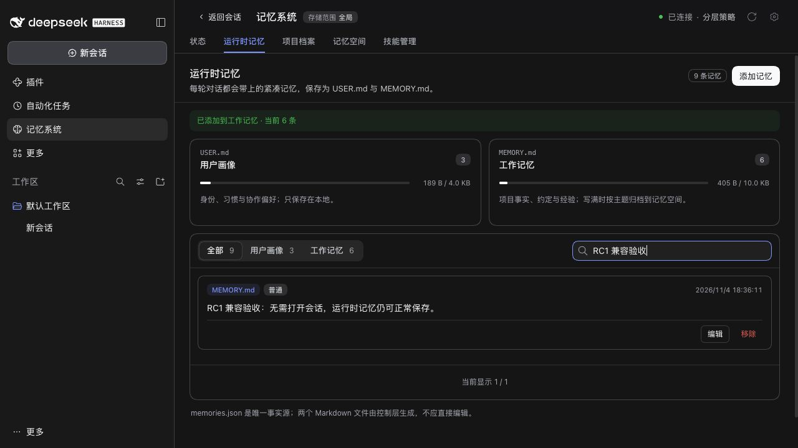

# 已发布 DSH 0.2.2 RC1 验收

**简体中文** | [English](./README.md)

## 包身份与兼容边界

2026-11-04 使用官方 npm `@deepseek-ai/dsh@0.2.2-rc.1`、Node 24.22.2 和隔离合成数据验证。npm `next` 指向 RC1，`latest` 仍为 `0.2.1-rc.5`，`alpha` 仍为 `0.2.2-alpha.3`。RC Host 要求 Node >=24.9.0。CLI 包的完整性标识：

```text
sha512-ijR9UEVYkG15Q/Q79JzvzLBzQOQfc63VLr9n6flpwHPhr5IKn2UxthnSoto/P9l7qGd7pPvI1Ra6TW7LH3oKpg==
```

RC1 保留 `agents.roots()` / `isOwnedBy()`、子 Agent Provider 枚举、嵌套 activation `request` 以及隐藏独立任务的创建能力。它与 #554 报告的未发布源码提交不同。PR #556 已移除尚未合并的源码专用适配器、推测性归属探测，以及主动拒绝独立管理任务的路径。生产 Host 代码与 main 一致，没有削弱功能或权限检查。支持版本范围及锁定的 RC5 开发依赖保持不变。

根包的 patch changeset 对应随包发布的中英文 README，说明 RC 支持及 Node.js 要求；生产实现、配置和存储格式均未变化。

## 回归证据

- 真实 RC 独立任务在**零活跃会话 Agent**、配置固定合成模型的条件下 **7 项通过**：保存到记忆、Runtime 维护、Skills 委派、证据回答、元数据提案、Document 创建与归档、Provider 选择均成功。每项任务前后真实 Agent 注册表均为空；ACP 仍只列出普通的已结束会话，Document 原文与真实归档索引可读。移除活跃会话兜底且不配置任务路由时，七项均报 `no default provider/model`；配置明确路由后七项均通过。
- 真实 RC 归属测试 **10 项通过**：根 Agent 接管、spawn/fork 工具限制、直接创建者隔离、取消清理、结构化结果，以及守卫或 persona 安装失败时零模型请求。
- Loader 回归：原始 main 夹具在 RC1 上的插件管理器测试 **5 项全部失败**；从实际 Host 解析 Loader，并观察其 `commit`/`write` 持久化方法后 **5 项全部通过**。没有修改 Host 或生产代码。
- 历史 Session 测试保留 descriptor 的精确内容、复制修复的幂等性及坏数据拒绝；由宿主公开校验器判断其是否已经支持合法的旧 descriptor。

| 检查 | 结果 |
|---|---|
| 锁定基线 `pnpm run verify` | 根测试 2478 通过 / 7 条件跳过；组件测试 751 通过 / 3 条件跳过。类型、构建、文档、Headless 与包检查均通过。 |
| 已安装 RC1 全量根测试，Node 24.22.2 | 2478 通过 / 7 条件跳过；167 个文件通过 / 2 个跳过。 |
| 已安装 0.2.0-rc.2、0.2.1-rc.3、0.2.1-rc.5、0.2.2-alpha.3 | 每个版本的独立任务、归属、插件管理与历史 Session 修复定向回归均为 166/166 通过。 |
| RC1 打包验收 | 18 个独立插件仓库与 19 个 tarball 通过，包含外部 SDK 消费者、从 0.5.29 升级并保留数据、设置保存与重启、Starter 停用及三个可选策略。 |
| 独立审查 | 已补上零活跃 Agent 的覆盖缺口并复验；未发现生产代码回归。 |

条件跳过均为已有的真实模型、CLI 或 Windows 可选集成检查，没有跳过 RC 兼容路径。合成模型用于验证编排及数据效果，不代表回答质量或真实云账号兼容性。

## 真实 Web 验收

已发布 RC 的 Web Profile 正常加载状态、运行时记忆、记忆空间、技能及插件组合设置。未打开会话时新增一条合成运行时记忆，刷新后仍然存在。通过实时设置关闭项目档案，更新完成后标签隐藏；重新开启后恢复。Native 记忆空间数据及图谱正常加载，“存入记忆”对话框显示任务 Agent 就绪。七类任务的实际执行由上述真实 Host 测试覆盖。



现有 `serve-e2e.mjs` 夹具主动关闭 subprocess/Shell 服务，因此 RC1 在该隔离 Web 环境中将四个依赖它们的上游条目标为 pending；Mnemon 来源及可选策略正常激活。这属于夹具限制，不是产品变更。本次未安装原生 Desktop，也未验证其系统专属集成。

## 复现

将 Host 安装在工作区外。`DSH_HOST_ROOT` 必须是包的物理路径，`RC_NODE` 指向 Node 24.22.2。已安装宿主测试前，先构建所有工作区包。

```sh
npm install --prefix <isolated-prefix> @deepseek-ai/dsh@0.2.2-rc.1 --no-audit --no-fund
pnpm run verify
env -u NODE_PATH DSH_HOST_ROOT=<physical-host-package> "$RC_NODE" node_modules/vitest/vitest.mjs run --config scripts/installed-dsh.config.ts
env -u NODE_PATH PATH="$(dirname "$RC_NODE"):$PATH" MNEMON_E2E_DSH=<physical-host-package>/lib/bin.js "$RC_NODE" scripts/verify-plugin-artifacts.mjs --skip-build
env -u NODE_PATH PATH="$(dirname "$RC_NODE"):$PATH" MNEMON_E2E_DSH=<physical-host-package>/lib/bin.js "$RC_NODE" scripts/serve-e2e.mjs --docs-demo --skills-scroll --strategy-extensions
```

打包检查只安装根 tarball，通过 loopback registry 解析十八个组件；从真实旧版本升级并保留预置数据，验证设置保存与重启、Starter 停用，并同时启用三个可选策略。CI 现在同时在 RC1 和锁定基线上执行这套验收，并在已安装 RC1、alpha.3 和保留的旧版本上执行全部根测试。

未使用用户 Desktop 数据、私有记忆、生产服务或付费模型请求。模型回复为合成数据；真实云账号质量及任意未发布源码构建不在本次验证范围。
