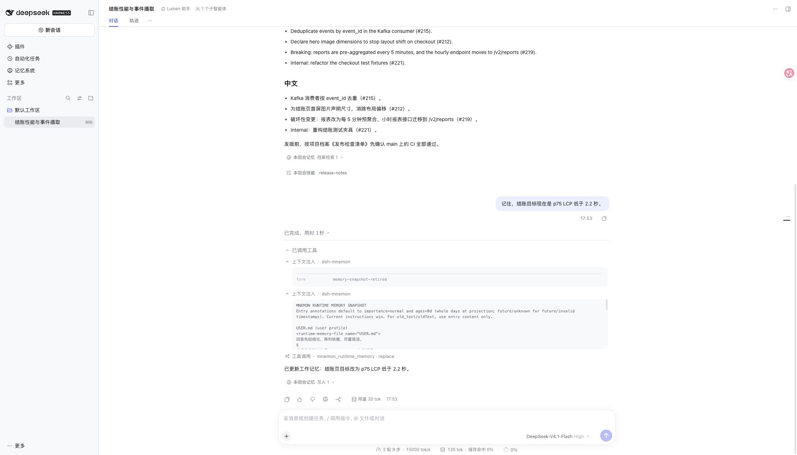
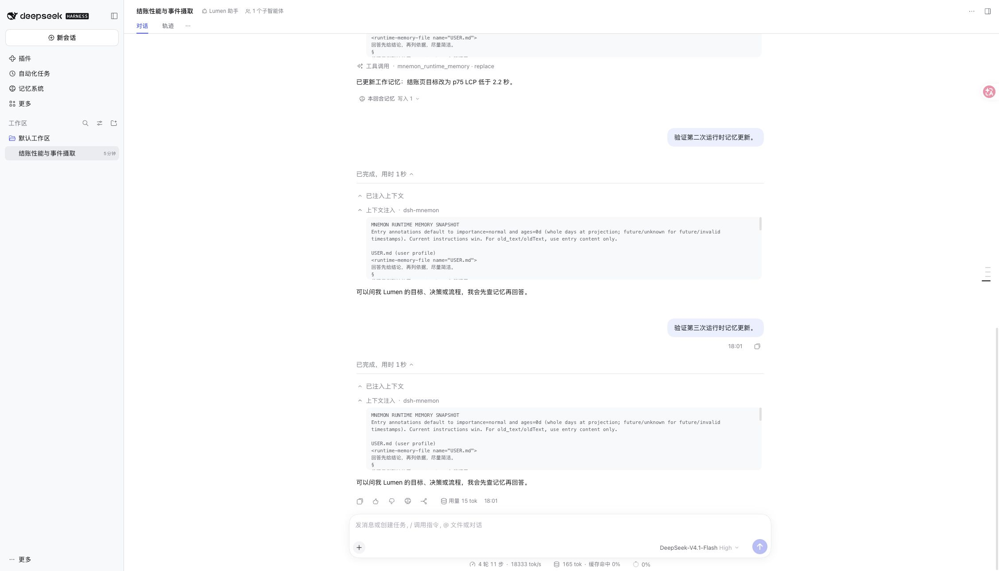

# DSH 0.2.2-rc.2 compatibility acceptance

[简体中文](README.zh-CN.md) | **English**

Verified on 2026-11-12, starting from dsh-mnemon v0.5.44 (`455dd1c017d82c4f75af1b9510d383c059b0690e`). The upstream target is the official npm `@deepseek-ai/dsh@0.2.2-rc.2`, corresponding to [release commit `ddac96760b6edf8fa0fe17cbdcf0b512f4c12b2c`](https://github.com/deepseek-ai/deepseek-harness/releases/tag/dsh-v0.2.2-rc.2), on Node 24.22.2. No upstream source was changed.

## Reproduction and correction

The unmodified release passes 2,706 installed-Host tests (8 conditional skips), and its npm Starter passes isolated Headless installation, configuration restoration, restart, disable and optional-strategy checks. A real RC2 WebUI profile exposes issue #614: replacing Runtime memory produces an empty `memory-snapshot-retired` context-injection card.



The fix registers an optional, Chat-only definition through DSH's public conversation registry. It exclusively claims empty developer messages with the exact retirement form and Mnemon's current or historical producer attribution. It does not change Session events, storage, model messages, snapshot retention, tool guards or Agent lifecycle. Nonempty messages, normal snapshots, other forms and other producers remain visible.

After three Runtime corrections, reopening the same conversation after a Host restart shows **zero retirement cards**. The append-only session file still holds all three retirement events (sequences 60, 79 and 91); all four ordinary historical snapshots remain inspectable in their original turns, with the latest target at 2.0 seconds. A fifth conversation turn completes after restart. This implements #614's hidden-tombstone option, not a rule hiding all historical memory snapshots.



The updated RC2 root suite passes **2,721 tests**, with 8 conditional skips. The 27 focused client/registry tests also pass on RC1, the 0.2.1-rc.5 development baseline and a fresh official 0.2.0-rc.2 installation. DSH 0.2.0 ignores exclusive display claims and retains its previous presentation; no new service is required for the memory client to start.

Full `pnpm run verify` passes: bilingual docs, types, deterministic builds, all independent plugin tests, 2,721 baseline root tests, isolated Headless startup and public package checks. An initial run overlapped the RC2 root suite and hit the existing hung-backtest test's five-second deadline; its focused rerun and the complete sequential rerun passed without changing that test. Packed acceptance and remote CI results are recorded against the PR commit.

The old `0.5.29` upgrade seed cannot register its memory tools on RC2, so the RC2 artifact job uses `0.5.43`, which contains the activation-owned Host adapter. The isolated upgrade from published `0.5.43` to this packed Client passes with Runtime Memory bytes unchanged. The baseline, RC1 and publication jobs retain the longer `0.5.29` migration path. This changes the acceptance fixture, not the plugin’s install policy.

## Reproduce locally

```sh
pnpm install --frozen-lockfile
pnpm run verify
npm install --global --prefix /tmp/dsh-rc2-acceptance @deepseek-ai/dsh@0.2.2-rc.2
DSH_HOST_ROOT=/tmp/dsh-rc2-acceptance/lib/node_modules/@deepseek-ai/dsh pnpm run test:installed-dsh
MNEMON_E2E_DSH=/tmp/dsh-rc2-acceptance/lib/node_modules/@deepseek-ai/dsh/lib/bin.js MNEMON_PLUGIN_UPGRADE_BASE=0.5.43 pnpm run verify:plugins
MNEMON_E2E_DSH=/tmp/dsh-rc2-acceptance/lib/node_modules/@deepseek-ai/dsh/lib/bin.js node scripts/serve-e2e.mjs --docs-demo --log-model-requests
```

The WebUI fixture uses fictional Lumen data and a loopback scripted model, with real DSH Sessions, tools and Mnemon storage. Change the checkout target through `mnemon_runtime_memory`, then twice through the Runtime editor, sending a new turn after each edit. Expand all process/context groups, restart the fixture with SIGUSR2 and reopen the same conversation. The before screenshot uses the original v0.5.44 artifact; the after check uses the PR's rebuilt Client. These checks exercise integration and persistence, not live-model quality or paid cloud providers.

The regression suite loads the published `/client` browser factory through its module-loader contract and exercises the public conversation assembler. A negative control that disables the filter fails both live/replay projection cases: three empty retirement cards are visible instead of none. Restoring the filter passes, including both registration orders, fallback suppression, non-Chat audit visibility and cleanup on plugin unload.

Native Windows Desktop packaging and the private gateway failure reported in #612 are separate environments; this macOS WebUI/Headless verification does not establish those outcomes.
