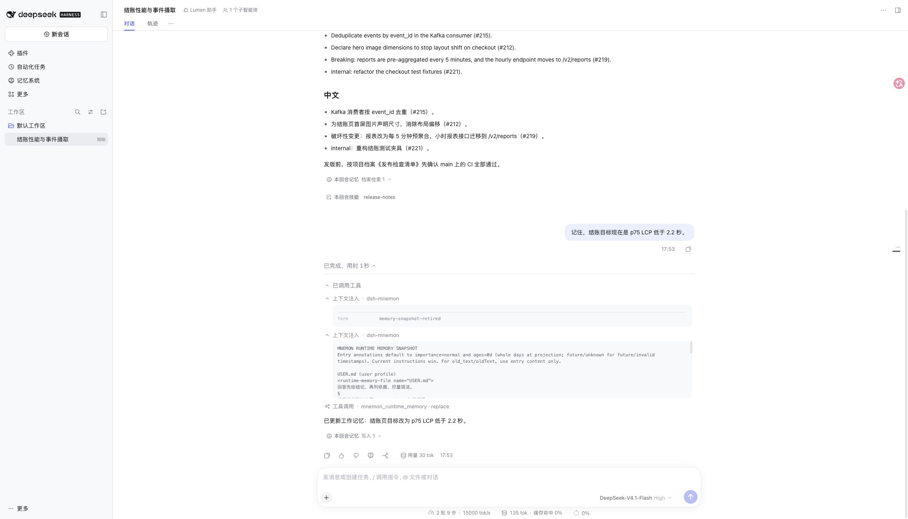
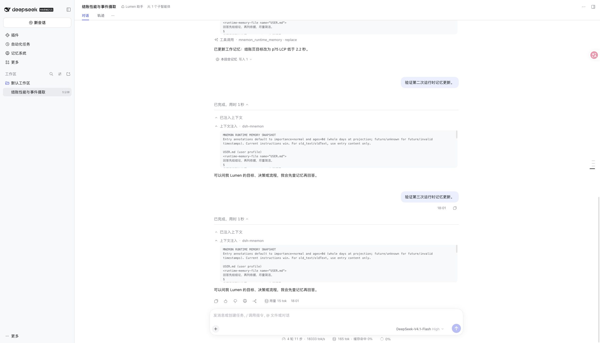

# DSH 0.2.2-rc.2 兼容性验收

**简体中文** | [English](README.md)

2026-11-12 验证，基线为 dsh-mnemon v0.5.44（`455dd1c017d82c4f75af1b9510d383c059b0690e`）。宿主是官方 npm `@deepseek-ai/dsh@0.2.2-rc.2`，对应[发布提交 `ddac96760b6edf8fa0fe17cbdcf0b512f4c12b2c`](https://github.com/deepseek-ai/deepseek-harness/releases/tag/dsh-v0.2.2-rc.2)，使用 Node 24.22.2。未修改上游源码。

## 复现与修正

原版本通过 2,706 项已安装宿主测试（8 项条件跳过）；npm Starter 的隔离 Headless 安装、配置恢复、重启、停用与可选策略检查也通过。真实 RC2 WebUI profile 复现了 #614：替换运行时记忆后，出现内容为空的 `memory-snapshot-retired` 上下文注入卡片。



修复通过 DSH 公开的会话登记接口，可选注册一个仅作用于 Chat 的定义。只有内容为空、带准确退役 form、且属于 Mnemon 当前或历史来源格式的 developer 消息会被独占接管。Session 事件、存储、模型消息、快照保留策略、工具守卫与 Agent 生命周期不变；非空消息、普通快照、其他 form 和其他来源仍然显示。

连续三次修正运行时记忆，重启 Host 并重新打开同一会话后，**退役卡片为零**。仅追加的会话文件仍保留全部三条退役事件（序号 60、79、91）；四份正常历史快照仍可在原轮次查看，最新目标为 2.0 秒。重启后的第五轮对话也正常完成。这实现了 #614 的隐藏墓碑选项，不会隐藏所有历史记忆快照。



修复后的 RC2 根测试 **2,721 项通过**，8 项条件跳过。27 项客户端/登记接口针对性测试在 RC1、0.2.1-rc.5 开发基线和全新安装的官方 0.2.0-rc.2 上也通过。DSH 0.2.0 不处理独占显示声明，保持原有显示；记忆客户端启动不增加必需服务。

完整 `pnpm run verify` 通过：双语文档、类型、确定性构建、各独立插件测试、2,721 项基线根测试、隔离 Headless 启动及公开包检查。首次执行与 RC2 根测试并行时，既有 hung-backtest 用例触发五秒超时；单独复跑及完整串行复跑均通过，未修改该用例。打包验收及远程 CI 结果以 PR 对应提交的检查记录为准。

## 本地复现

```sh
pnpm install --frozen-lockfile
pnpm run verify
npm install --global --prefix /tmp/dsh-rc2-acceptance @deepseek-ai/dsh@0.2.2-rc.2
DSH_HOST_ROOT=/tmp/dsh-rc2-acceptance/lib/node_modules/@deepseek-ai/dsh pnpm run test:installed-dsh
MNEMON_E2E_DSH=/tmp/dsh-rc2-acceptance/lib/node_modules/@deepseek-ai/dsh/lib/bin.js pnpm run verify:plugins
MNEMON_E2E_DSH=/tmp/dsh-rc2-acceptance/lib/node_modules/@deepseek-ai/dsh/lib/bin.js node scripts/serve-e2e.mjs --docs-demo --log-model-requests
```

WebUI 夹具使用虚构的 Lumen 数据与回环脚本模型，Session、工具和 Mnemon 存储均为真实实现。先通过 `mnemon_runtime_memory` 修改结账目标，再通过运行时编辑器修改两次，每次修改后发送新轮次。展开全部过程和上下文分组，用 SIGUSR2 重启夹具并重开同一会话。修复前截图使用原始 v0.5.44 制品；修复后检查使用本 PR 重建的 Client。这些检查验证集成与持久化，不代表真实模型质量或付费云 Provider 验收。

回归测试通过模块加载契约读取已发布 `/client` 浏览器工厂，执行公开的会话组装器。负对照停用过滤器后，两个实时/回放投影用例均失败：会显示三个空退役卡片，而非零个。恢复过滤器后通过，同时覆盖两种登记顺序、fallback 抑制、非 Chat 审计可见性与插件卸载清理。

Windows 原生 Desktop 打包与 #612 报告的私有网关失败属于不同环境；本次 macOS WebUI/Headless 验证不证明这两个场景已解决。
