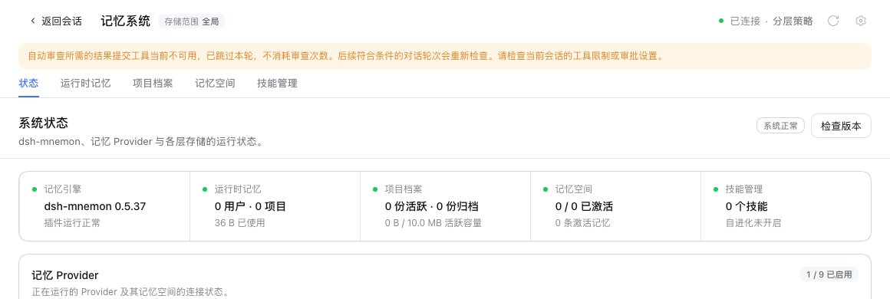

# Idle review tool access / 空闲审查工具可用性

Issue [#525](https://github.com/omdsh-dev/dsh-mnemon/issues/525). This screenshot uses this branch's built code in a disposable DSH 0.2.1-rc.2 WebUI, Chromium 156, a loopback model stub, and a test-owned `mnemon_*` execution guard. No production profile, paid model, private memory, or credentials are used.

此截图使用本分支构建的代码，在隔离 DSH 0.2.1-rc.2 WebUI、Chromium 156、本机模型桩与测试专用 `mnemon_*` 执行守卫中验收。没有使用真实用户配置、付费模型、私有记忆或凭据。

Four substantive conversation turns reached an eligible checkpoint (score 7, threshold 5). The actual status and summary RPCs reported `idleReviewAttempts: 0`, `idleReviewBlocked: "tool-access"`, and `subagents.reviews: 0`; the stub recorded no review model start. The screenshot shows the reason and recovery guidance in the existing notice area. Its native screenshot clip excludes connection credentials and temporary storage paths.

四轮有效对话达到合格检查点（分数 7、阈值 5）。真实 status 与 summary RPC 返回 `idleReviewAttempts: 0`、`idleReviewBlocked: "tool-access"`、`subagents.reviews: 0`，模型桩没有审查启动记录。截图展示现有提示区中的跳过原因及恢复说明，原生截图范围避开连接凭据和临时存储路径。

The automated Host regression also removes the guard and confirms that the next eligible turn completes one review. It covers spawn/fork, persistent/in-memory budgets, native tools and Code Mode, cancellation, timeout and authoritative-result checks on published DSH releases.

自动化 Host 回归另验证解除限制后，下一合格轮次正常完成一次审查；覆盖 spawn/fork、持久/内存内额度、原生工具与 Code Mode、取消、超时及权威结果校验，使用已发布的 DSH 版本。
