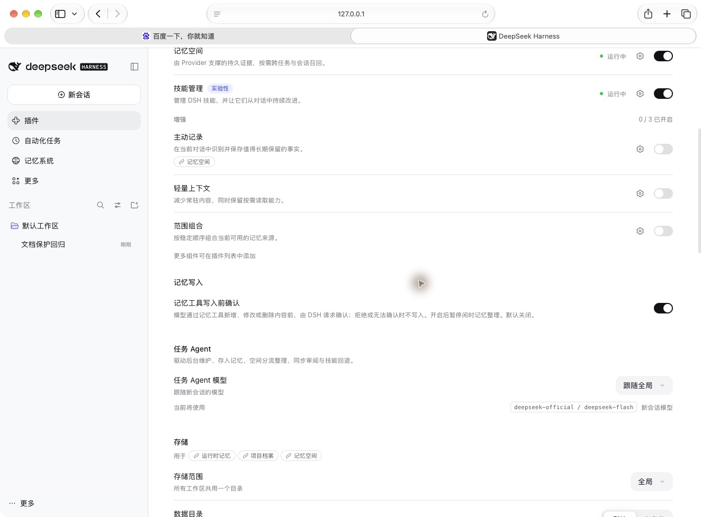
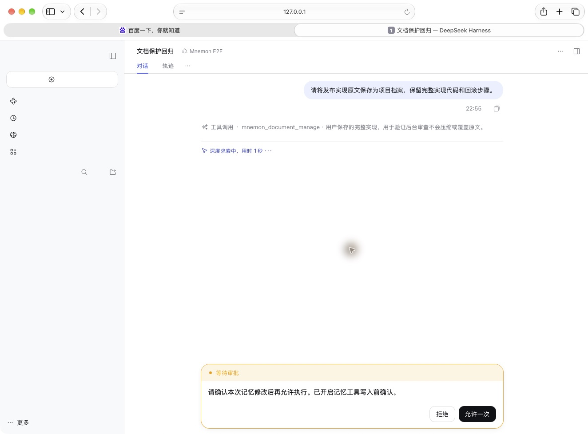
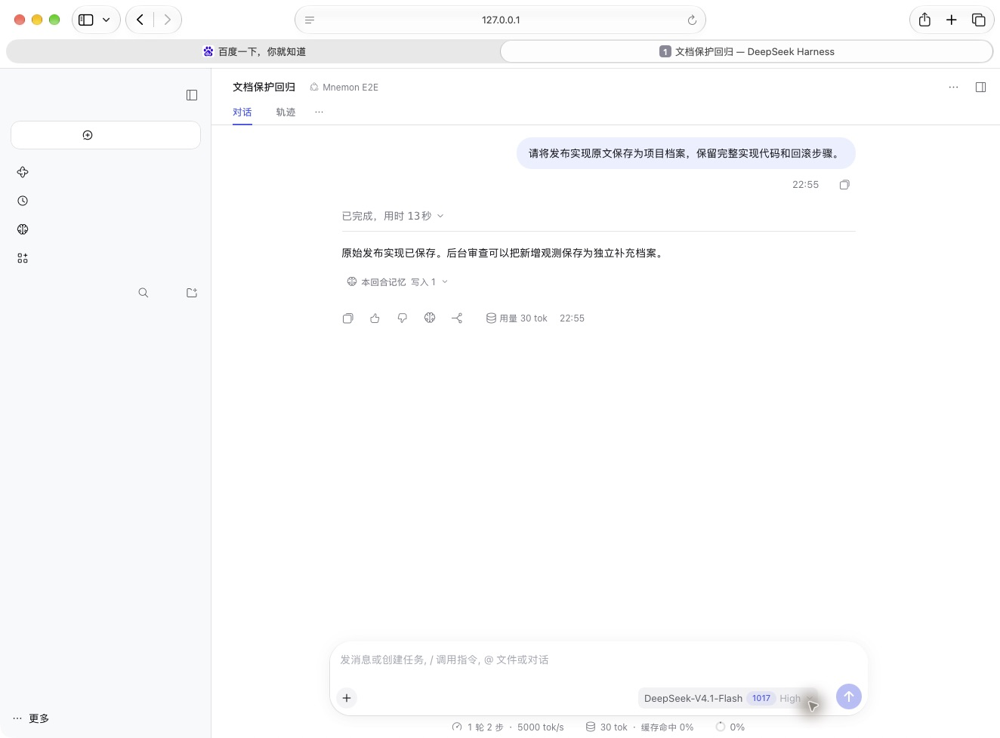

# Memory write confirmation (#140)

2026-11-16. Built from main `91580389` plus this PR. Real published DSH 0.2.1-rc.5 WebUI in a disposable profile, Safari on macOS. The model is a deterministic loopback fixture, not the provider named by the model picker. No production memory, remote provider or paid model was used.

1. **Settings:** the new switch defaults off. Turning it on saves immediately; reloading the page retains it. The existing configuration save-failure and read-only controls are covered in automated tests.
2. **Before writing:** a foreground `mnemon_document_manage` create waits for DSH approval. The Chinese prompt is localized using DSH's `zh` locale. The disposable active-document directory contained zero files while approval was pending.
3. **After approval:** selecting Allow once completes the tool and displays one memory write. The directory then contained exactly one document with the original code, rollback steps and `ORIGINAL_IMPLEMENTATION_MUST_SURVIVE` marker.

| Enabled setting | Waiting for approval | Successful write |
|---|---|---|
|  |  |  |

## Regression coverage

`pnpm run verify` passes: 3,795 tests passed, 14 conditional skips (root: 2,831 passed, 10 skipped). The real Host tests exercise native and nested PTC calls, denied/cancelled/unavailable approvals, the `never` policy, a missing approval service, existing denial rules, and the default-off path. They also verify that allowing one named write does not authorize a second generic View Action, and that an already-pinned View observes a newly enabled preference. The replacement regression failed before the implementation because the original content was overwritten without approval.

Idle review is paused before its preflight/worker starts while confirmation is required, reports the reason, and resumes eligibility after the preference is turned off. Configuration, save failure and read-only settings checks also pass.

## Scope

Confirmation applies to model-facing Mnemon write tools. Manual Memory System edits, CLI/RPC management, Git sync, shell tools, trusted in-process plugins and separately configured Skills automation keep their existing authorization. One approval covers the chosen tool operation, including its existing capacity maintenance. It does not revoke a write whose approval/handler has already started. This is an opt-in interaction control, not a filesystem sandbox or a guarantee about model judgment.

The temporary servers and browser tabs were stopped/closed after capture.
