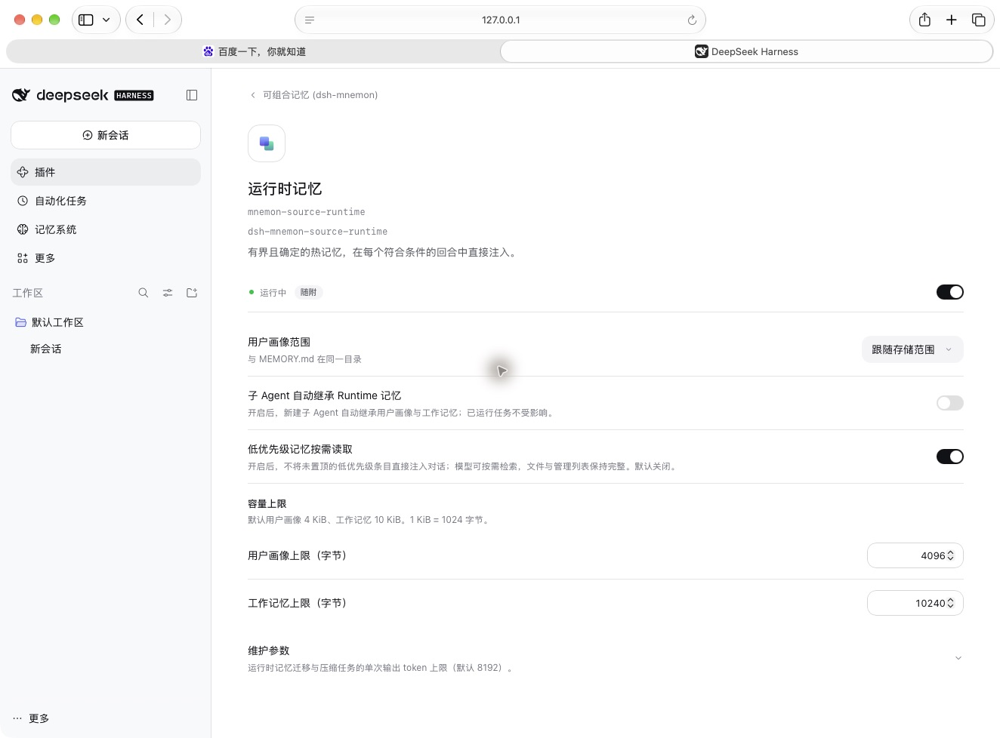

# Runtime projection deferral — Issue #364

## Scope and compatibility

`runtimeMemory.deferLowPriority` is an opt-in setting, off for new and existing configurations. It omits only unpinned low-priority entries from the prompt. Normal, critical and pinned entries retain their projection. The Runtime search Route returns bounded, literal matches and metadata from a Host-owned snapshot pinned to the same Source, scope and Git branch. Storage, writes, quotas, management lists and backup formats are unchanged. Disabling the option restores full projection on later turns.

## Validation

- Regression first failed in three cases: low-priority content still appeared, no deferred Route existed, and the resolved configuration had no opt-in field.
- Controller/Source/config/client targeted suites: 262 passed. Includes default-off behavior, pinned and branch content, unchanged source files, Source isolation, stable snapshot reads after a later correction, failed settings writes and read-only controls.
- Published DSH Host: the first request contains no synthetic optional fact; `mnemon_view_route` retrieves it and the next request receives it with a successful tool receipt. Model choices are scripted; no live-model quality claim.
- `pnpm run verify`: all checks passed, including deterministic builds, full package tests, Headless activation and package validation. Root suite: 2818 passed, 10 conditional skips.
- Actual DSH 0.2.1-rc.5 WebUI in an isolated fixture: off by default; toggle saved successfully; browser refresh retained the enabled value. No private data or live API credentials.

## Limits

The policy uses explicit importance, not a semantic classifier. Custom Strategies must retain the offered Runtime search Route. Previously recalled content follows normal conversation-history retention. Tests verify delivery and scope, not a particular model's recall decisions.
