# Read-only Memory Spaces: issue #434

**English** | [简体中文](./README.zh-CN.md) | [Issue #434](https://github.com/omdsh-dev/dsh-mnemon/issues/434) | [Verification record](./verification.json)

Issue #434 asks for two things at once. An existing namespace, such as a Hindsight bank another tool still writes, should stay readable. Every new write from DSH should go only to a namespace chosen for it. This is the first step of the Provider strategy in the plan of [PR #457](https://github.com/omdsh-dev/dsh-mnemon/pull/457): any namespace besides the one DSH writes to is read only.

Tested on branch `claude/feat-434-space-write-policy`, written on main `a7e3bc54` (v0.5.34), on 2026-10-23 (Asia/Shanghai), with macOS arm64, Node 24.19.0 and pnpm 10.13.1.

The Provider was the Hindsight of `provider-lab/` (its official GHCR standalone image) at `127.0.0.1:18889`. It was reached through a counting proxy on `127.0.0.1:19660` that logged every request. Two banks were made for this record:

- `wp434-legacy` was seeded with two memories directly through the Hindsight API, as another tool would write them.
- `wp434-dsh` started empty.

Both banks use Hindsight's `chunks` extraction mode, which needs no LLM; the lab's Ollama was not running. Recall uses Hindsight's local embeddings and reranker.

## What changed

- **An explicit choice.** The space's **Edit** dialog has **Writes**, below the Provider settings it applies to. **Writable** says "DSH writes here as before." **Read only** says "Still recalled; DSH writes nothing here, nor to any space on the same namespace." The card of a read-only space shows **Read only**. A change of the choice alone saves only the choice. When the settings change too, a choice that cannot be saved after them is reported as such. The same choice is the Source management operation `body-write-policy`, `{ memoryBodyId, policy: 'writable' | 'read-only' }`, which needs confirmation as every management mutation does. The page client calls it through `setWritePolicy`, and no Agent tool reaches it.
- **Refused before the Provider is called.** The Memory Spaces service checks the policy on disk when a write is dispatched, not when a View was composed. It checks for remember, each destination and each item of a batch, forget, link, merging into a space, deleting a Mnemon Native Store and filling its vectors. A merge checks again right before its import, and a vector fill before each step. Every path the Agent, the page, the task Agent and the Host take ends there. A refusal names the space and makes no Provider call.
- **Where writes land, not the card.** Each space has a key: the Provider type, then what the Provider names as the place its writes land, with its runtime defaults resolved. Built-in Providers give it through a new optional adapter method, `namespaceKey`:
  - Hindsight: endpoint and bank.
  - Mem0: endpoint, user and agent, a wildcard writing as `dsh-user` or `dsh`.
  - Honcho: endpoint, workspace and both peers.
  - RetainDB: endpoint, project and user.
  - Supermemory: endpoint and container tag.
  - OpenViking: endpoint, account and memory root. The actor peer is only a header and is left out.
  - Holographic: the resolved store file.
  - ByteRover: the resolved folder.
  - Mnemon Native: its Store.

  A Provider without the method is keyed by its service location alone, which fails closed. Two keys are the same place when one extends the other, so an OpenViking root whose owner only the server knows covers every root of its account. A space made by hand, one the persistence strategy creates, a second Provider instance on the same server, a reconnect, a rediscovery and switching a space on all gain no write.
- **Writable applies to the space's own place.** It removes only that key, never through a wildcard or an old externalId. A space that writes where another read-only space does stays read only and says so.
- **No fallback.** A write that names no space goes to the one active writable space. With none, or several, it asks for one. The Source's facts offer no link or forget through read-only spaces, and its `archivableCount` leaves them out. The write scope given to Host writers leaves them out, the task Agent's target check refuses them, and its tool guard keeps the writer off them. Save to memory does not list them, in a conversation or on the Memory Spaces page. With every space read only, Runtime capacity and Document archival take the local-archive path.
- **What the model and the page see.** The directory a model inspects marks a read-only space `writePolicy: 'read-only'` and gives it `remember`, `link` and `forget` as `false`. Recall evidence and page items report the same, so no Forget is offered on its memories.
- **Where it is kept.** The policy is kept per data directory and per Memory Spaces Source instance in `state/memory-provider-write-policy.json`, beside the Provider connections. It is a file of its own because older builds rewrite the space registry and drop fields they do not know. At most 1,000 places can be read only; past that, read only is refused rather than dropping the oldest. A file, or an entry, that cannot be read makes every space read only and recall keeps working. The directory then carries `writePolicyProblem`, a write naming no space says why, and the page shows a banner with **Reset write choices** behind a confirmation.
- **Spaces without the policy are unchanged.** No file is written, no field is added, the revision encoding is the same, and the errors are the same as before. A Mnemon Native recall still records its reads in the Store, as everywhere.

## Result on real Hindsight

The same scenario ran on main and on the branch, against the same two banks, the branch first so that main's writes could not change what the branch saw. Each row is one call into the Memory Spaces service, the call the Source makes for the Agent, the page and the Host.

| Write | main `a7e3bc54` | branch |
|---|---|---|
| Remember, naming the legacy space | Written: `POST /memories` to `wp434-legacy` | Refused, no request |
| A batch, naming the legacy space | Written: `POST /memories` | Refused, no request |
| Forget a legacy memory | Written: `PATCH /memories/<id>` invalidated it | Refused, no request |
| A capture naming no space, with the legacy space the only active one | Written: `POST /memories` | Refused ("no active memory space takes writes"), no request |
| Remember, naming the DSH space | Queued in `wp434-dsh` | Queued in `wp434-dsh` |
| Remember naming no space, both spaces active | Refused: "memoryBodyId is required" | Queued in `wp434-dsh`, the one writable space |
| Recall across both spaces | Both banks | Both banks |

| Count | main | branch |
|---|---|---|
| Hindsight mutations of `wp434-legacy` | 4 (3 `POST`, 1 `PATCH`) | 0 |
| Memories in `wp434-legacy`, before → after | 2 → 4 (three added, one invalidated) | 2 → 2 |
| Hindsight mutations of `wp434-dsh` | 1 | 2 (`POST /memories`) |
| Memories in `wp434-dsh`, before → after | 4 → 5 | 2 → 4 |

On the branch, each receipt from the DSH bank says `queued`, with completion `accepted`, never `committed`. Hindsight extracts in the background, and the policy does not change how such a receipt reads. `wp434-dsh` held two memories before the branch run. They came from an earlier run of the same branch scenario, whose recall ran before Hindsight had stored its writes; that run is not recorded.

The live scenario is committed as `plugins/dsh-mnemon-source-memory-spaces/tests/hindsight-write-policy.live.spec.ts`. It is opt-in with `MNEMON_WRITE_POLICY_HINDSIGHT`, and its counting proxy runs inside the test. The record above was made at `e55da9e4`. After the review's fixes, the harness ran again on `3cd04d74`. The four writes aimed at the legacy bank were refused with no Hindsight request. The two writes to the DSH bank each made one `POST /memories`, with completion `accepted`. Recall read both banks. `wp434-legacy` held 4 memories before and 4 after. `wp434-dsh` went from 5 to 7.

## In the WebUI

`scripts/serve-e2e.mjs --remember-target` ran the real DSH WebUI with a fresh fixture: the docs demo's Mnemon Native spaces, and a scripted model that names Lumen 项目 for a memory. It ran on main `a7e3bc54` (port 19662) and on this branch (port 19663), driven by headless Chrome over CDP, in light mode, in English and Chinese. The space names are the fixture's Chinese ones in both languages.

**The choice, in the space's Edit dialog.** Main has no such choice. On the branch, **Writes** offers **Writable**, selected by default, and **Read only**, each with what it means beside it.

| main | this change |
|---|---|
| 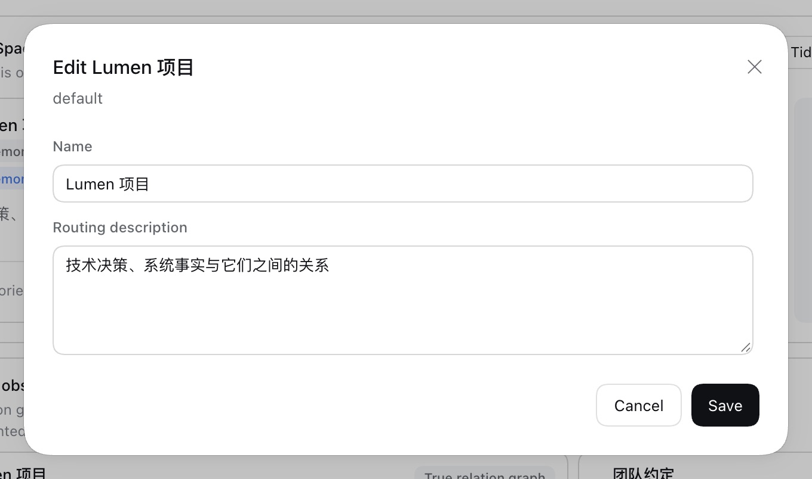 |  |
| 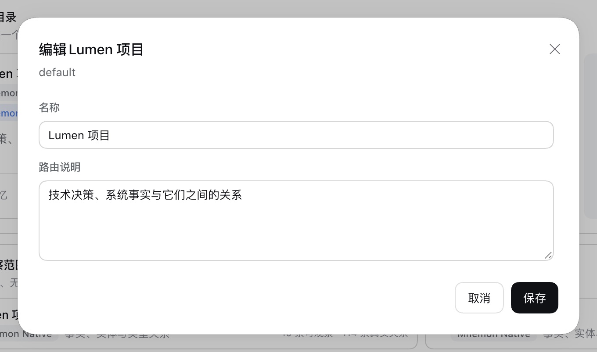 | 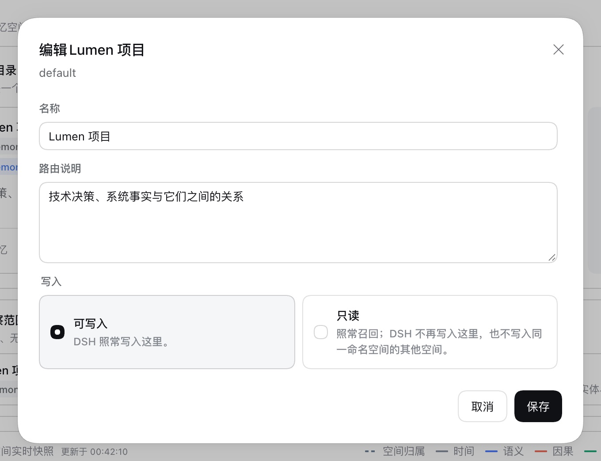 |

| Read only chosen | Read only chosen, Chinese |
|---|---|
| 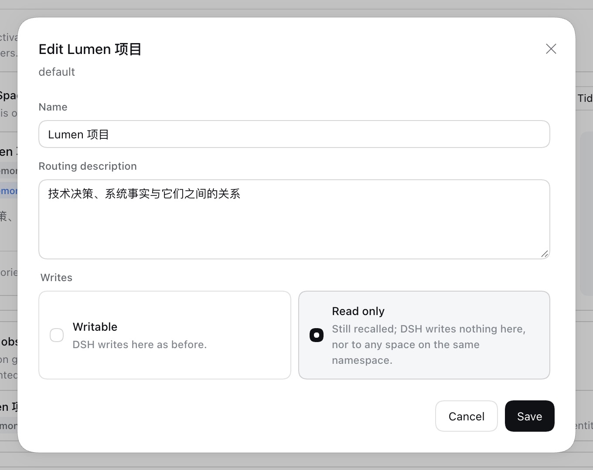 | 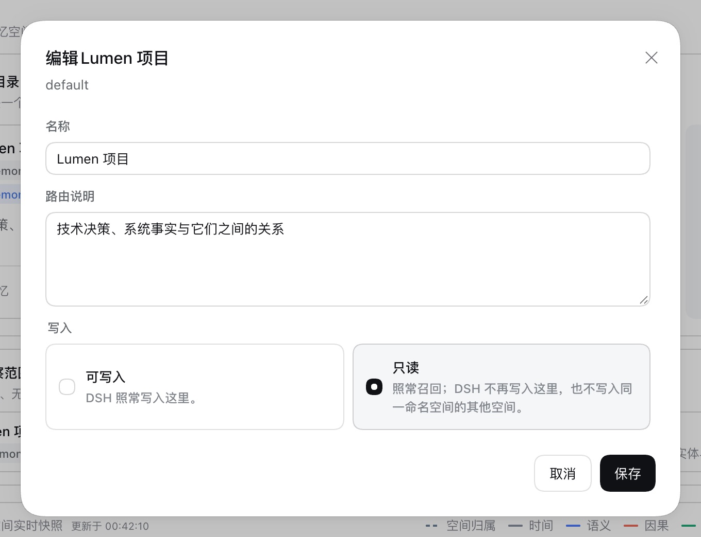 |

**The card.** After saving, the card of Lumen 项目 shows **Read only**. Its Delete button is disabled, because a read-only Mnemon Native space keeps its Store; hovering over it says so.

| main | this change |
|---|---|
| 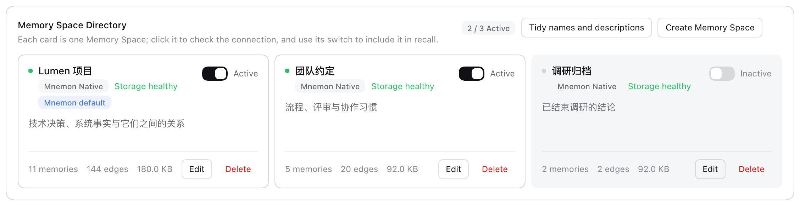 | 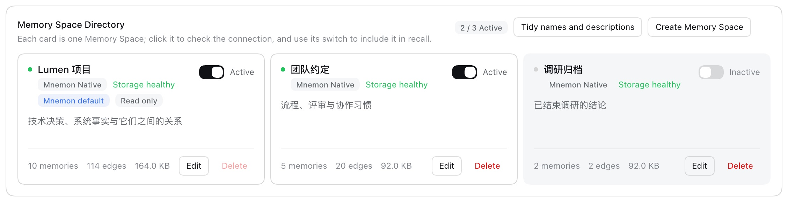 |
| 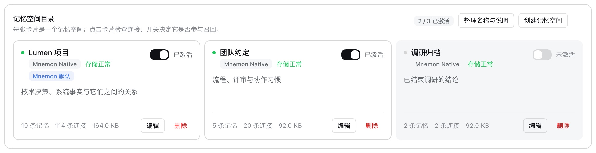 | 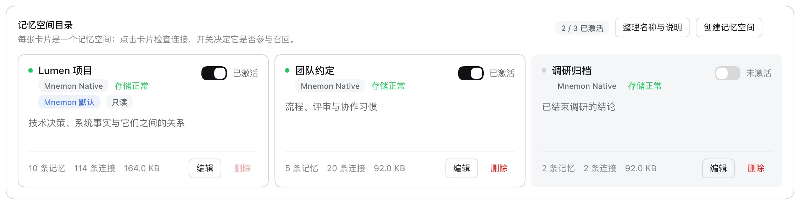 |

**Save to memory in a conversation.** Main offers Lumen 项目 as a destination. The branch leaves it out and still offers 团队约定, the other active space.

| main | this change |
|---|---|
| 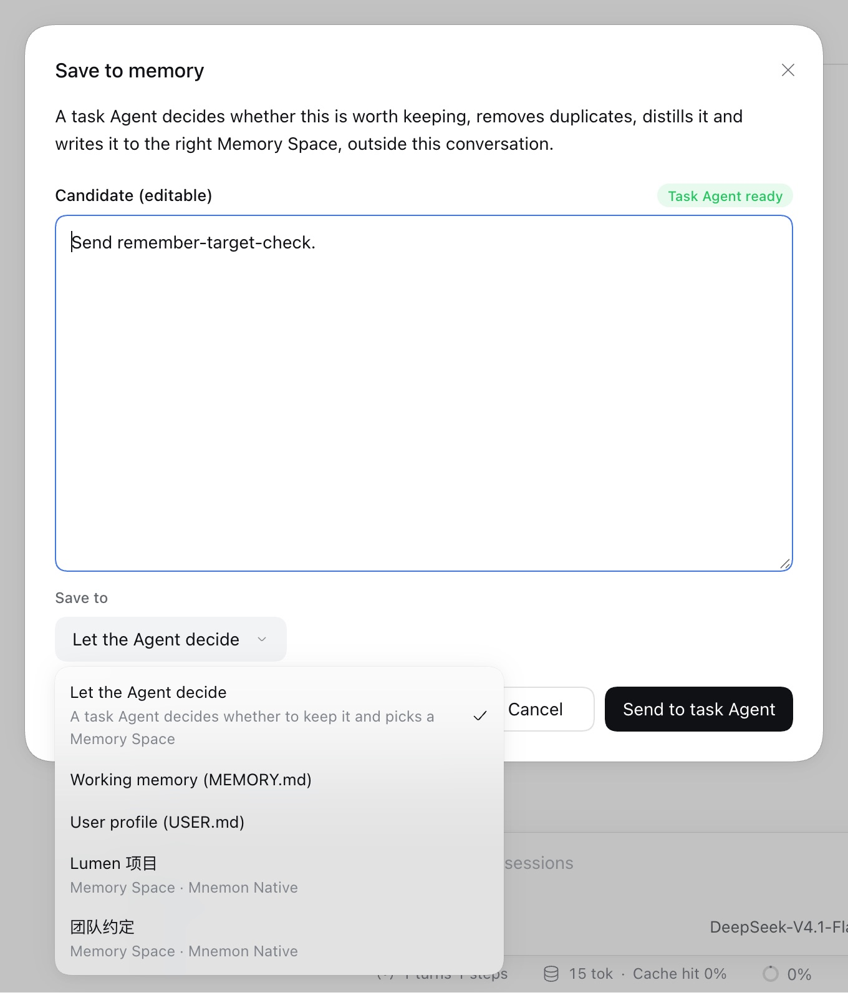 | 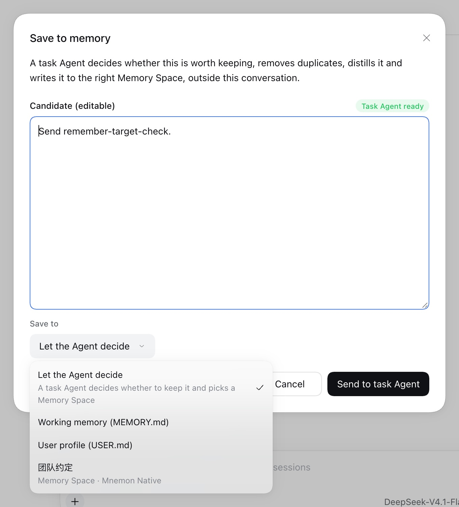 |
| 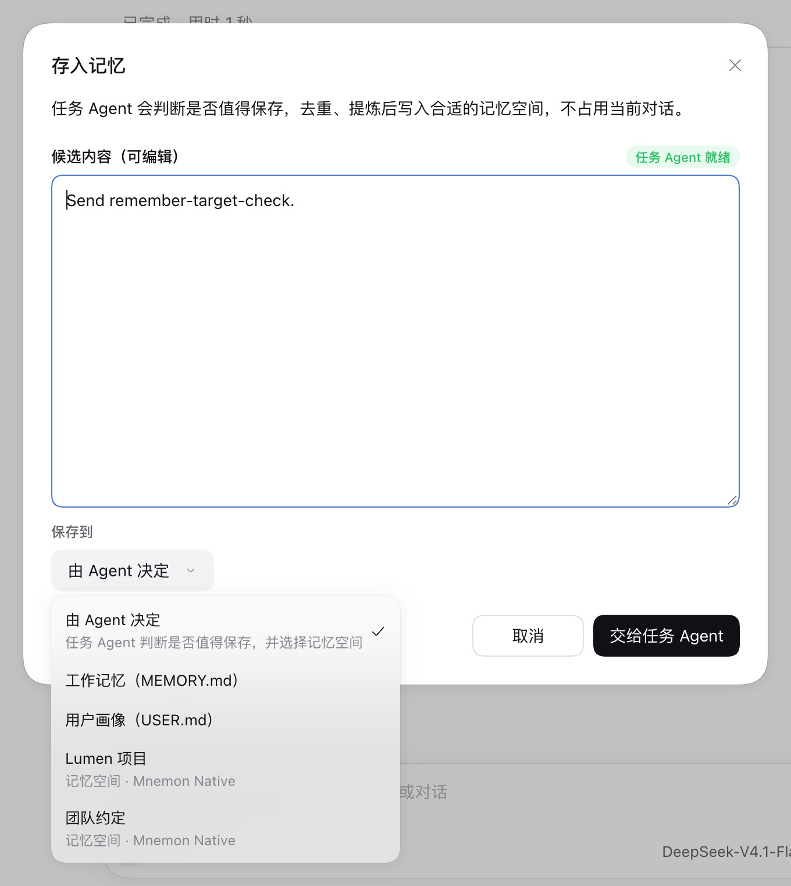 | 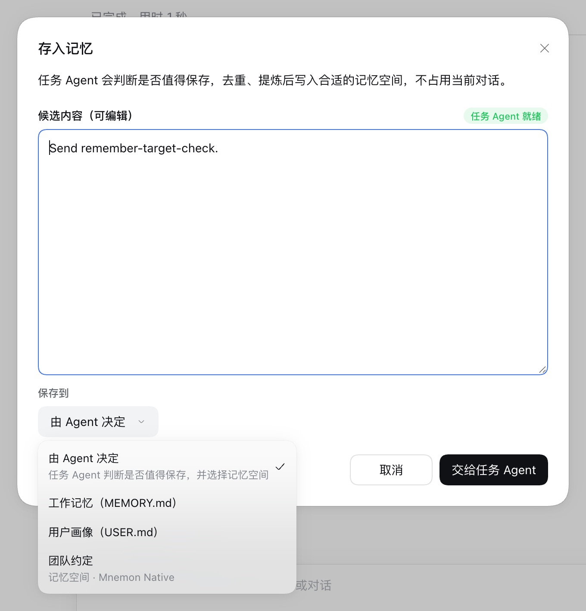 |

**A write the model aims at the space.** On `remember-target-check` the model lists the spaces and calls `mnemon_remember` naming Lumen 项目. On main the task Agent writes it there (`added`). On the branch the Host refuses before any task Agent runs, and the model passes on the refusal: `Memory Space "default" (Lumen 项目) is read only: it is recalled and takes no writes. Name a writable space.` The model's own words are scripted, in Chinese, in both languages.

| main | this change |
|---|---|
| 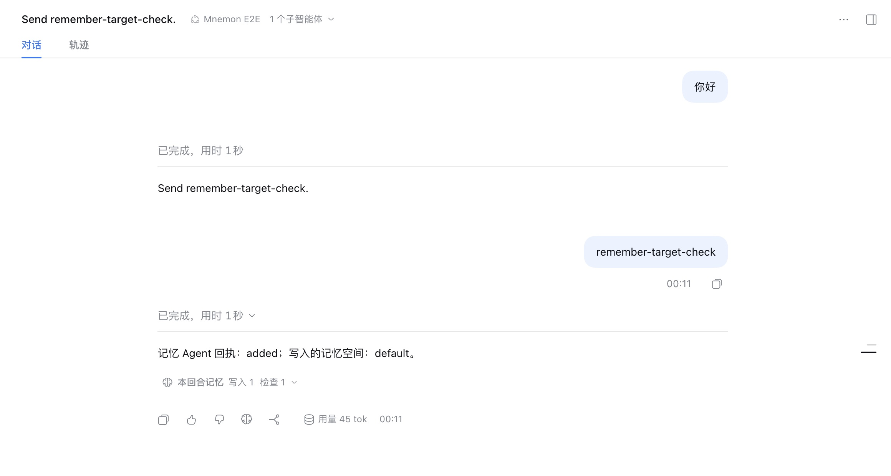 | 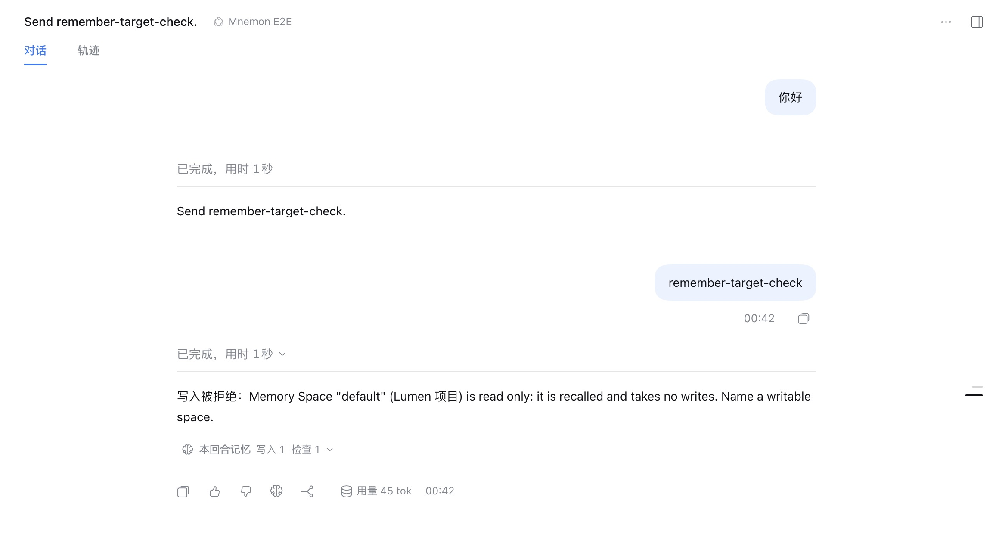 |

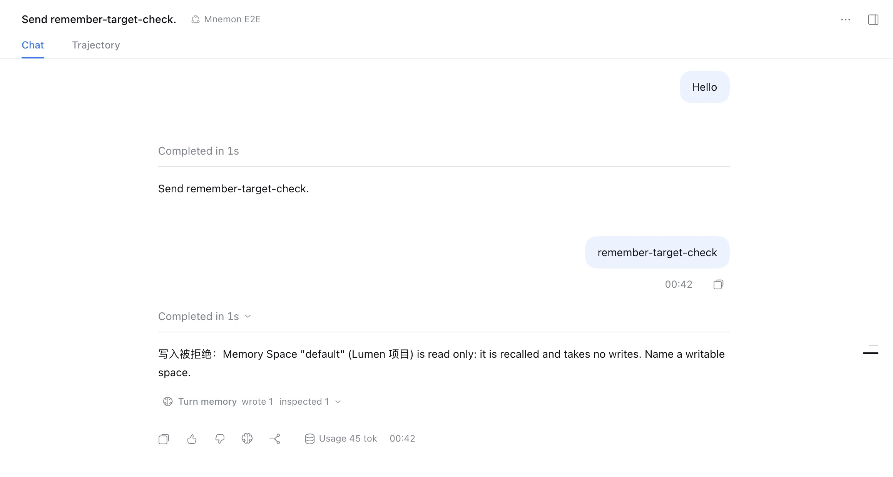

## Tests

- `plugins/dsh-mnemon-source-memory-spaces/tests/write-policy.spec.ts` drives the real Source with a counting bank Provider. One test covers each write path: View remember, forget and link, and management remember, a batch, forget and link. Further tests cover these cases: a legacy id named explicitly, while the space is inactive and after it is switched on; a space made by hand for the same bank; a space whose settings move to that bank; a disconnect followed by a new mount; a policy changed after a View was composed; the default destination; no fallback; the facts and write scope; and recall evidence and page items that report what a read-only space takes. The review's cases are tests of their own: Mem0 users and agents with wildcards, Holographic spaces made by hand or by the persistence strategy on one store, blank and relative ByteRover folders, OpenViking peers, trailing slashes and owners only the server knows, a Hindsight space moved to another bank, a second Provider instance on the same server, and the 1,000-place limit. Over Mnemon Native, the tests cover these cases: no command that writes memories or vectors for remember, a batch, forget, link, merge, vector fill or delete; a merge target and a vector fill that turn read only midway; a batch stopped at a destination that turned read only; an unreadable or unsupported file, or one with an entry it cannot read, said in the directory and a write naming no space, and reset; a restart and another data directory; and no change without a policy.
- `write-policy-page.spec.tsx` renders the real page against the real Source. It covers the choice, a change of the choice alone saving only it, the badge, changing back, the page's own Save to memory dialog, which offers no read-only space, and the banner and confirmed reset for a file that cannot be read.
- `hindsight-write-policy.live.spec.ts` is the live scenario above, opt-in with `MNEMON_WRITE_POLICY_HINDSIGHT`.
- Root tests cover the rest. The layer-combination matrix gains a read-only space for MEMORY.md and Document archival through the Agent tool, the web page and the Host's own path, and for what the View offers. The task Agent's target check and tool guard are tested, the Save to memory place list leaves read-only spaces out, and **Fill in** is not offered for a read-only Native space.

```text
pnpm --filter dsh-mnemon-source-memory-spaces exec vitest run   # 315 passed, 3 skipped
pnpm exec vitest run --dir tests                                # 2,176 passed, 7 skipped
pnpm run typecheck && pnpm --filter dsh-mnemon-source-memory-spaces run typecheck
pnpm --filter dsh-mnemon-source-memory-spaces run build && pnpm run build
MNEMON_CLI_PATH=/nonexistent/mnemon pnpm run verify:plugins
node scripts/verify-docs.mjs
```

## Limits

- The WebUI screens use Mnemon Native spaces, not the Hindsight banks, because the e2e fixture has no Hindsight. The write path they show is the same one the Hindsight scenario above measures.
- On main, the English run of `remember-target-check` repeated the memory the Chinese run had saved. Mnemon recognized the duplicate, so that run shows nothing new, and the record keeps only the Chinese screen.
- Hindsight is never an archive destination, because its writes are async-extracting. Archival into a read-only Hindsight bank cannot happen on either version, so archival is checked with Mnemon Native in the layer matrix.
- The task Agent writer needs a model. Its target check and tool guard are checked in the Host tests, not live.
- A Pack restore and Git sync copy whole stores. The policy governs DSH's own writes, so it does not stop them. Neither carries the policy file, and neither removes it.
