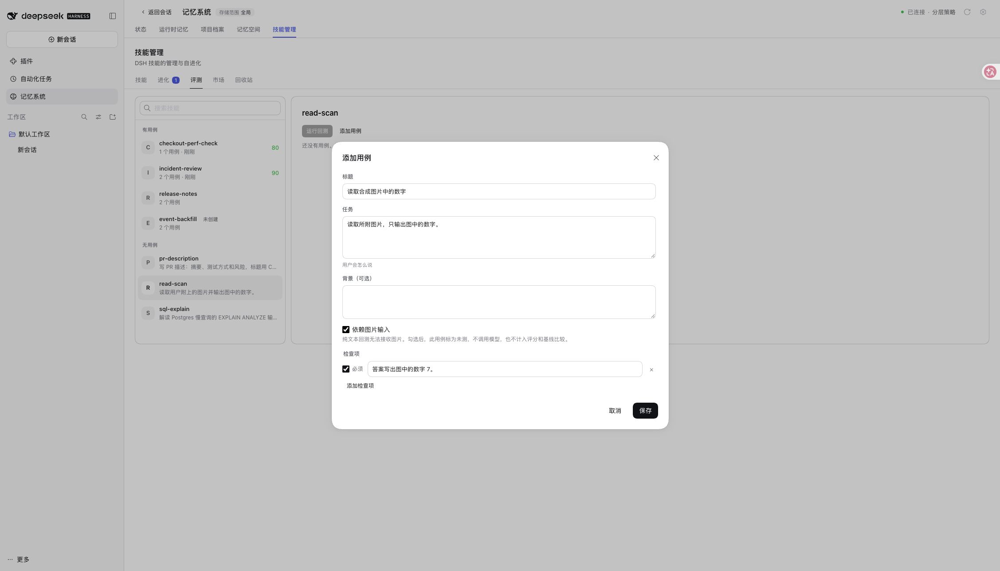
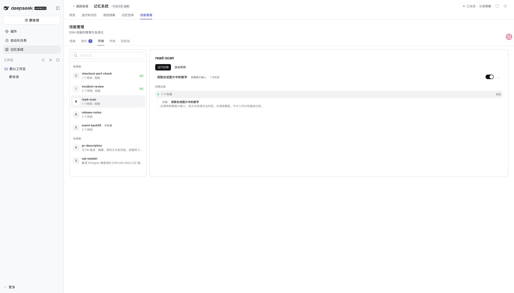

# Image-dependent skill evals / 图片依赖技能评测

Issue #446, minimal explicit-marker alternative. Captured from this branch's
built Host and Skills Source on the real DSH 0.2.1-rc.2 WebUI, using Node
22.22.0, pnpm 10.13.1 and a disposable fictional Lumen profile. Only synthetic
test data was used; the loopback model fixture received no requests.

截图来自本分支构建后的 Host 和技能 Source，运行于真实 DSH WebUI。使用隔离的
Lumen 演示环境和合成用例；回测没有调用模型，没有使用私人数据或真实模型凭据。

```sh
env -u HTTP_PROXY pnpm run verify
env -u HTTP_PROXY node scripts/serve-e2e.mjs --docs-demo=zh-CN --without-mnemon-cli
```

The process-local proxy removal avoids an invalid inherited `HTTP_PROXY` URL;
no machine configuration is changed. Full verification passed: bilingual docs,
types, deterministic builds, all workspace suites, 2,192 root tests (7 existing
conditional skips), isolated Headless activation and package checks. The Host
skill-evolution suite passed 17 tests and the Skills page suite passed 22.

仅为验证子进程移除了格式错误的继承代理地址，没有修改系统配置。完整验证通过，
包含根包 2,192 项测试（7 项按既有条件跳过）、所有插件测试、类型、构建、Headless
启动和发布包检查。Host 技能进化测试 17 项、技能页面测试 22 项全部通过。

## Browser steps / 界面步骤

1. Create `read-scan`, with instructions to read an attached image and return its
   number without guessing. Add a case asking for the number 7 and select
   **Requires image input**. / 新建读图技能与检查数字 7 的用例，勾选**依赖图片输入**。
   
2. Save, then click **Backtest**. The completed run shows **1 not measured** and
   explains why it has no score. / 保存后运行回测，显示**1 个未测**并说明不计分的原因。
   
3. Read the disposable profile's actual `evals.json` and the model fixture's
   request counter. The stored run is completed at 1/1, has neither `score` nor
   `passRate`, and records `unmeasuredReason: "requires-vision"`. Request counts
   stayed at 0 before and after the browser backtest. The relevant case and run
   are preserved in [evidence.json](./evidence.json).
   / 读取实际落盘记录和模型请求计数：进度为 1/1，没有总分或通过率，原因字段正确；
   回测前后请求数均为 0。合成用例和运行记录保存在同目录的证据文件中。

For older readers, the per-case record retains the ungraded `error` verdict and
its numeric placeholder; the UI renders **Not measured** and the scorer excludes
it. Text-only cases, mixed runs, read-only UI, marker preservation/clearing,
historical failure hints and draft/baseline comparison are covered by automated
tests. This change adds no attachment upload or vision execution.

为兼容旧读取方，单用例记录保留不计分的 `error` 判定和数值占位；界面显示**未测**，
评分时排除此项。自动测试覆盖文本用例、混合回测、只读界面、标记保留与清除、
历史失败提示和草案基线比较。本改动不包含附件上传或真正的视觉评测。
