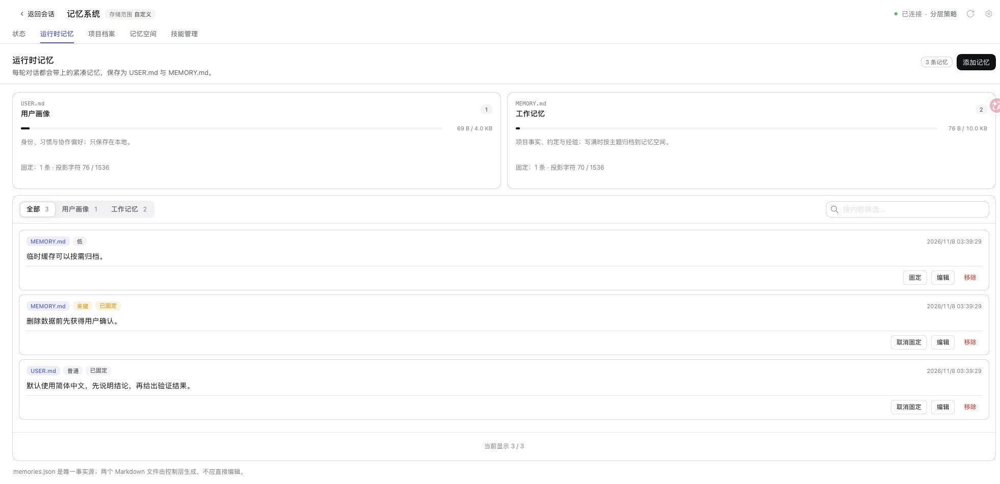
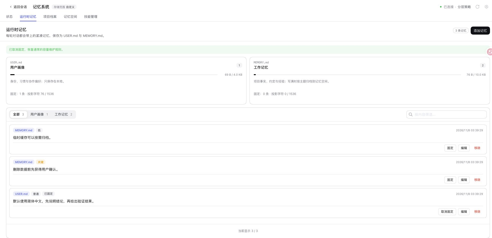

# Runtime pins / 运行时固定条目

Official DSH 0.2.2-rc.1 Web, Node 24.22.2, macOS arm64; isolated profile loading the PR build. The unreleased package still reports the base version 0.5.42. All entries are synthetic and no paid model was called.

官方 DSH 0.2.2-rc.1 Web、Node 24.22.2、macOS arm64；隔离 profile 加载 PR 构建。未发布包仍显示基础版本 0.5.42。所有条目均为合成数据，没有调用付费模型。

- Click Pin for one USER and one MEMORY entry: both badges and per-target counts/character budgets update. Reload retains the state. / 为一条 USER 和一条 MEMORY 点击固定，标识及对应计数、字符预算更新，刷新后保持。
- Click Unpin for MEMORY: its quota returns to zero, the USER pin remains, and the disk record contains the explicit false flag. / 取消 MEMORY 固定，其预算归零，USER 保持固定，磁盘记录保留显式 false。
- Host/Source tests cover repeated Provider/local archival, new-turn projections, verbatim USER compaction, scoped/light/general budgets, pin-capacity rejection before Provider work, Pack roundtrips, merge overflow and old SDK rejection. These are deterministic synthetic tests, not claims about model obedience. / Host/Source 自动化测试覆盖连续 Provider/本地归档、新轮次快照、USER 原文保留、范围/轻量/通用策略预算、Provider 写入前拒绝容量冲突、Pack 往返、合并溢出及旧 SDK 拒绝路径；这是确定性合成验收，不代表模型一定服从。

