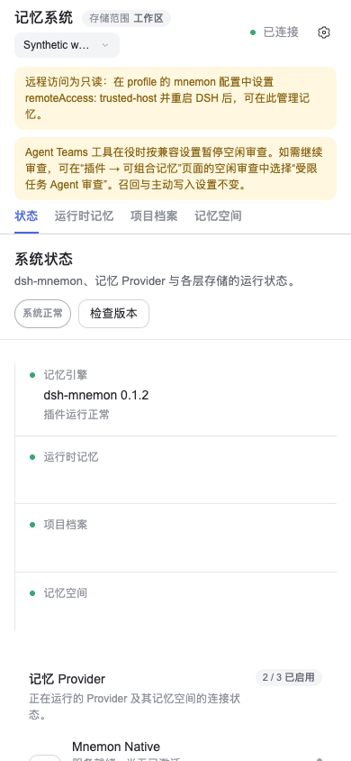
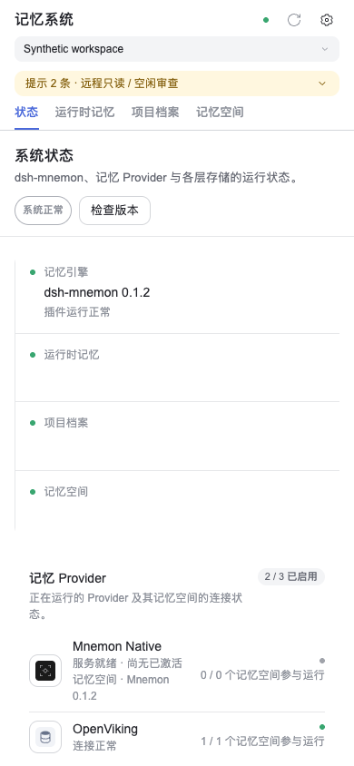
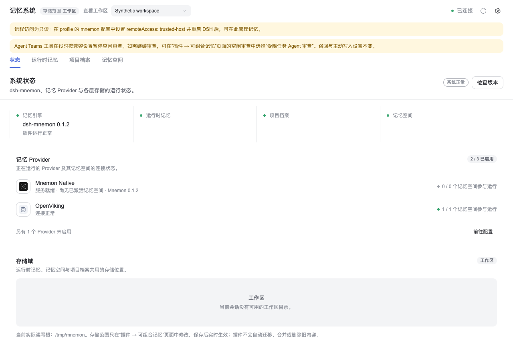

# Compact panel chrome: issue #521

[简体中文](./README.zh-CN.md) | **English**

Captured on 2026-11-01 from implementation `c74ff1bafabcb4f425fae98112d85cc3fef9e2bb`, based on main `7cbdefc64c019a073cfdb493b0b516b5b7177bb6`.

Headless Chrome renders the actual React Workbench, Source pages and published DSH UI primitives. A disposable synthetic RPC/settings fixture supplies two ordinary notices, a fictional workspace and fixed status data; light-theme tokens are supplied by the fixture. No private memories, credentials or external model calls are involved.

| Before: main stylesheet, 390×844 | After: compact chrome, 390×844 |
|---|---|
|  |  |

The before image reconstructs main's presentation by loading its root stylesheet and unwrapping the new notice containers with `display: contents`; it uses the same React fixture, not a separate full main build. Both images use a coarse pointer. Heights run from the panel top to the bottom of the navigation tabs:

| Measurement | Before | After |
|---|---:|---:|
| Masthead | 66px | 70px |
| Total chrome | 259.5px | 143.5px |

At 1280×900, the header and full-notice geometry matches main's stylesheet: masthead 48px and total chrome 169.5px.

Browser checks also cover keyboard expansion and collapse, complete original text, retained expansion across pages, the 520/521px boundary, a 390px panel inside a 1280px viewport, and visible errors/restart reminders. A browser-only combination with #520 (`2a2939816ee787874e8fc341c8de0d027ce34dd9`) retains its 44px selector and fits horizontally; its larger touch targets make total chrome 182.5px. That patch is not part of #521.

`pnpm run verify` passed for the implementation, including 2,259 root tests; seven opt-in tests were skipped. These captures establish Client layout and interaction in Chrome. They do not certify a physical Android device, the complete DSH browser host, or live Provider/model behavior. DSH Headless activation passed separately.
