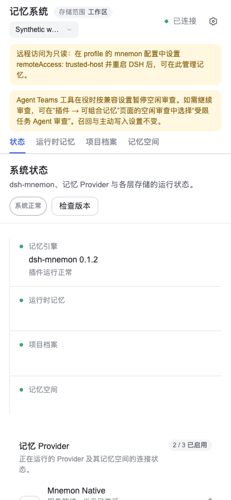
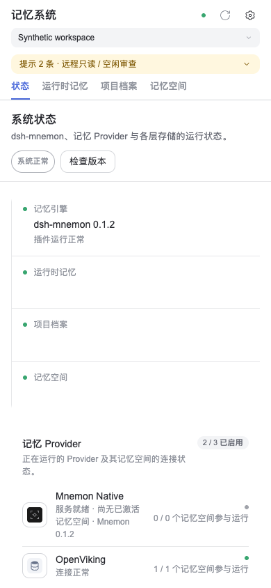
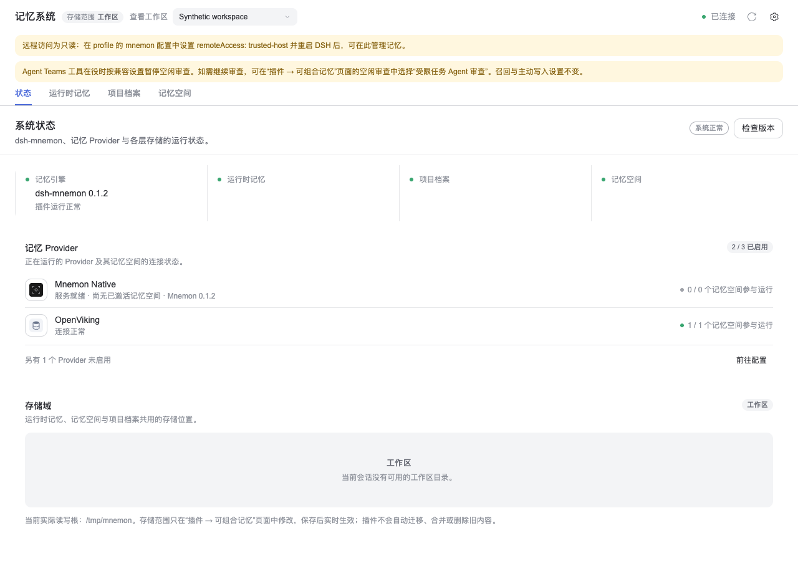

# 紧凑面板顶栏：issue #521

**简体中文** | [English](./README.md)

截图日期为 2026-11-01，实现版本为 `c74ff1bafabcb4f425fae98112d85cc3fef9e2bb`，基于 main `7cbdefc64c019a073cfdb493b0b516b5b7177bb6`。

无界面 Chrome 实际渲染 React Workbench、Source 页面和正式发布的 DSH UI primitives。一次性合成 RPC/settings 夹具提供两条普通提示、虚构工作区和固定状态数据；浅色主题 token 由夹具提供。未使用私有记忆、凭据或外部模型调用。

| 修改前：main 样式表，390×844 | 修改后：紧凑顶栏，390×844 |
|---|---|
|  |  |

修改前截图通过加载 main 的根样式表，并用 `display: contents` 展平新增提示容器来还原原有呈现；使用相同 React 夹具，并非单独构建的完整 main。两张截图均启用粗指针。高度从面板顶部量至导航标签底部：

| 测量项 | 修改前 | 修改后 |
|---|---:|---:|
| Masthead | 66px | 70px |
| 顶部区域总高 | 259.5px | 143.5px |

在 1280×900 下，顶栏和完整提示条的几何尺寸与 main 样式表一致：masthead 为 48px，顶部区域总高为 169.5px。

浏览器检查还覆盖键盘展开与收起、完整原文、跨页面保留展开状态、520/521px 断点、1280px 视口中的 390px 面板，以及错误和重启提醒保持可见。仅在浏览器中叠加 #520（`2a2939816ee787874e8fc341c8de0d027ce34dd9`）后，选择器仍满足 44px，且没有横向溢出；较大的触控目标使顶部区域总高变为 182.5px。该补丁不包含在 #521 中。

实现已通过 `pnpm run verify`，其中根测试通过 2,259 项，跳过七项按需运行的测试。截图验证 Chrome 中的 Client 布局与交互，不代表实体 Android 设备、完整 DSH 浏览器宿主或真实 Provider/模型行为已通过验收。DSH Headless 激活另行通过。
