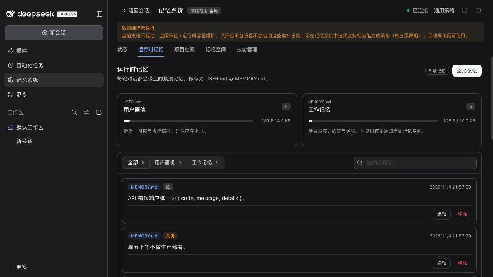
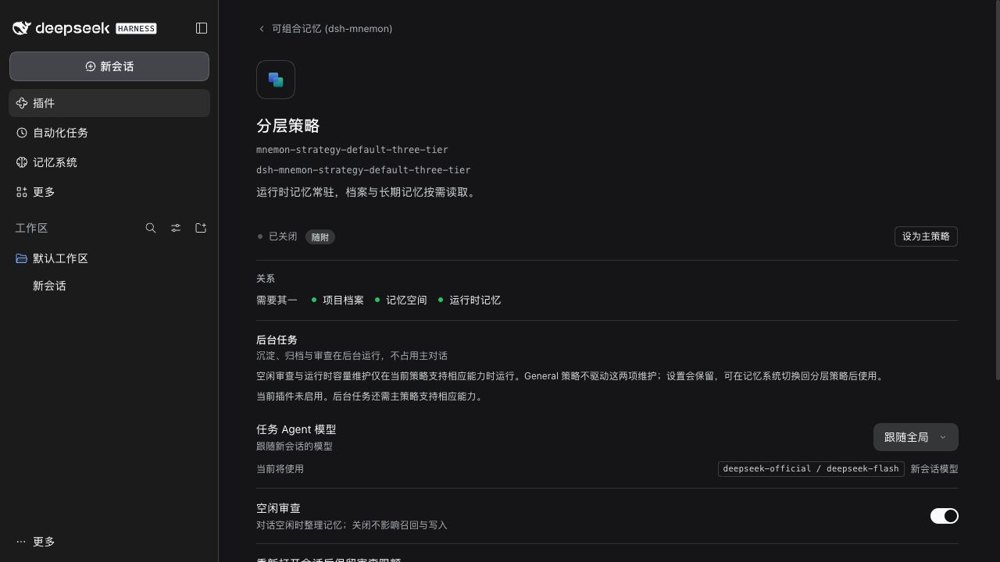
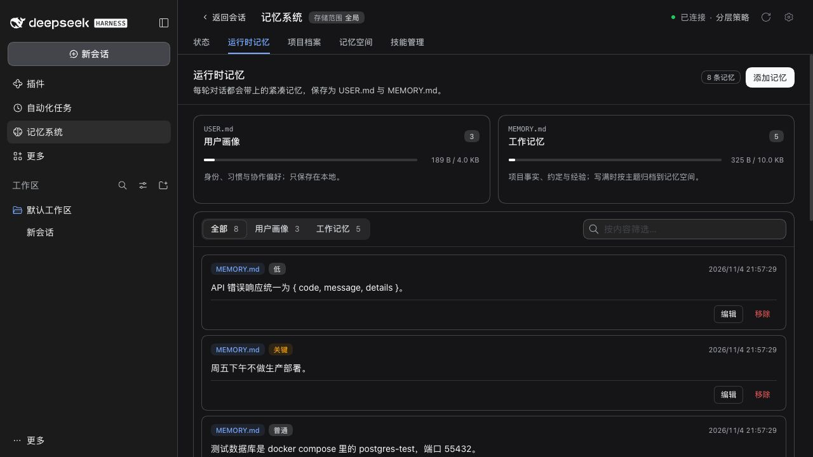

# Issue #557: strategy workflow visibility

Validated on 2026-11-04 with published DSH 0.2.2-rc.1 and Node 24.22.2. The disposable Web profile uses synthetic Lumen data and a loopback model; no personal profile, private memory or paid model calls are involved.

| Check | Result |
|---|---|
| General selected, no conversation opened | Both idle review and runtime capacity maintenance are visibly unavailable |
| Layered settings while General is selected | Explains the strategy dependency; the saved idle-review switch remains enabled |
| Switch back to Layered | The notice disappears; all eight seeded runtime entries remain |
| Custom and legacy strategies | RPC regressions cover partial declarations, explicit empty declarations, legacy Layered and a serving fallback |
| Existing scheduling and manual authority | Unchanged; lifecycle and real-Host regressions pass |

- Full pinned-baseline `env -u NODE_PATH pnpm run verify`: 2487 root tests passed, 7 optional skips; 751 component tests passed, 3 optional skips. Type checks, deterministic builds, docs, Headless and package checks passed.
- Final copy: 74 settings/presentation tests passed; updated the reviewed bilingual copy fingerprints and rebuilt.
- Published RC1: 349 related RPC, client, settings, workflow and lifecycle tests passed with `scripts/installed-dsh.config.ts` and the physical installed Host. No feature was skipped in this set.
- Red/green: the five RPC capability cases and four client notice cases failed before the fix and passed after it.
- Independent review found no P1/P2 blockers. The API addition is optional, requires no extra status read, and does not alter saved settings or maintenance scheduling.

The harness disables Shell, leaving four upstream dependent entries pending. This does not affect the verified memory paths. Native Desktop OS integration and live model/provider quality are outside this check.
