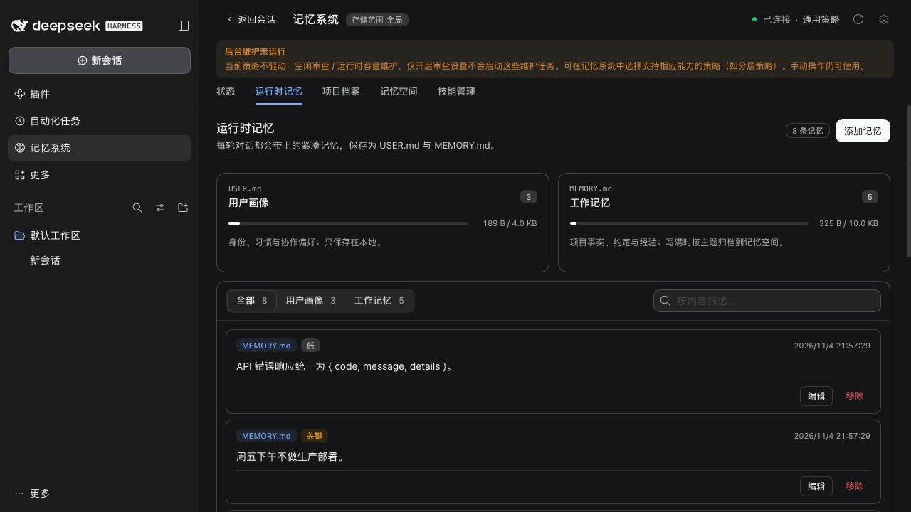
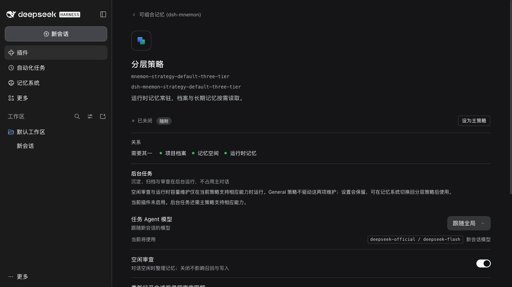
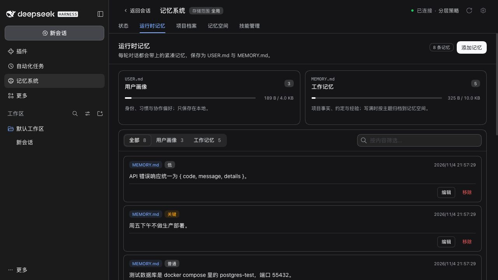

# Issue #557：策略后台维护状态说明

2026-11-04 使用官方发布的 DSH 0.2.2-rc.1、Node 24.22.2 验证。隔离 Web 配置使用虚构 Lumen 数据与本地合成模型，未使用个人配置、私有记忆或付费模型。

| 检查 | 结果 |
|---|---|
| 选择 General，未打开对话 | 明确显示空闲审查与运行时容量维护未运行 |
| General 下打开分层策略设置 | 解释策略生效条件；已保存的空闲审查开关仍为开启 |
| 切回分层策略 | 提示消失；八条合成运行时记忆全部保留 |
| 第三方与旧版策略 | RPC 回归覆盖部分能力、显式空声明、旧版分层策略和实际服务策略回退 |
| 调度与手动权限 | 行为未变；生命周期及真实 Host 回归通过 |

- 固定开发基线 `env -u NODE_PATH pnpm run verify`：根测试 2487 通过、7 条件跳过；组件测试 751 通过、3 条件跳过。类型、确定性构建、文档、Headless 与包检查通过。
- 最终文案：设置与展示基线测试 74 项通过，更新中英文文案指纹并重新构建。
- 官方 RC1：通过 `scripts/installed-dsh.config.ts` 使用真实安装目录，相关 RPC、客户端、设置、工作流及生命周期测试 349 项全部通过，无功能路径跳过。
- 修复前五个 RPC 能力用例和四个客户端提示用例失败，修复后通过。
- 独立审查未发现 P1/P2 阻塞问题。状态字段为可选增量，不增加状态读取，不修改已存配置或维护调度。

夹具禁用 Shell，使四个上游依赖条目处于 pending，不影响本次记忆路径验证。原生 Desktop 系统集成、真实模型及云 Provider 的质量不属于本次验收。
