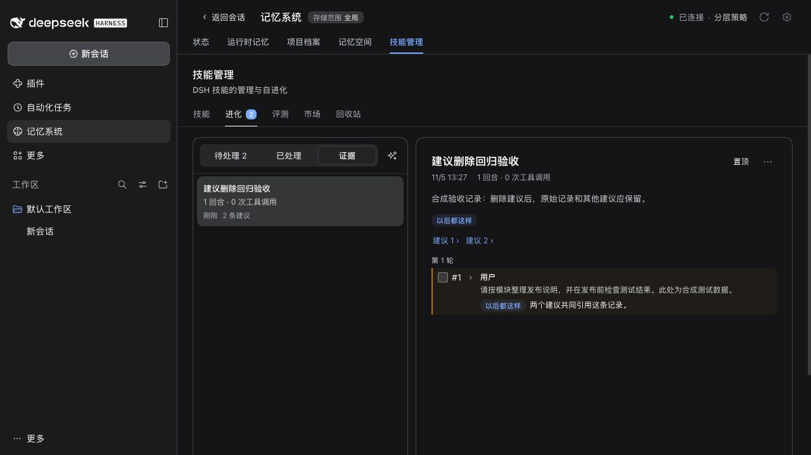
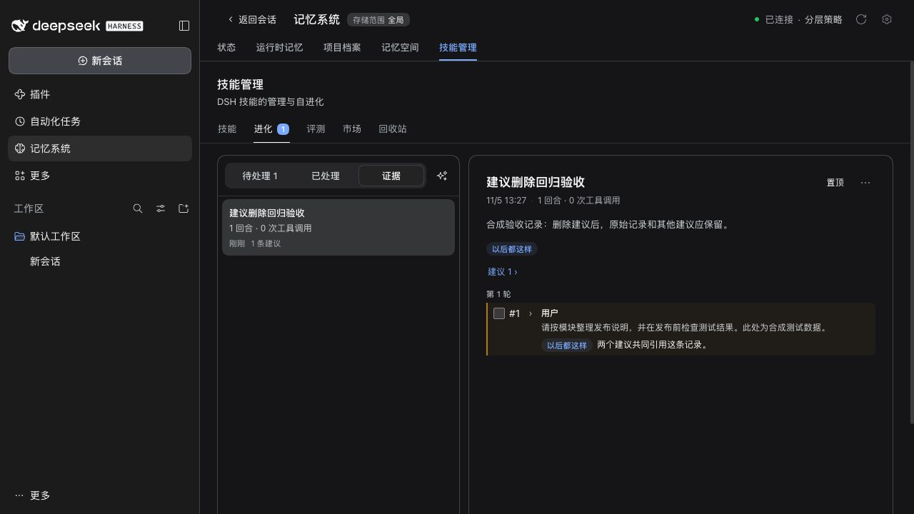
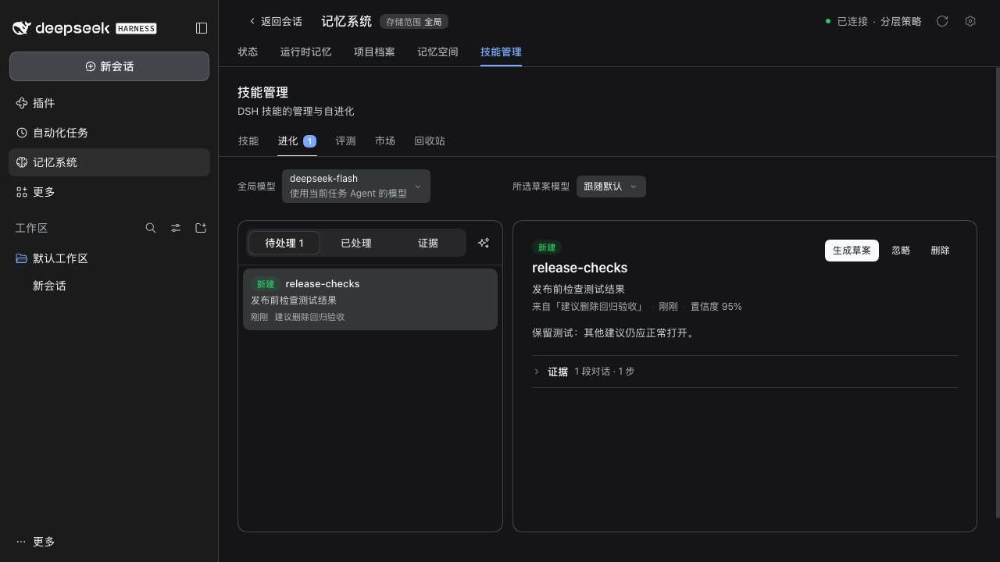

# Issue #565 verification / 验收记录

Issue: https://github.com/omdsh-dev/dsh-mnemon/issues/565

## Changes / 改动

- Deleting a suggestion persists cleaned review and trajectory-summary links. Legacy dangling links are filtered from ledger reads and full trajectories, including annotations. Reads do not write files or change the management revision; a later ordinary locked write saves the normalized data it touches.
- 删除建议时，复盘记录和轨迹摘要中的失效引用会同步写入清理结果。旧数据读取时也会过滤失效引用，包括独立轨迹文件的标注；读取不会写文件或改变管理版本，后续正常加锁写入会保存它涉及的数据的清理结果。
- Conversation steps, annotations, valid suggestions and test cases remain available. Review counts are capped by remaining references when links are removed, retaining the existing distinction between a newly inserted/updated suggestion and a review that only strengthens its evidence. Legacy reviews without reference IDs keep their historical counts.
- 原始对话、标注、有效建议和评测用例仍保留。移除引用时，复盘计数最多保留剩余引用数，继续区分新增/更新建议与仅补充证据的复盘；没有引用 ID 的旧复盘保留原有历史计数。
- A suggestion deleted between list and detail requests displays a localized notice. Other read failures remain visible and offer Retry; inactive requests cannot replace the current detail with an error.
- 列表与详情请求之间建议被删除时显示本地化提示；其他读取错误继续显示并可重试，已失效请求的错误不会覆盖当前详情。

## Automated checks / 自动验证

```sh
pnpm --filter dsh-mnemon-source-skills verify
pnpm run verify
```

- Skills: 95 tests passed; typecheck and build passed. Regression tests fail on the original implementation for persisted dangling references, legacy reads, the Evidence link after deletion, missing-detail loading and other read failures.
- Skills：95 项测试通过，类型检查和构建通过。修复前可复现写入残留引用、旧记录读取、删除后的证据入口，以及建议详情失败后一直加载的问题。
- Full verification: 2,498 Core tests passed / 7 conditional skips; 759 plugin tests passed / 3 conditional skips across 18 plugins. Bilingual docs, types, deterministic builds, real Headless activation/restart, package contents and exports passed.
- 完整验证：核心 2498 项通过、7 项条件跳过；18 个插件共 759 项通过、3 项条件跳过。双语文档、类型检查、可重复构建、真实 Headless 激活和重启、包内容及导出检查通过。

## Real WebUI / 真实页面

Official npm DSH `0.2.2-rc.1`, Node `24.22.2`, macOS, isolated local Web profile using this PR's built artifacts. Fixtures and the model endpoint are synthetic and local. This is WebUI verification, not a Windows Desktop binary run.

官方 npm DSH `0.2.2-rc.1`、Node `24.22.2`、macOS 隔离本地 Web 配置，加载本 PR 的构建产物。数据和模型端点均为本地合成测试，不涉及真实模型调用。本项验证 WebUI，未运行 Windows Desktop 二进制。

1. Seed two live suggestions and one legacy deleted ID in a review, its trajectory summary and full trajectory annotations. Evidence displays only the two live links.
2. Delete `release-notes` through the real UI confirmation. Evidence retains its original content and only one suggestion link/count.
3. Follow the remaining link. The `release-checks` detail and actions load normally; the browser reports no console errors.

1. 在复盘、轨迹摘要和独立轨迹标注中注入两条有效建议及一个旧的已删除 ID；页面只显示两条有效入口。
2. 通过实际页面确认删除 `release-notes`，记录原文保留，入口和计数变为一条。
3. 打开剩余入口，`release-checks` 详情与操作正常显示，浏览器无控制台错误。

| Before deletion / 删除前 | After deletion / 删除后 |
| --- | --- |
|  |  |


