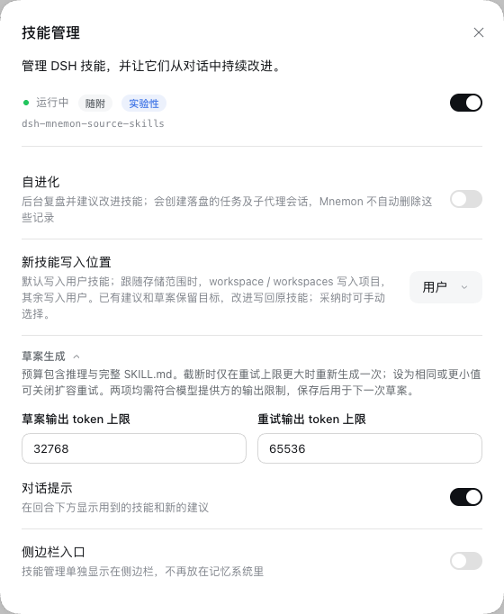
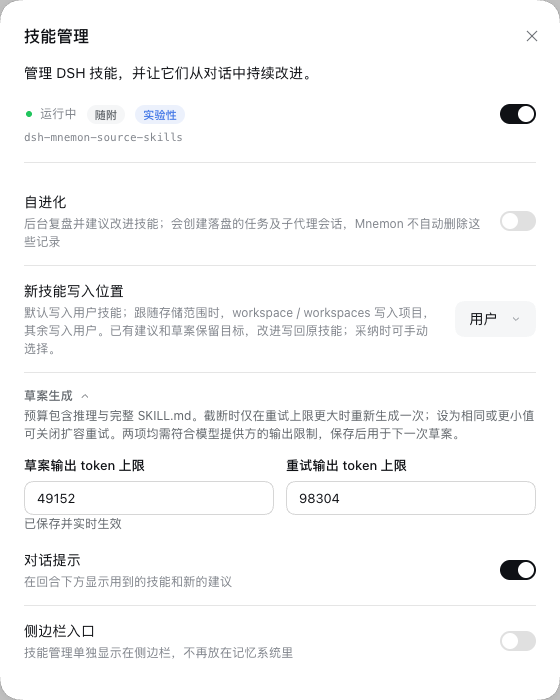

# Skill draft output budgets

[简体中文](./README.zh-CN.md)

The real DSH 0.2.2-rc.1 WebUI runs the code from `3475288406b68e005f6e69afc67922542cf8bc12` on Node 24.22.2. The disposable `scripts/serve-e2e.mjs --without-mnemon-cli` fixture isolates its profile, workspace, memory, and skill roots and uses only a loopback model stub. No real gateway or paid model call was used.

1. Open **Plugins → dsh-mnemon → Skills → Draft generation** with self-evolution off: the budgets are 32,768 and 65,536.
2. Set them to 49,152 and 98,304 and select **Apply**: the real settings page reports that they are saved and live.
3. Reload the page and reopen the settings: both saved values remain. [Validation](./validation.json) records the readback and screenshot hashes.

The screenshots capture only the settings dialog and contain no credentials, private data, or local paths. The fixture and its test browsers were stopped after capture. These images verify settings behavior, not live-model generation quality; truncation recovery, cancellation, content guards and unchanged ledger behavior are covered by `tests/skill-evolution.spec.ts` and `tests/subagent.spec.ts`.

Full verification on the production revision passed: 2,512 root tests with 7 skips, 753 workspace tests with 3 skips, and documentation, types, deterministic builds, Headless and package checks. The official DSH 0.2.2-rc.1 root run also passed 2,512 tests with 7 skips. Two review followup regressions change only tests; the resulting skill-evolution suite passes all 53 tests.
