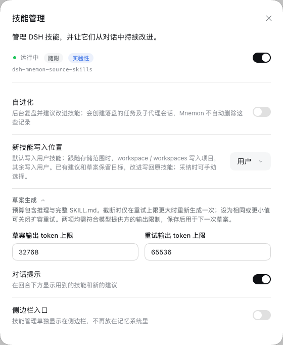
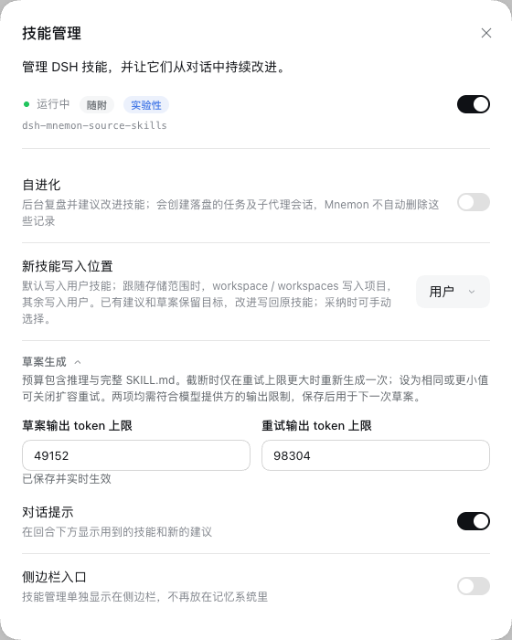

# 技能草案输出预算

[English](./README.md)

真实 DSH 0.2.2-rc.1 WebUI 在 Node 24.22.2 上运行 `3475288406b68e005f6e69afc67922542cf8bc12` 的代码。一次性 `scripts/serve-e2e.mjs --without-mnemon-cli` 夹具隔离 profile、工作区、记忆和技能根目录，只配置回环模型桩，未调用真实网关或付费模型。

1. 关闭自进化时打开**插件 → 可组合记忆 → 技能管理 → 草案生成**，默认预算为 32,768 和 65,536。
2. 改为 49,152 和 98,304 后点击**应用**，真实设置页面显示“已保存并实时生效”。
3. 刷新页面并重新打开设置，两项保存值保持一致。[验证记录](./validation.json)保存了回读结果和截图摘要。

截图只包含设置对话框，没有凭据、私有数据或本地路径。截图完成后已停止夹具及测试浏览器。图片验证设置行为，不代表真实模型生成质量；截断恢复、取消、内容校验和 ledger 保持不变由 `tests/skill-evolution.spec.ts` 与 `tests/subagent.spec.ts` 覆盖。

生产代码提交的完整验证通过：根测试 2,512 项通过、7 项跳过，工作区测试 753 项通过、3 项跳过，文档、类型、确定性构建、Headless 和包检查均通过。官方 DSH 0.2.2-rc.1 根测试同样 2,512 项通过、7 项跳过。审查补充的两项回归只修改测试，补充后技能进化测试共 53 项全部通过。
