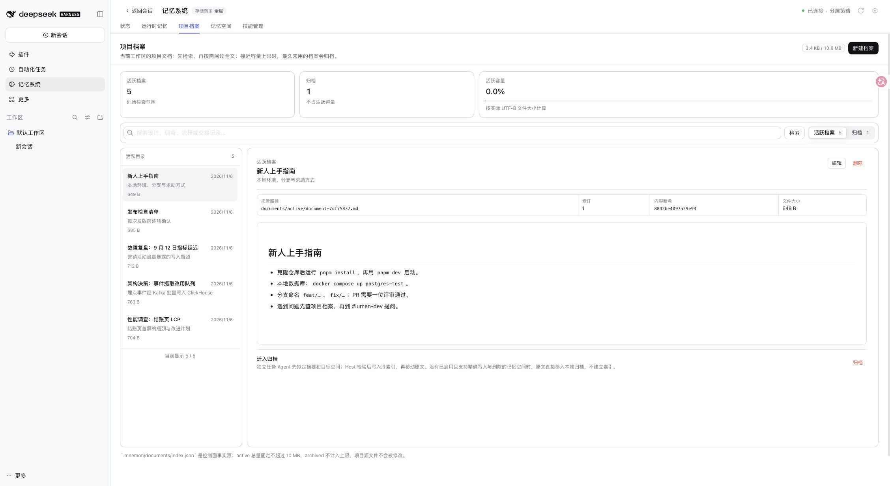
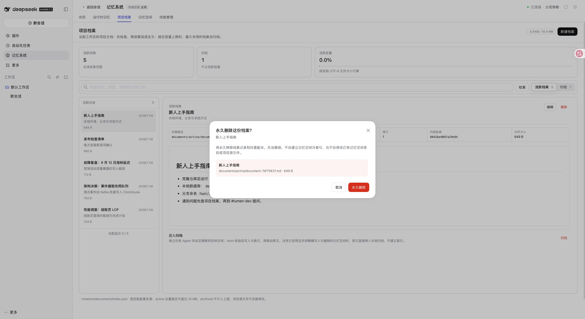
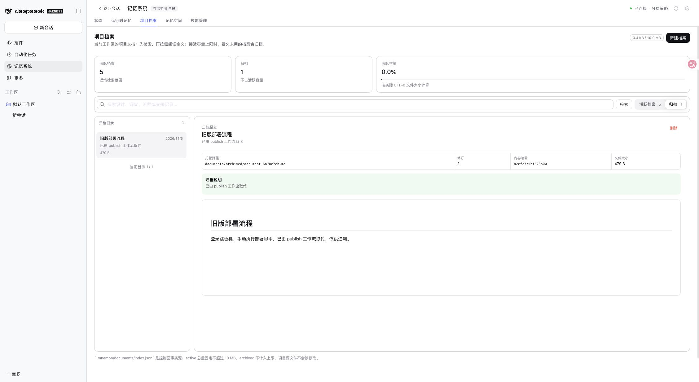
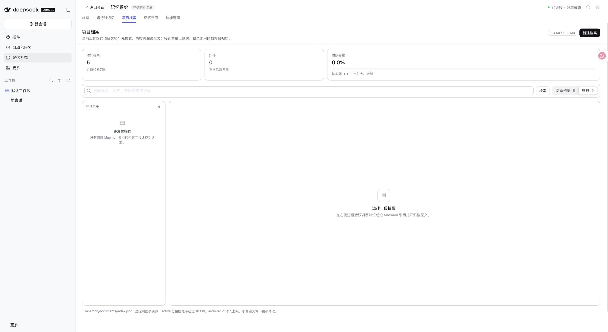

# Confirmed managed Document deletion (#578)

[简体中文](./README.zh-CN.md)

Implementation based on main `0db25213d128dfeb420163de20fd41a787366c87`, tested on 2026-11-06 with Node 24.22.2 and the pinned published DSH 0.2.1-rc.5 profile. The isolated docs-demo used synthetic data and a loopback model fixture; no user profile or paid model service was used.

## Visible behavior

Browser checks opened the active-document confirmation and cancelled it, then inspected the archived document. Deletion was executed through the built Source management API against the same disposable store; the browser was refreshed to inspect the resulting empty archive. This is not a claim that the final irreversible browser button was clicked. Source-backed React interaction tests cover clicking confirmation, cancellation, success, read-only state, stale confirmation and a second client's deletion.

## Verification

- `pnpm run verify`: full workspace typechecks/builds/tests, deterministic root build, real isolated Headless activation/restart and package/import checks.
- Documents: 65 tests passed, including active/archived deletion, explicit confirmation, index and exact-file revisions, stale queued requests, pinned ReadGrant rejection, unchanged project originals, index-write rollback, unsafe/shared paths, file symlinks, direct file edits and detail refresh.
- Root: 2,550 tests passed; 8 existing environment-dependent tests skipped. The file-symlink regression is skipped on Windows, where creating it can require privileges; this run was on macOS.
- Initial deletion regressions failed before implementation. Separate review regressions reproduced and then fixed old detail/new index pairing, direct-file edits and two index fields pointing at another document.
- [Structured fixture result](./validation.json): archived count 1 -> 0, total 6 -> 5, managed file absent, read rejected, all five other active files byte-identical.

The version-1 index format is unchanged. `fileRevision` is a read/receipt field, not stored metadata. Old page clients may omit the optional deletion callback; an absent file revision never authorizes deletion. Existing Memory Space entries and original project files are not removed. Backup/sync history retention is unchanged. Rollback handles an index commit failure; this is not a crash-atomic transaction across two files, nor protection from a second disk failure during rollback. Windows native UI and the reporter's private store were not tested.
