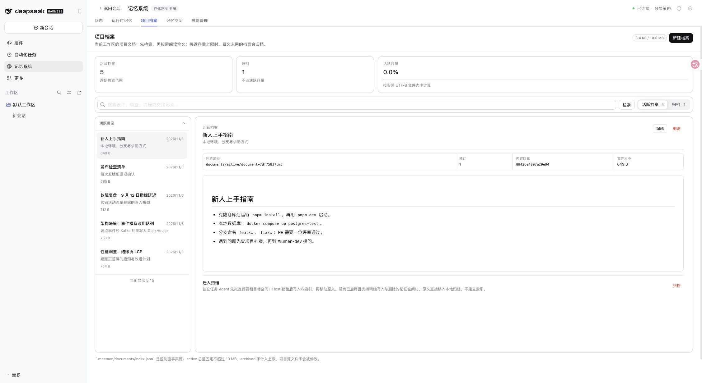
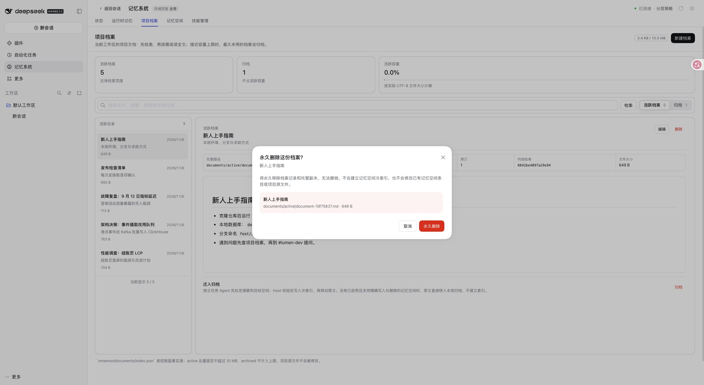
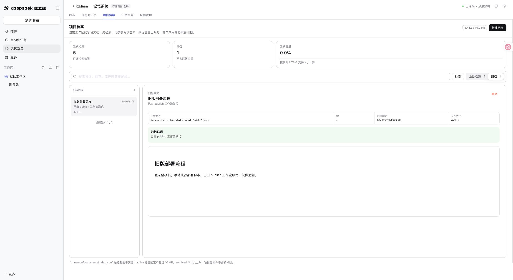
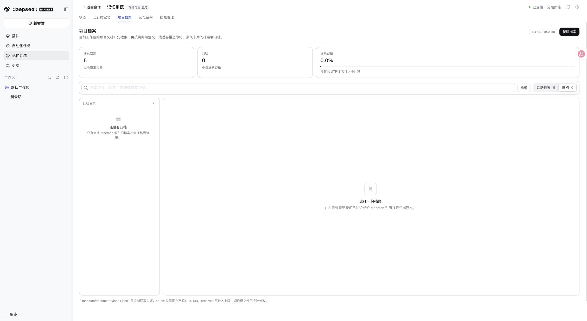

# 托管档案确认删除（#578）

[English](./README.md)

基于 main `0db25213d128dfeb420163de20fd41a787366c87`，于 2026-11-06 使用 Node 24.22.2、锁定的正式 DSH 0.2.1-rc.5 Profile 验证。独立 docs-demo 使用合成数据和回环模型夹具，没有使用用户 Profile 或付费模型服务。

## 界面

浏览器中打开了活跃档案的确认窗口并取消，然后查看归档档案。删除由构建后的 Source 管理 API 在同一临时数据根执行，再刷新浏览器观察归档列表；这里不声称点击了浏览器中的最终不可逆删除按钮。连接真实 Source 的 React 交互测试覆盖确认、取消、成功、只读、过期确认及其他客户端删除后的刷新。

## 验证

- `pnpm run verify`：完整工作区类型检查、构建和测试，根包确定性构建、真实隔离 Headless 激活与重启、制品和导入检查。
- Documents 共 65 项通过，覆盖活跃/归档删除、显式确认、索引和实际文件修订、队列内过期请求、固定 ReadGrant 越界拒绝、项目原文件保留、索引写入失败回滚、不安全/共用路径、文件符号链接、直接编辑文件和详情刷新。
- 根测试 2,550 项通过，8 项既有环境条件测试跳过。Windows 创建文件符号链接可能需要权限，因此该回归在 Windows 跳过；此次为 macOS 验证。
- 初始删除回归在实现前失败；独立复核另复现并修复了旧详情配新索引、确认后直接修改文件、两个索引字段同时错指另一文件三个边界。
- [结构化夹具结果](./validation.json)：归档 1 -> 0，总数 6 -> 5；托管文件不存在、再次读取拒绝，其余五份活跃文件逐字节不变。

索引仍为版本 1。`fileRevision` 只在读取和回执中返回，不写入持久元数据。旧自定义页面可不实现可选删除回调；缺少文件修订不会授权删除。已有记忆空间条目和项目源文件保留，备份与同步历史保留规则不变。索引提交失败会回滚，但不保证跨两个文件的崩溃原子性，也不保证回滚期间再次发生磁盘故障的恢复。未验证 Windows 原生界面或报告者的私有数据。
