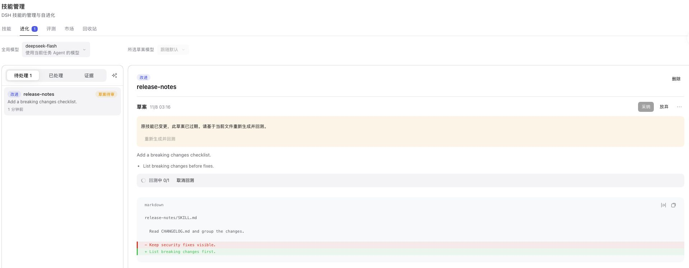
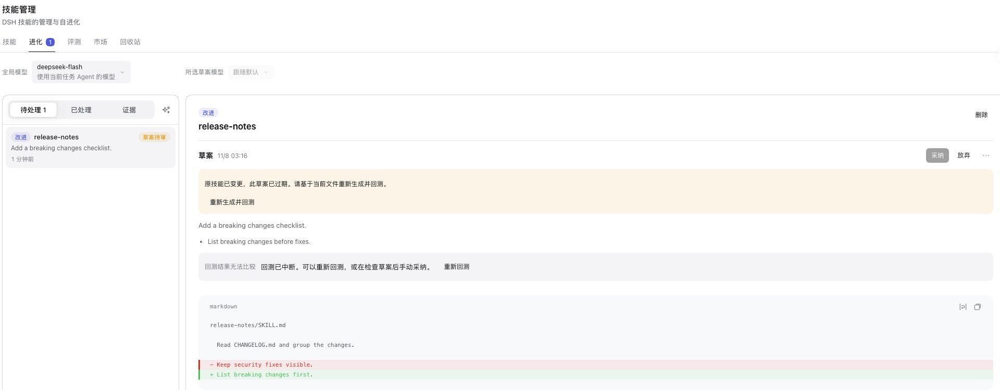

# Skill draft and backtest recovery / 草案与回测恢复

Official DSH 0.2.2-rc.1, Node 24.22.2, macOS arm64; isolated Web profile loading the PR build. Only a synthetic release-notes skill, draft and backtest were created. No model account or paid inference was used.

官方 DSH 0.2.2-rc.1、Node 24.22.2、macOS arm64，隔离 Web profile 加载 PR 构建。仅使用合成技能、草案和回测记录，没有使用模型账号或付费推理。

1. Edit the original skill after recording a draft and start a synthetic run. The stale-file warning is visible and adoption is disabled. / 记录草案后修改原技能，并构造运行中记录：显示过期提示，禁止采纳。
2. Click Cancel backtests. The persisted run is interrupted, the original file remains intact, and Regenerate and backtest becomes available. / 点击取消回测：磁盘状态变为中断，原文件保留，重新生成并回测恢复可用。
3. Automated Host/Source tests verify regeneration against the latest hash, mid-generation changes, deadlines, cancellation, queue slots, restart recovery and late settlement. Actual model-generated quality is outside this synthetic acceptance. / 自动化测试覆盖最新哈希重生成、生成期间文件变更、截止时间、取消、排队、重启回收和迟到结果；合成验收不评价真实模型输出质量。

## PR 576 review / PR 576 审查

The contributor's commit is preserved with its original author. Its 15-minute draft deadline is useful, but aborting a signal alone does not settle an uncooperative task. The added regression fails on that commit: the suggestion remains drafting after 16 minutes. The follow-up races cancellation, restores state and rejects late results. It extends the same recovery boundary to backtests, which PR 576 does not cover. The original cooperative-cancellation regression is retained.

保留贡献者原作者的提交。原补丁的 15 分钟截止时间方向正确，但仅发送取消信号不能结束不响应信号的任务。新增回归在原提交上失败：16 分钟后建议仍处于 drafting。后续修改让取消可以结束等待，恢复状态并拒绝迟到结果；同时补齐原 PR 未覆盖的回测恢复。原有配合取消的测试保留。
