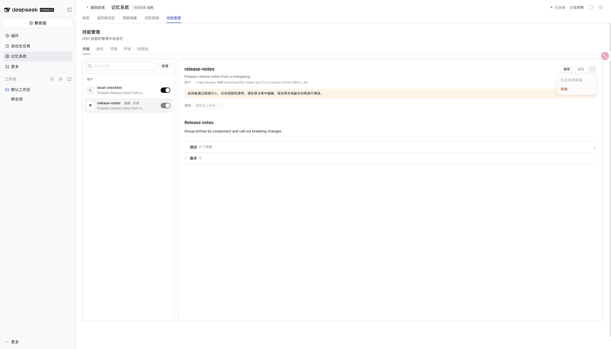
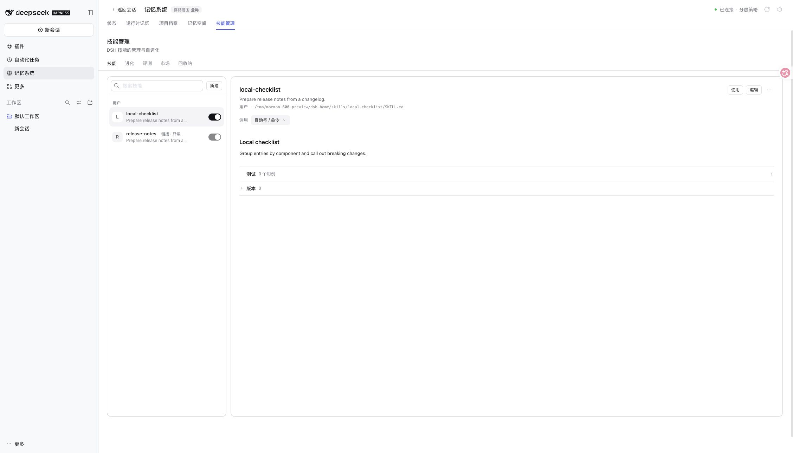

# Issue #600: linked skills stay read-only

[中文](./README.zh-CN.md)

2026-11-10, based on main `e9da7d1d717737defc088ac9afd32c4ca99ff9ef`. Published DSH 0.2.2-rc.1, Node 24.22.2, macOS arm64; synthetic skills in an isolated Web profile. The fixture installed packed candidates, then refreshed the owned Skills artifact after the final UI iteration. No personal profiles, credentials or model calls were used.

| Check | Result |
| --- | --- |
| `pnpm run verify` | Pass: 2672 root tests, 8 conditional skips; workspace tests, typechecks, builds and package contracts pass |
| `pnpm --filter dsh-mnemon-source-skills verify` after the final UI changes | Pass: 146 tests, typecheck and build |
| New linked-skill cases with original production files restored | 6 failures; existing linked case passes |
| Focused linked-skill suite with fix | 7 pass; 137 outside selection |
| Real Web profile | Local skill remains editable; linked skill is readable and usable, with edit/invocation changes/improvement disabled; Use inserts `/release-notes` into the composer without sending |

The focused command is `pnpm exec vitest run tests/skill-evolution.spec.ts plugins/dsh-mnemon-source-skills/tests/service.spec.ts -t linked`; both Windows CI jobs also run it. Directory cases use junctions on Windows. File links, a linked skill root, and a draft whose target becomes a link without changing content are included.

The Source rechecks the filesystem under its write lock before recording or adopting updates. Discovery follows links for reading; write decisions use `lstat`, without OS-alias or case-sensitive realpath comparisons. Ordinary local skills and existing draft/evaluation data are retained. Read-only markers are optional DTO fields, not a persistent format migration. This protects against normal link changes between operations; it is not a sandbox against an unrelated process concurrently replacing filesystem entries during a synchronous write.

Linked skill: the explanation and disabled improvement action are visible, while Use remains available.

Ordinary local skill: editing and invocation controls remain available.

