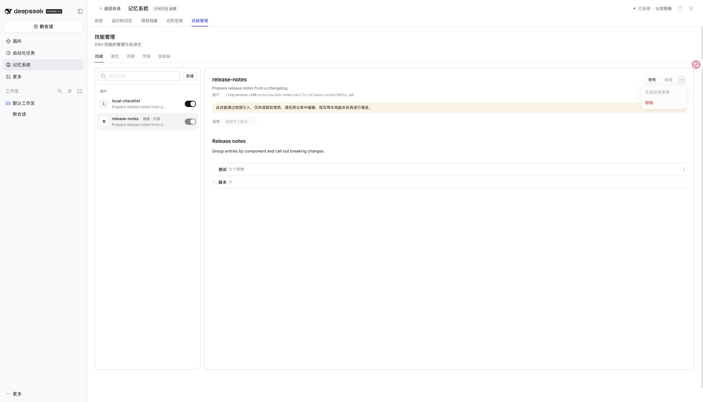
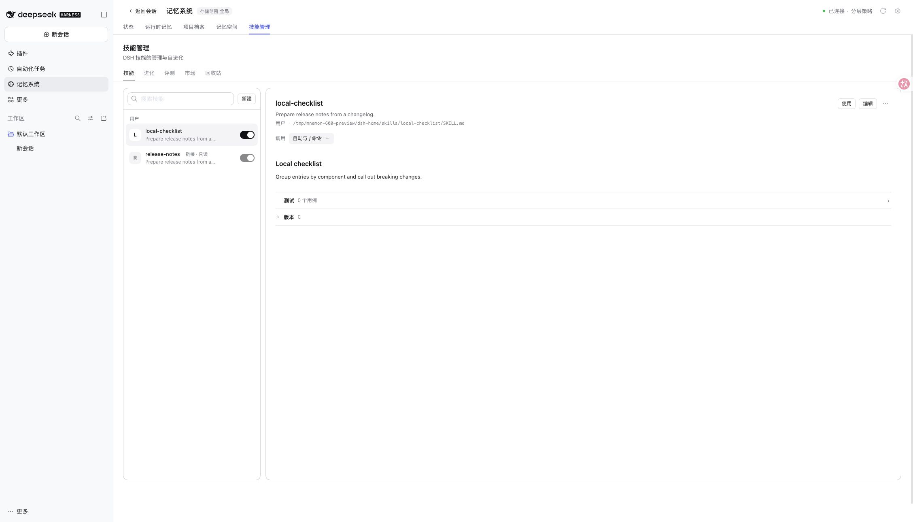

# Issue #600：链接技能保持只读

[English](./README.md)

2026-11-10，基于 main `e9da7d1d717737defc088ac9afd32c4ca99ff9ef`。在 macOS arm64、Node 24.22.2、已发布 DSH 0.2.2-rc.1 的隔离 Web 配置中验证合成技能。先安装打包候选，最终页面调整后更新隔离环境中的 Skills 构建。未使用个人配置、凭据或联网模型。

| 检查 | 结果 |
| --- | --- |
| `pnpm run verify` | 通过：根测试 2672 项通过、8 项条件跳过；工作区测试、类型检查、构建及包契约通过 |
| 最终页面调整后的 `pnpm --filter dsh-mnemon-source-skills verify` | 146 项测试、类型检查和构建通过 |
| 恢复原生产代码后运行链接技能回归 | 新增 6 项失败，原有链接场景通过 |
| 修复后的链接技能定向测试 | 7 项通过，137 项不在筛选范围 |
| 真实 Web 页面 | 本地技能仍可编辑；链接技能可读可用，编辑、调用设置、生成改进草稿被禁用；使用按钮将 `/release-notes` 放入输入框，未发送 |

定向命令和 Windows CI 覆盖见[英文记录](./README.md)。Windows 目录场景使用 junction；另外覆盖文件链接、整个技能根目录链接，以及内容未变化但目标在生成草稿后变成链接的情况。

Source 在写锁内记录和采纳更新前重新检查文件系统。发现阶段继续跟随链接读取，写入判断使用 `lstat`，不比较 realpath 大小写或系统路径别名。普通本地技能及已有草稿、评测数据保留；只读标记是可选 DTO 字段，不迁移持久化格式。这处理操作之间的正常链接切换，不承诺隔离其他进程在同步写入期间并发替换文件的攻击。

链接技能：可见只读说明与禁用的改进操作，使用按钮可用。

普通本地技能：编辑及调用控制保持可用。

