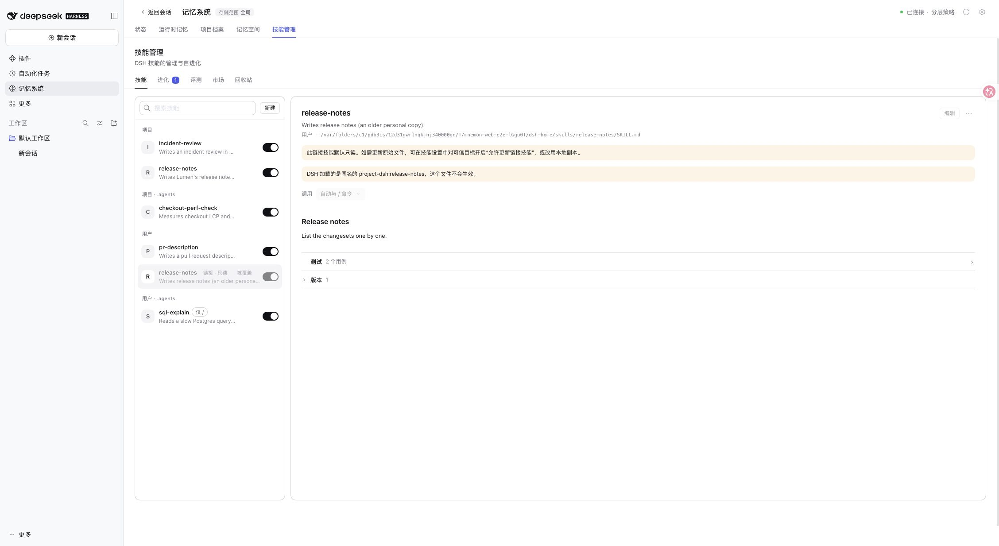
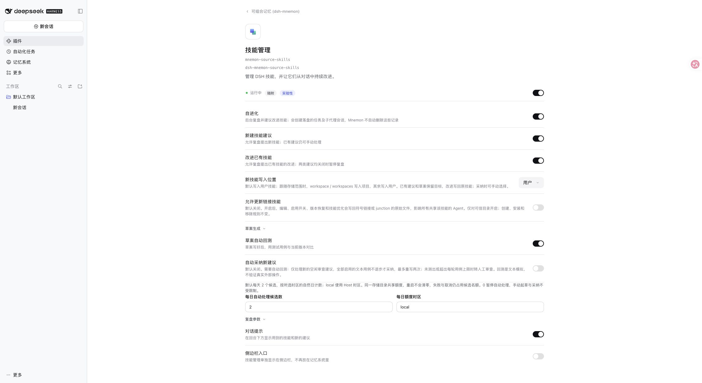
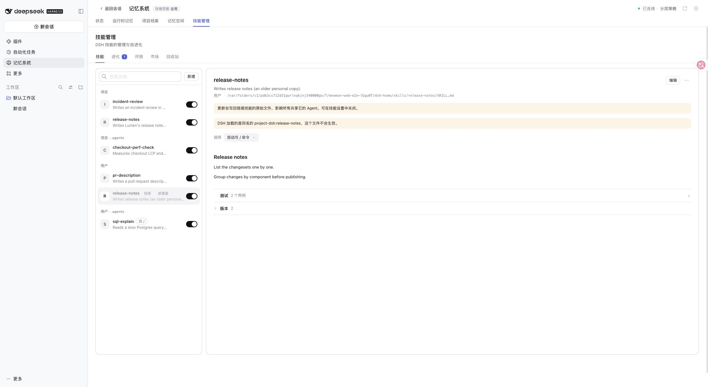
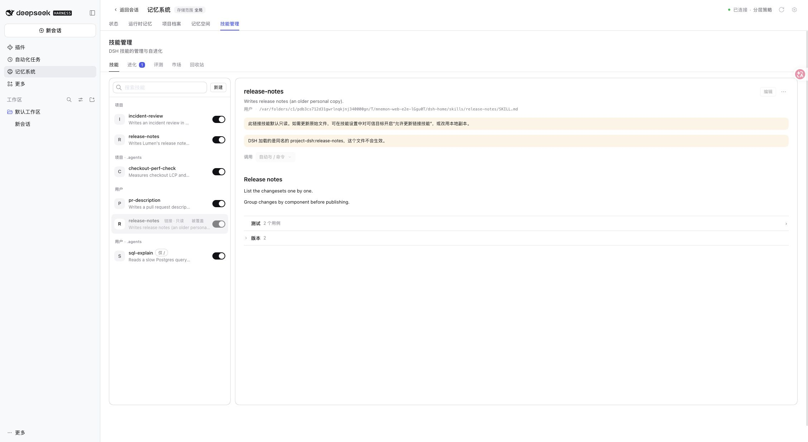

# Linked skill updates / 链接技能更新

Issue: [#611](https://github.com/omdsh-dev/dsh-mnemon/issues/611).

## Environment / 环境

- Base: `455dd1c017d82c4f75af1b9510d383c059b0690e`, dsh-mnemon 0.5.44.
- Published DSH `0.2.2-rc.2`, source identifier `ddac96760b6edf8fa0fe17cbdcf0b512f4c12b2c`, Node 24.22.2, macOS, real WebUI.
- Disposable `serve-e2e.mjs --docs-demo=en` profile, fictional Lumen skills and memory. A user skill bundle was moved to a shared fixture directory and linked back. No live model or private data was used.
- 独立临时 profile，使用虚构项目数据。将用户技能移到临时共享目录，再建立目录链接；未使用真实模型 API 或私人数据。

## Observations / 实测

1. With the new setting absent, the skill is readable but editing and invocation controls are disabled. / 未配置时仍可读取，编辑与调用开关禁用。
2. **Plugins → dsh-mnemon → Skills → Allow linked skill updates** defaults off. Enabling it immediately makes the linked document editable. / **插件 → 可组合记忆 → 技能管理 → 允许更新链接技能**默认关闭；开启后立即可编辑。
3. Editing adds `Group changes by component before publishing.` to the original target. Filesystem readback confirms the bundle remains a symbolic link and resolves to the same target; version count increases from one to two. The shadowed user copy remains shadowed, preserving normal DSH precedence. / 编辑实际更新原文件，链接和目标不变，版本数从 1 增至 2；被项目同名技能覆盖的关系不变。
4. Restarting the Host preserves the setting and saved content. Turning the switch off restores read-only controls while keeping the saved content. / Host 重启后配置与内容均保留；关闭开关后恢复只读，已保存内容保留。

## Automated checks / 自动验证

- `pnpm run verify`: passed. Root: 2,707 passed, 8 conditional skips. Skills Source: 157 passed. Includes type checks, bilingual docs, deterministic builds, all plugin suites, real Headless and package validation.
- Installed DSH rc.2 focused Host/config/settings/runtime suite: 147 passed.
- Link regression cases cover bundle links, individual SKILL.md links, flat markdown links and linked roots. They exercise default rejection, enabled save/invocation/version restore/draft adoption, stale-hash rejection, disabled adoption and preserving links. Existing Windows CI runs the linked tests with directory junctions.
- 链接回归覆盖目录、单文件、平铺 Markdown 和根目录链接；验证默认拒绝、开启后的编辑/调用/恢复/草案采纳、旧哈希拒绝、关闭后拒绝采纳，以及链接保留。Windows junction 交由现有 Windows CI 验证；本地未宣称 Windows 桌面实测。

## Boundaries / 边界

The setting permits updates to existing linked originals only. Creation and installation through linked roots, removal/trash semantics, review admission, explicit draft adoption and automatic-adoption gates keep their existing rules. Source management revision checks and file content hash fences remain in force. Shared target edits affect every Agent using that target; enable only for trusted directories. Independent Skills Source compositions can set `allowLinkedUpdates` in their own configuration.

该设置只允许更新已有链接的原文件。链接根目录的新建/安装、移除/回收站、复盘准入、手动采纳与自动采纳门槛沿用原规则。管理修订号和文件内容哈希检查保持有效。共享原文件的修改会影响所有使用它的 Agent，只应对可信目录开启；独立组合可以配置 Skills Source 的 `allowLinkedUpdates`。
