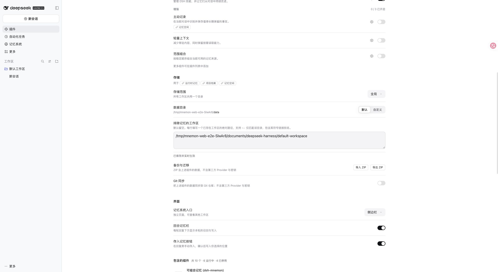
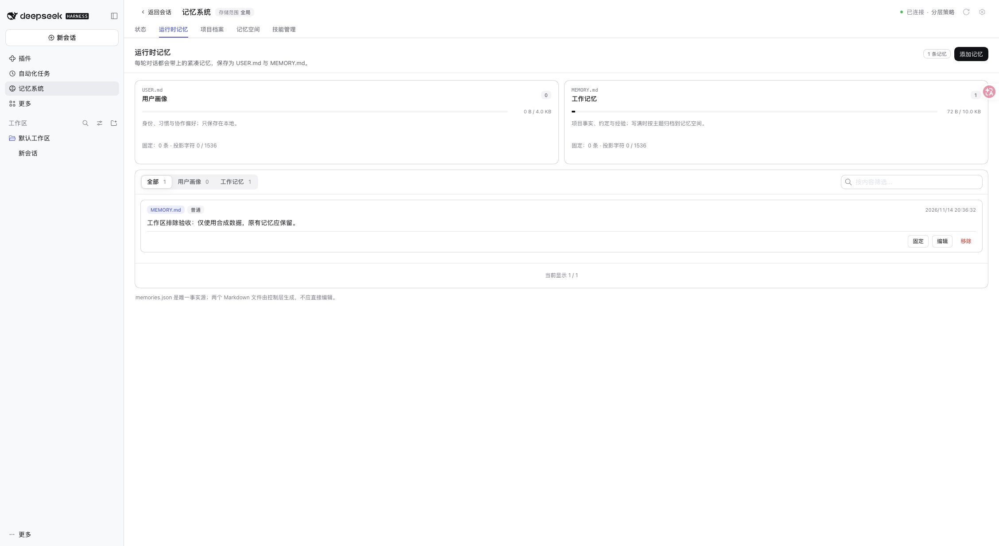
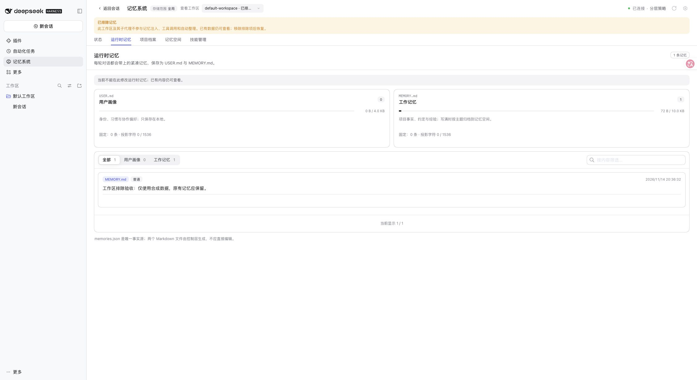

# Workspace memory exclusion validation

Issue: [#613](https://github.com/omdsh-dev/dsh-mnemon/issues/613).

## Environment

- Feature branch: `codex/feat-613-workspace-exclusion`, based on `main` at `1dec529da00a9527351efd329a4beac400cd399a`.
- Node 24.22.2; published DSH packages only. Baseline: 0.2.1-rc.5; additional real-Host tests: 0.2.2-rc.1 and 0.2.2-rc.3.
- Real WebUI on DSH 0.2.2-rc.3, running this branch's built packages with a disposable profile and synthetic memory. No external model requests or personal memory were used.

## Verified behavior

| Scenario | Result |
| --- | --- |
| Default empty list | Existing behavior retained; no path lookup is needed to decide participation. |
| Path selection | Exact canonical directory matching, symlink aliases and `~` supported; nested directories do not match implicitly. Invalid or unavailable paths produce diagnostics rather than disabling unrelated workspaces. |
| Parent and child | A child with a different cwd inherits its parent's workspace. Cached workspace identity or the public workspace/session catalog covers unloaded parents. |
| Excluded conversation | Native and PTC turns complete with an ordinary Host tool. Requests contain no Mnemon tools, system guidance, memory View, or retained memory fact. Automatic review is not invoked. |
| Mutation boundaries | Direct memory-tool execution and write RPC are refused; the attempted fact is not saved. |
| Fresh excluded project | Starting a session creates no project memory directory, even with persistent review watermarks enabled. |
| Live restoration | Removing the exclusion restores memory injection and writing in the same live parent. Both existing and newly written facts remain present. |
| Storage layouts | Real-Host scenarios cover custom/shared storage, workspace-local storage and centrally managed workspaces, in both native and PTC modes. |
| WebUI | Saving, removing, and reapplying the exclusion take effect without restarting DSH. Excluded workspaces stay connected, show the exclusion label, retain readable data and hide memory write controls. |

The regression first exposed unwanted directory creation from review-watermark initialization and surviving global routing guidance. Both paths are now gated and covered by the real-Host suite.

## Commands and results

```bash
VITEST_MAX_FORKS=2 VITEST_MIN_FORKS=2 VITEST_MAX_THREADS=2 VITEST_MIN_THREADS=2 pnpm run verify
pnpm run typecheck
pnpm run verify:build
pnpm run test:root --maxWorkers=2 --minWorkers=2
pnpm run verify:headless
pnpm run verify:package
DSH_HOST_ROOT=<official-rc1-or-rc3> pnpm run test:installed-dsh tests/workspace-exclusion-host.spec.ts tests/workspace-exclusion.spec.ts tests/guidance.spec.ts tests/turn-view-host.spec.ts tests/idle-review-tool-access-host.spec.ts --maxWorkers=2 --minWorkers=2
```

- Complete root suite: **2,752 passed, 9 conditional skips**. Docs, types, deterministic build, workspace plugin builds/types/tests, Headless activation and package checks passed. Final routing-guidance changes were followed by another type/build/root/Headless/package check.
- Published rc.1 and rc.3: **82 passed each**.
- Targeted routing-guidance and workspace Host check: **10 passed**.
- Test concurrency was bounded to two workers to avoid an existing unrelated parallel backtest deadline flake; its deadline was not changed.

## UI evidence

Configure exact workspace paths in Storage:



After removing the exclusion, the original synthetic memory remains and write controls return:



After reapplying it, the same memory remains readable, the workspace is marked excluded, and write controls are absent:



Exclusion controls subsequent Mnemon participation. It does not erase already delivered conversation history, delete stored memory, or roll back an operation already dispatched to a Provider. It is not a Host or filesystem sandbox.
