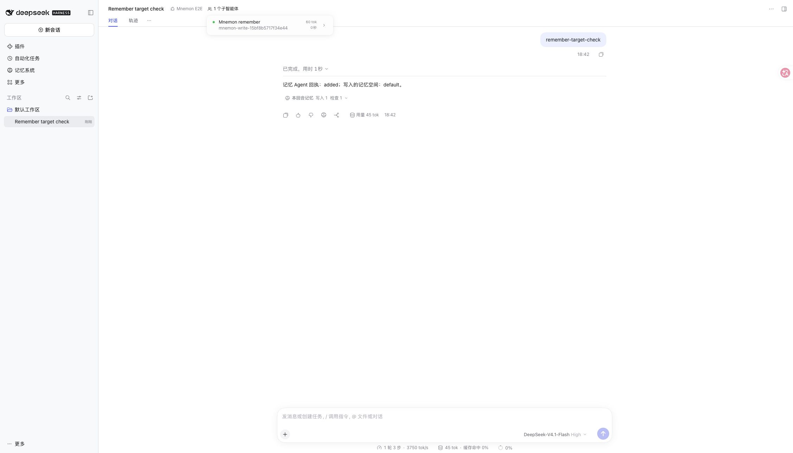

# Memory worker names

[简体中文](./README.zh-CN.md)

Base: `455dd1c017d82c4f75af1b9510d383c059b0690e` (0.5.44). Tested with Node 24.22.2 and npm DSH 0.2.2-rc.2.

`pnpm run verify` passed: root 2,707 passed, 9 conditional skips, plus independent plugins, deterministic builds, Headless and package checks. Installed RC2 `agent-ownership-host.spec.ts` and `subagent-start.spec.ts`: 32 passed. The new real-Host test failed on main because the catalog used `agent-1`; it now runs two concurrent evidence workers, resolves both names after completion and confirms their Agents were released. Older nested activation requests omit the name.

The real RC2 WebUI ran `serve-e2e.mjs --remember-target`. Its scripted local model used the actual tools and storage: a non-target write was refused, the target write returned `added`, and the completed child appeared as `mnemon-write-<suffix>` with its existing `Mnemon remember` label. No paid API or personal data was used. Synthetic token/timing numbers are not performance evidence.

This implements the issue's readable-name option. It does not batch writes, alter isolation, or reduce model calls. Catalogs already recorded by older versions are retained unchanged. Windows-native rendering was not separately exercised.
