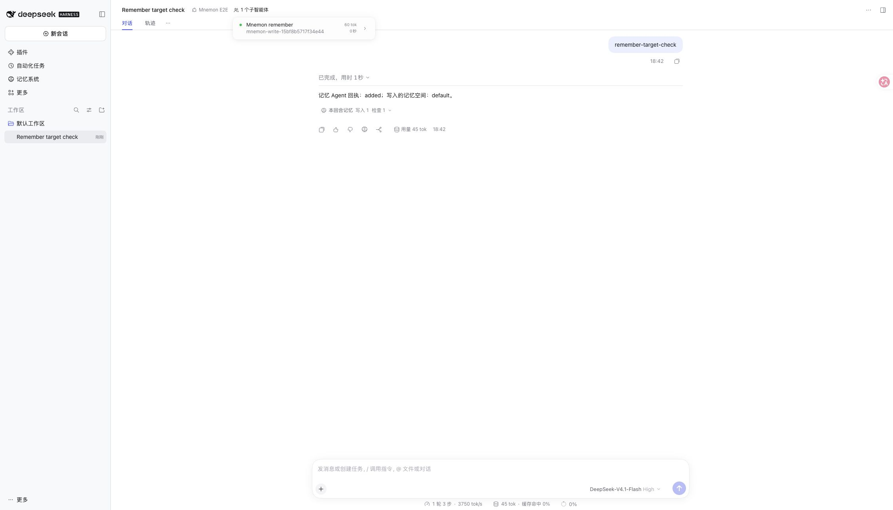

# 记忆工作 Agent 命名

[English](./README.md)

基于 `455dd1c017d82c4f75af1b9510d383c059b0690e`（0.5.44），使用 Node 24.22.2 和 npm DSH 0.2.2-rc.2。

`pnpm run verify` 通过：根测试 2,707 通过、9 项条件跳过，另有独立插件、可复现构建、Headless 和包检查。RC2 的 `agent-ownership-host.spec.ts` 与 `subagent-start.spec.ts` 共 32 项通过。新增真实 Host 测试在 main 上因目录名为 `agent-1` 失败；修复后两个并发任务完成后都可按名称找到，Agent 已释放。旧版嵌套 activation 参数不包含 name。

真实 RC2 WebUI 使用 `serve-e2e.mjs --remember-target`，仅模型决策由本地脚本模拟，工具和存储真实运行：非目标空间写入被拒绝，目标写入返回 `added`，完成的子 Agent 显示 `mnemon-write-<后缀>` 和原有 `Mnemon remember` 标签。未调用付费 API，未使用私人数据。截图中的合成 token 数与耗时不作为性能证据。

实现 issue 中的可读命名选项，不批量化写入、不改变隔离、不减少模型调用。历史目录记录不改写。未单独验证 Windows 原生界面。
