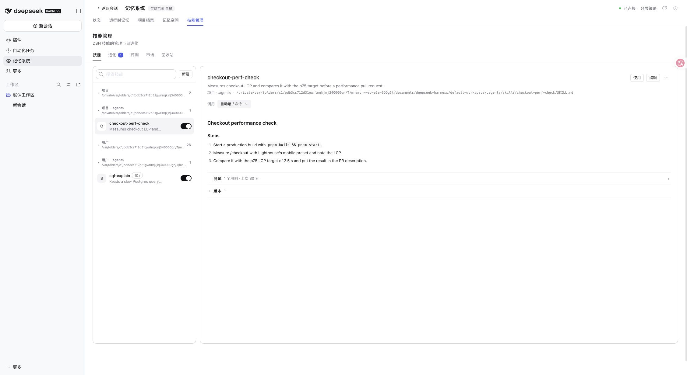
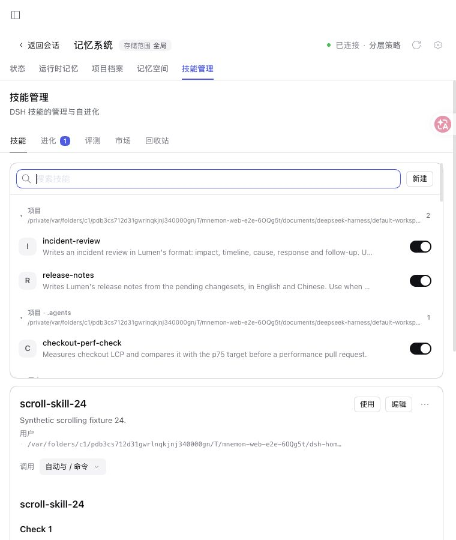

# Collapsible skill directories

[简体中文](./README.zh-CN.md)

Base: `455dd1c017d82c4f75af1b9510d383c059b0690e` (0.5.44). `pnpm run verify` passed: root 2,706 passed, 8 conditional skips, independent plugins, deterministic builds, Headless and package checks. The Skills package's final tests passed (157). Automated interaction coverage checks collapse, preserved detail, search disclosure, and restoration of the collapsed state after clearing search.

Actual npm DSH 0.2.2-rc.2 WebUI, Node 24.22.2, `serve-e2e.mjs --docs-demo=en --skills-scroll`. All data is synthetic; no model call was needed. The four original roots retain their precedence and the default expanded presentation. Collapsing Project and User leaves the selected project skill readable; a search finds `scroll-skill-24` even in a collapsed source.

At a 760 x 900 viewport, the list remains independently scrollable (358 px client height, 1,994 px content height), above the full selected document. The viewport was restored afterward.

No skill files, invocation flags, Source authority or persisted configuration changed. Collapse state lasts while the page is mounted; it is not a new profile setting. Native Windows Desktop was not separately tested.
