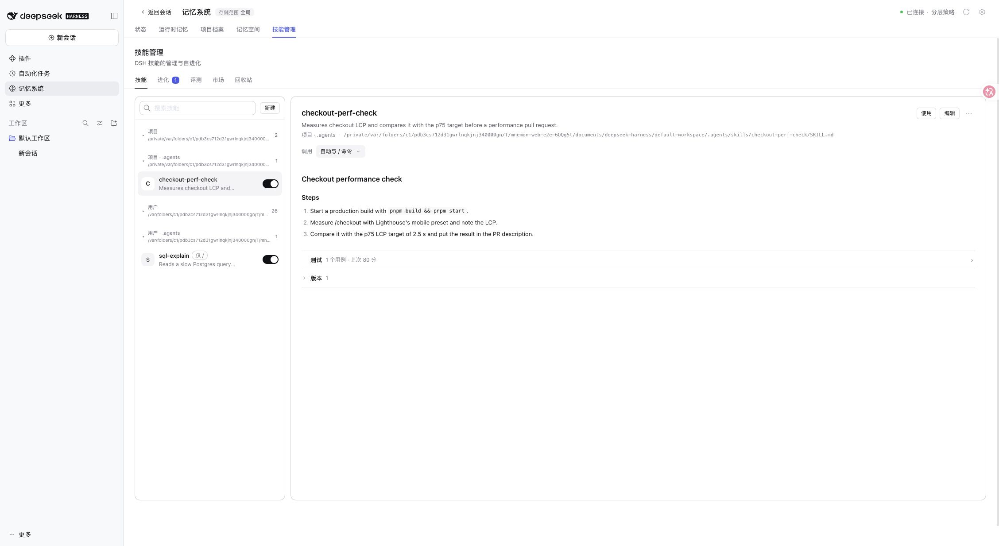
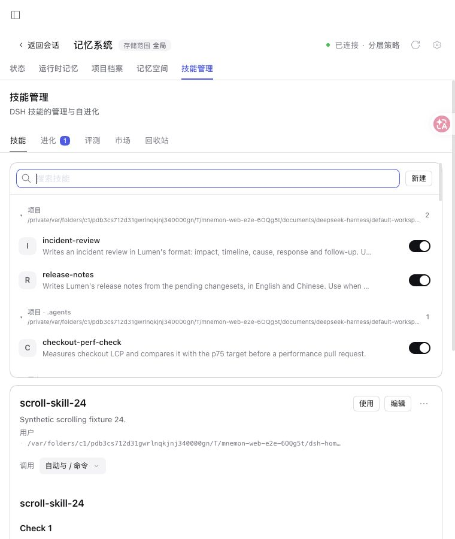

# 技能目录折叠

[English](./README.md)

基于 `455dd1c017d82c4f75af1b9510d383c059b0690e`（0.5.44）。`pnpm run verify` 通过：根测试 2,706 通过、8 项条件跳过，独立插件、可复现构建、Headless 和包检查通过。技能包最终 157 项测试通过。交互测试覆盖折叠、详情保留、搜索展开，以及清空搜索后恢复折叠状态。

真实 npm DSH 0.2.2-rc.2 WebUI、Node 24.22.2，运行 `serve-e2e.mjs --docs-demo=en --skills-scroll`。数据均为合成数据，不需要模型调用。四个原有目录保持优先级和默认展开行为。折叠项目与用户目录后，当前项目技能详情仍可阅读；搜索能找到已折叠目录中的 `scroll-skill-24`。

760 x 900 视口下，列表仍独立滚动（可视高 358 px，内容高 1,994 px），详情在下方完整显示。验证后恢复了原视口。

没有修改技能文件、调用开关、Source 权限或持久配置。折叠状态仅保留在当前页面内，没有增加 profile 设置。未单独验证原生 Windows Desktop。
