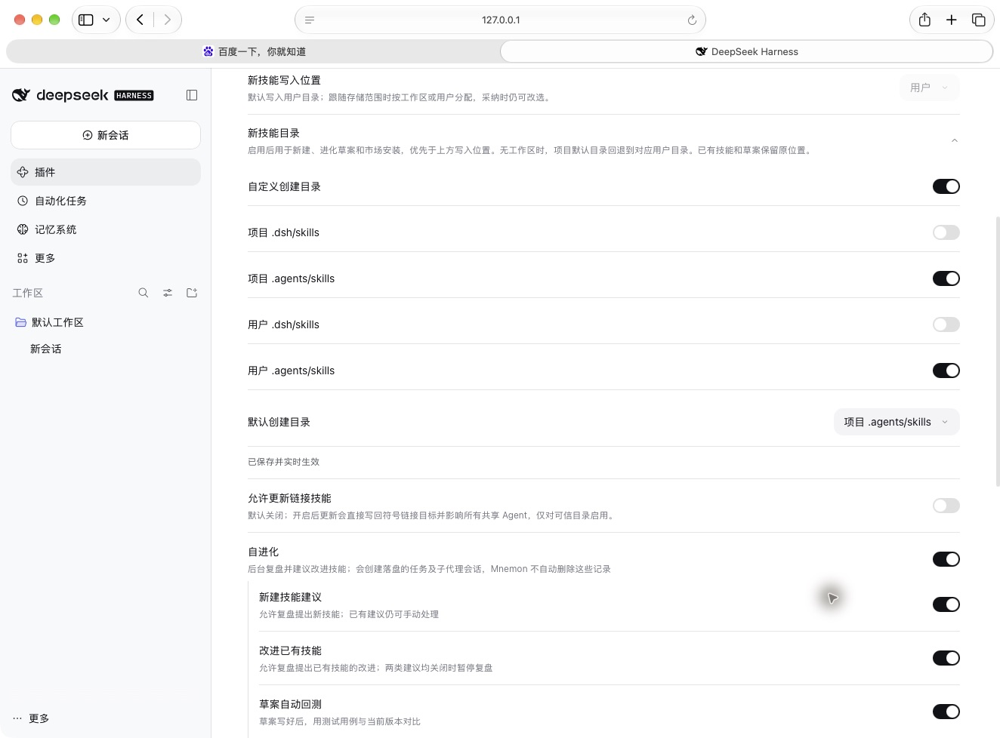
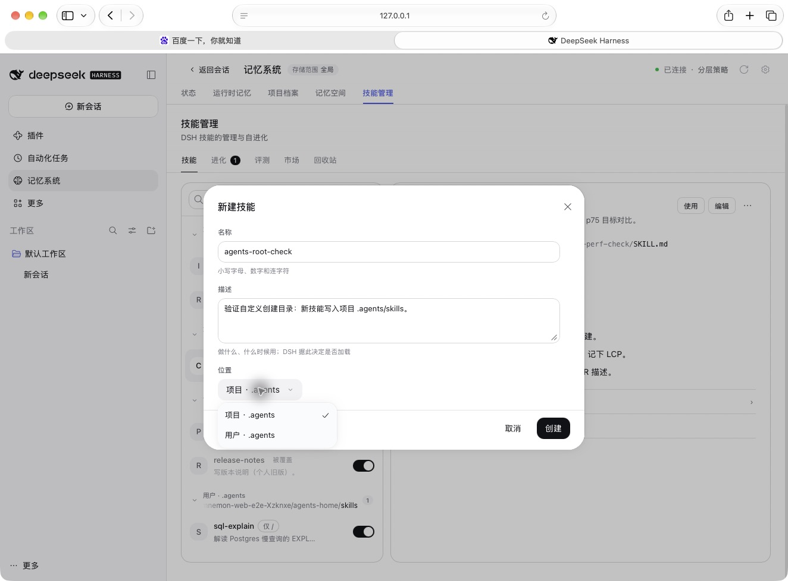
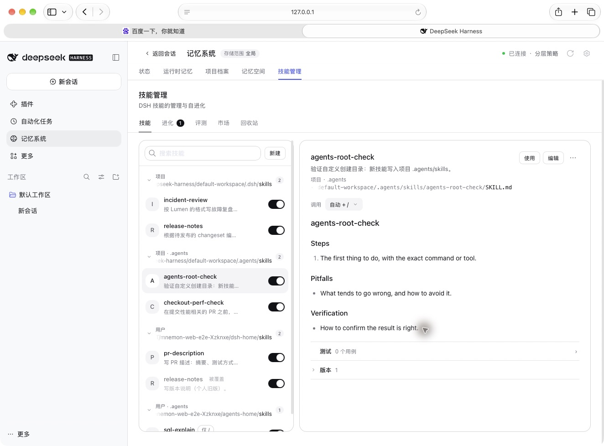

# Skill creation directory preferences (#658)

## Behavior

Optional `skills.skillRoots` / standalone Source `skillRoots` selects the offered creation roots and default. It applies to manual create, new evolution proposals/drafts, draft adoption and first market installs. Unset preserves legacy behavior, including `targetScope`. Explicit choices and recorded draft/skill targets remain authoritative; these preferences do not grant permissions or change scan precedence.

A project default falls back to the corresponding user root without a workspace. Invalid roots, duplicates, empty choices and a default outside the choices are rejected. Existing hash, origin, linked-file and workspace checks remain in place.

## Validation

- Red/green: seven added Source regressions fail before the implementation and pass after it.
- Tests cover configured/default/explicit creation, all-root discovery, no-workspace fallback (including project-only lists), recorded draft targets across configuration changes, updates in their original roots, market install/update, Host evolution with and without a workspace, staged settings validation/save/reset and real component creation/adoption/install.
- `pnpm run verify`: 3,765 tests passed, 14 existing optional tests skipped. Docs, all type checks, deterministic builds, package tests, root tests, real Headless activation and package contents/exports validation passed.
- `pnpm run e2e:serve --docs-demo`: the actual built plugin ran in an isolated published DSH 0.2.1-rc.5 WebUI with synthetic data. Safari saved `[project-agents, user-agents]` with `project-agents` as default. The page showed the persisted setting and disabled the superseded legacy destination selector. The new-skill dialog offered exactly those two choices, selected Project Agents by default, and created `agents-root-check` in the selected project's `.agents/skills`.
- The created `SKILL.md` was independently read from the disposable fixture: SHA-256 `86532ec2e745d56bd6bd5ed971629af41f47ec4184dc528557dbf1b0d8296013`.
- No paid model calls or user memory were used. The test browser tab and disposable Host were closed after capture. No personal installation was changed.

## Screenshots

Settings saved / 设置已保存:

Only configured choices, with the project default / 创建弹窗与默认位置:

Created skill under the project Agents root / 已创建的技能:

