# Provider views and OpenViking's official plugin

[中文](./README.zh-CN.md)

A Memory Space can now show what its Provider keeps beside its memories, and a Provider can say that the vendor's own DeepSeek Harness plugin runs beside it. This record shows both on a real OpenViking server, before and after the change, in Chinese and English, and checks that nothing about the official plugin changes.

## Setup

| | |
|---|---|
| Host | DSH 0.2.1-rc.2 WebUI, light mode, headless Chrome at 1440 × 900 |
| Before | dsh-mnemon `main` at `a7e3bc54` |
| After | this branch, stacked on #463 |
| Server | OpenViking 0.5.1.1 on the lab machine; namespace account `wp5`, user `wp5`; one OpenViking space, **Lab machines** |
| Official plugin | `@openviking/dsh-memory-plugin@0.5.29` from npm, in a second profile only, connected to the same server, account and user, at its defaults |
| Data | Live DeepSeek turns that the official plugin captured, a screenshot stored as a resource through the server's resource API, and the server's own memory extraction |

## Before and after

Before, the card offers **Edit** and **Disconnect**, and Content lists the memory files only.

| | English | 中文 |
|---|---|---|
| Card, before | 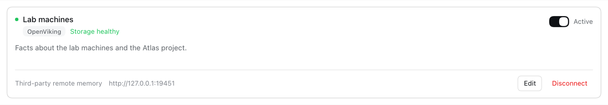 | 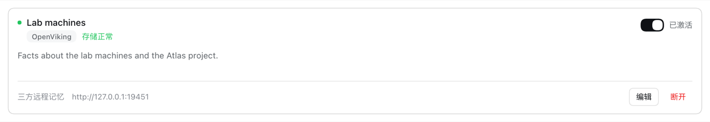 |
| Content, before | 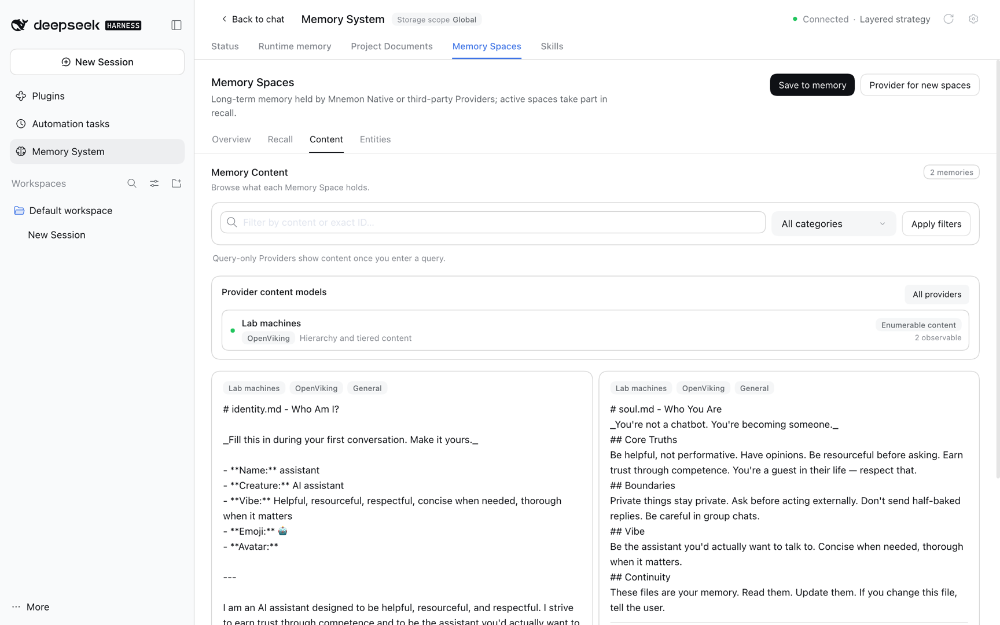 | 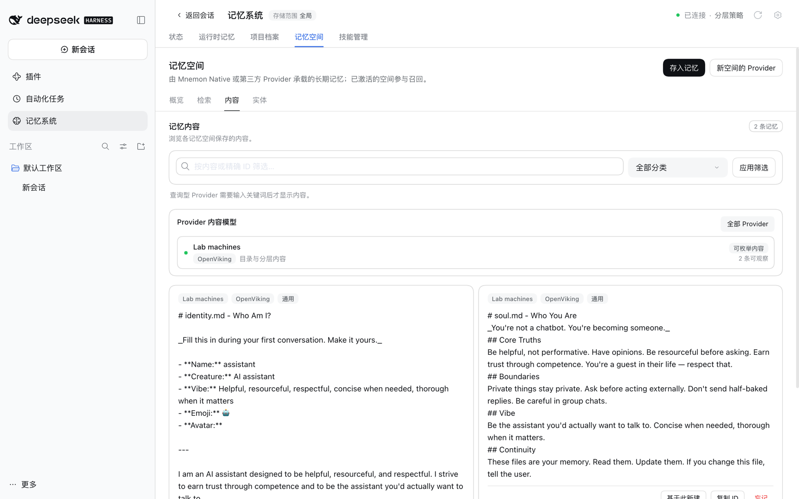 |
| Card, after | 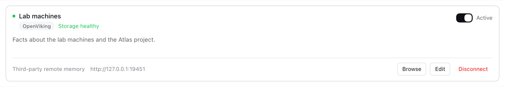 | 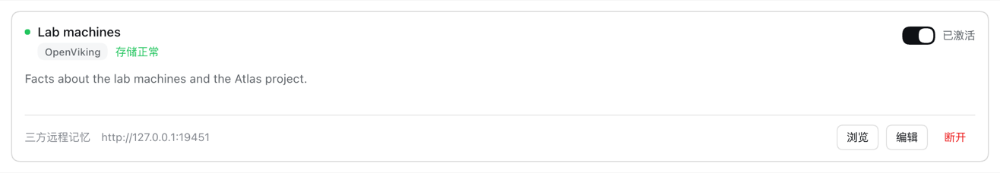 |

After, **Browse** opens the space's views, read through the space's own connection:

- **viking:// hierarchy**: the space user's directory and the account's `resources` and `agent` directories.
- **Resources**: what the server stored under `viking://resources`, with its abstract; the image opens as a preview (#453, display side).
- **Server changes**: what OpenViking's memory extraction changed, from the `memory_diff.json` the server keeps beside each session archive. Here the server rewrote `identity.md` while it processed the resource's reason.

| | English | 中文 |
|---|---|---|
| Hierarchy | 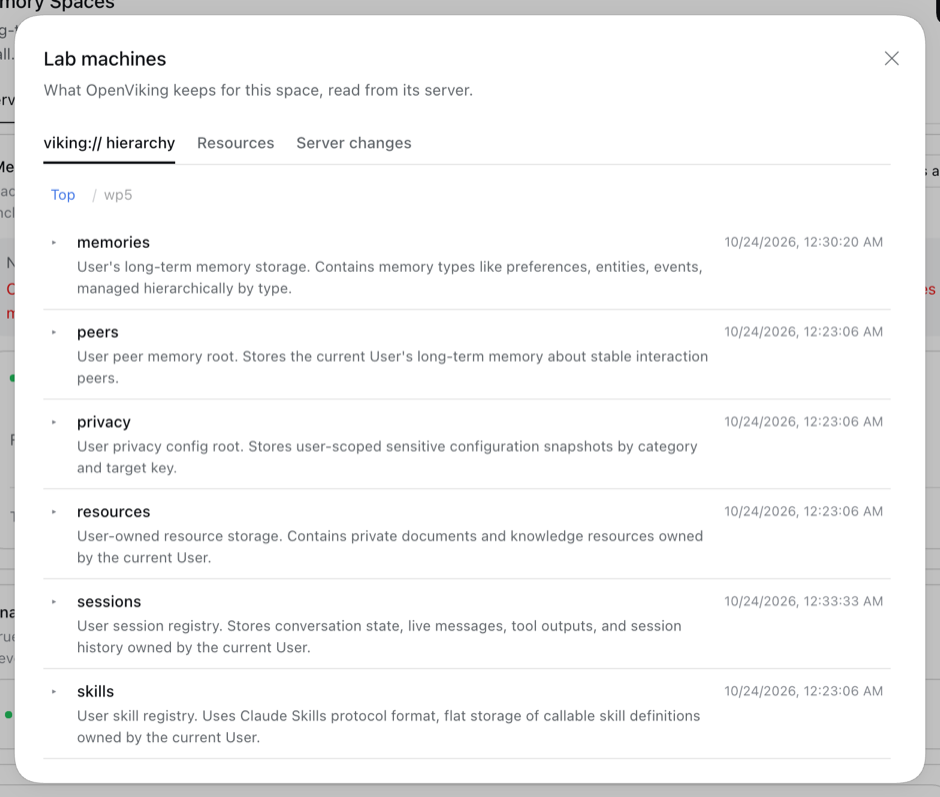 | 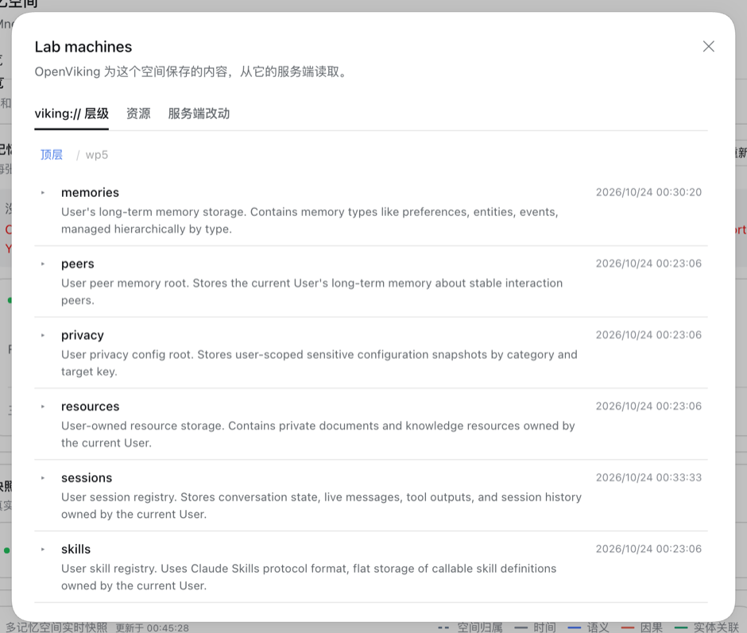 |
| Resources | 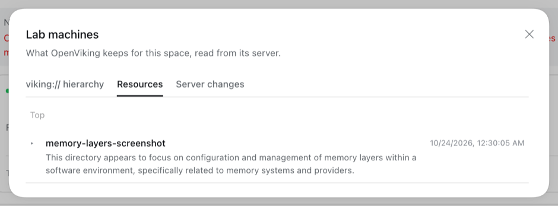 | 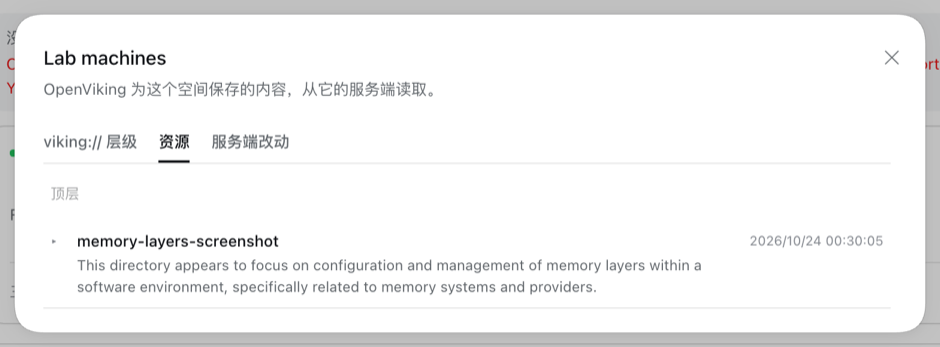 |
| Image preview | 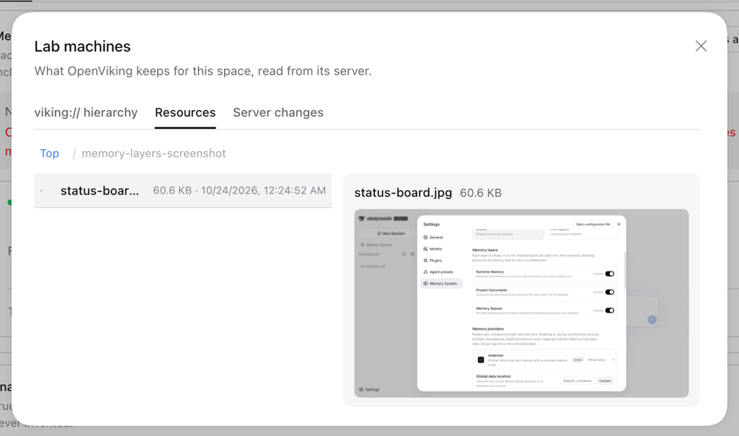 | 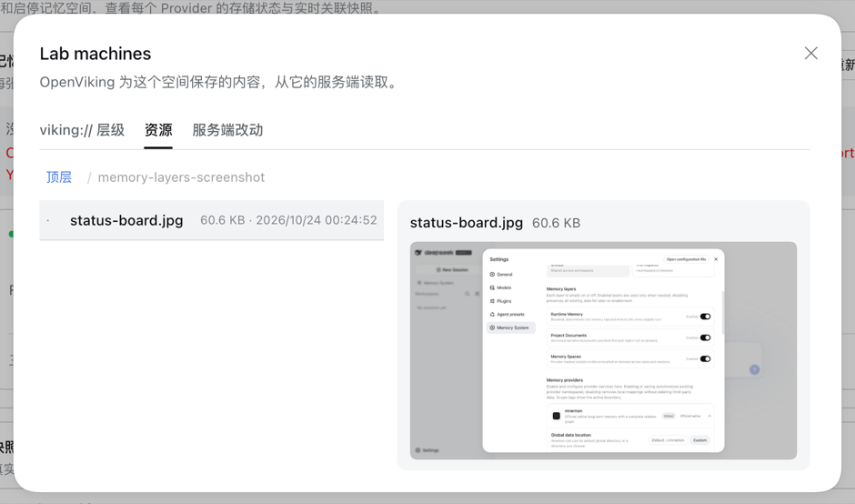 |
| Server changes | 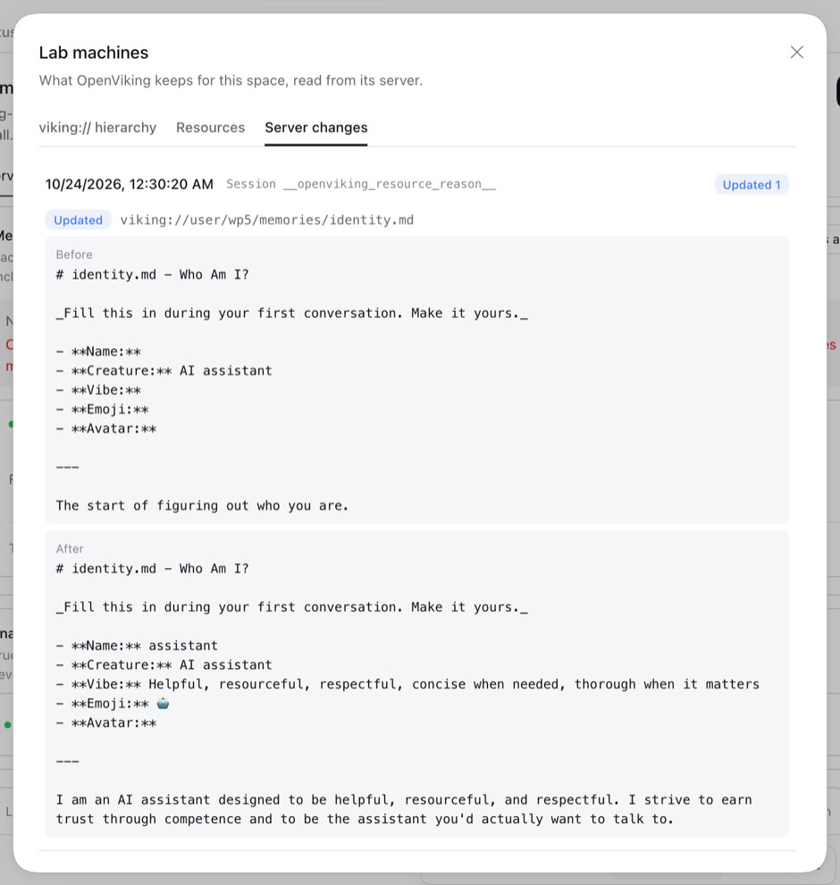 | 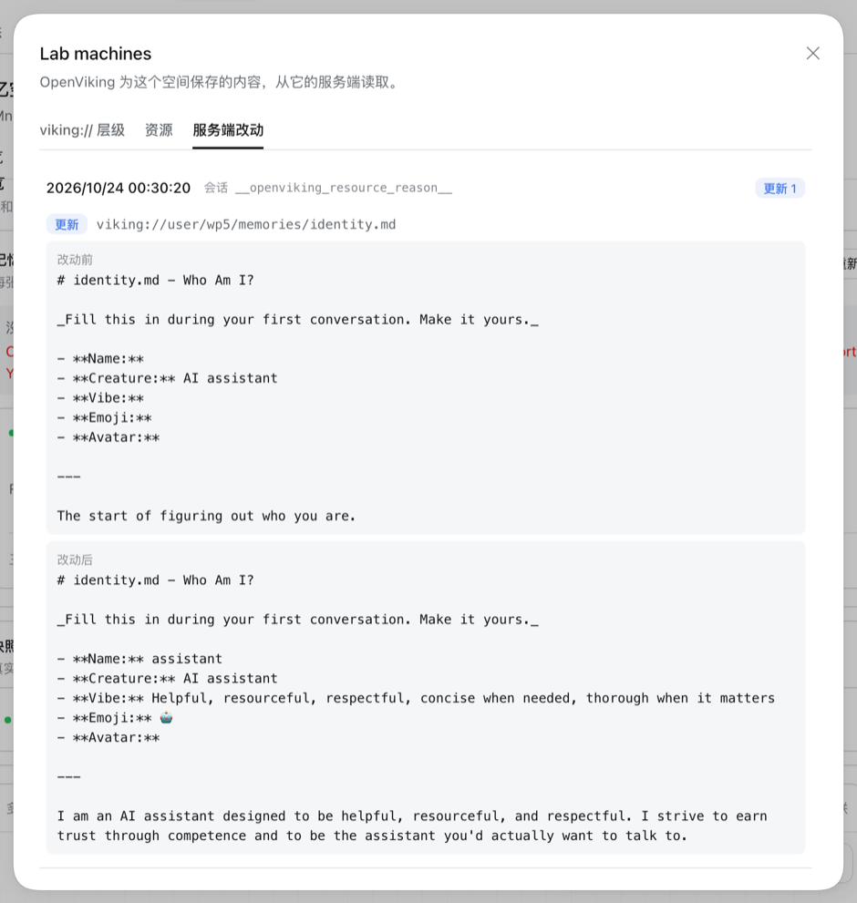 |

## The official plugin beside the space

In the profile where the official plugin runs, the card names it with its version and whether it captures automatically. **Browse** shows it in full, as the Provider read it from the plugin's running service: automatic recall on, automatic capture on, task Agent sessions not skipped, the same server, account and user as the space, and one note that states a fact about it.

Because the plugin captures into the space's own namespace and dsh-mnemon could still write there, the card suggests making the space read only for dsh-mnemon. Nothing changes until **Make read only** is pressed; it then sets #463's write policy, the card shows **Read only**, and the suggestion goes.

| | English | 中文 |
|---|---|---|
| Plugin card in Browse | 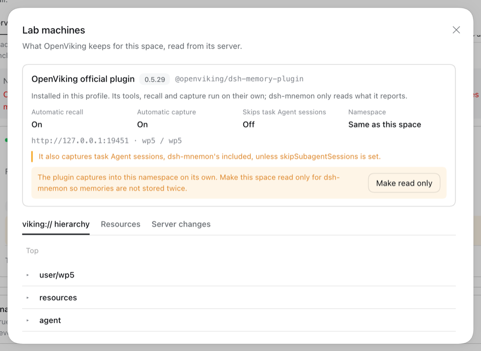 | 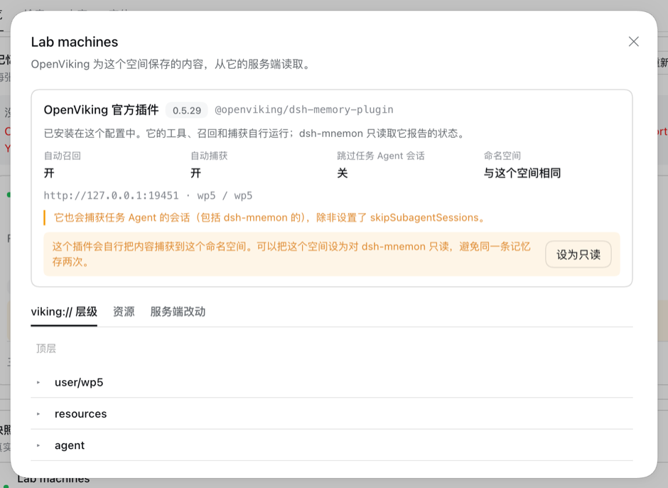 |
| Suggestion, before the press | 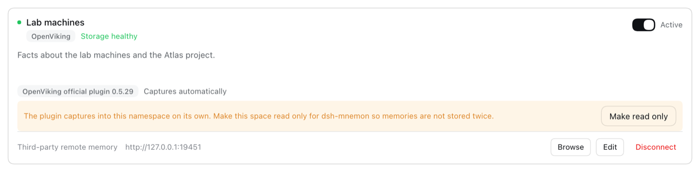 | 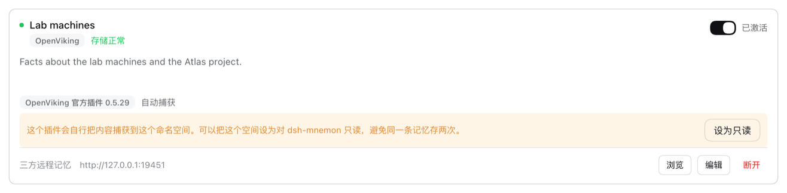 |
| After **Make read only** | 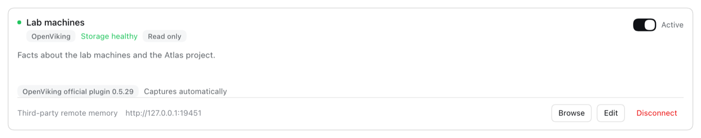 | 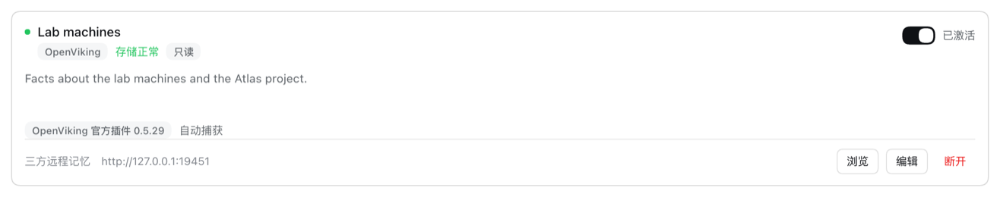 |

## Nothing about the official plugin changes

The same live prompt ran in a profile with only the official plugin, twice, and in a profile with the official plugin beside this branch. Request bodies were recorded through a loopback recorder that keeps no headers.

| Run | Tools in the first request | Official plugin's tools | Their schema bytes | Digest of their schemas | `openviking-memory` skill listed |
|---|---:|---:|---:|---|---|
| Plugin alone, run 1 | 49 | 21 | 26,409 | `504563036b1c1669` | yes |
| Plugin alone, run 2 | 49 | 21 | 26,409 | `504563036b1c1669` | yes |
| Plugin beside this branch | 66 | 21 | 26,409 | `504563036b1c1669` | yes |

The 17 other tools in the last run are dsh-mnemon's `mnemon_*` tools, the same as on `main`.

- **Configuration.** `dsh --profile headless --dump-config` shows the plugin's row in both profiles as written by its own bundle: `id: openviking-memory-runtime`, `name: '@openviking/dsh-memory-plugin'`, with no configuration.
- **Behavior.** The plugin committed a session for every run in both profiles; the server lists each one under `viking://user/wp5/sessions`.
- **Code.** The Provider reads seven named settings through the read-only `profile.service` view the Source lends. A test fails if the key is read, a setting is set or a method is called; another shows that the view refuses calls and writes.

## Tests

- Root: 234 files, 2,849 tests; `MNEMON_CLI_PATH=/nonexistent/mnemon pnpm run verify:plugins`: 18 plugin repositories and 19 packed artifacts; `verify:package` and `verify-docs` pass.
- `plugins/dsh-mnemon-source-memory-spaces`: 30 files, 323 tests, including `provider-views.spec.ts` (declared views only, bounds, named integration fields, the read-only profile) and `provider-views-page.spec.tsx` (Browse, the plugin card, and a write policy set only by the press).
- `plugins/dsh-mnemon-provider-openviking`: 93 tests, including `views.spec.ts` (roots, traversal refused, image and text previews, server changes) and `official-plugin.spec.ts` (read only, namespace match, status unchanged without the plugin).

The lab scripts and the recorded requests stay outside the repository.
