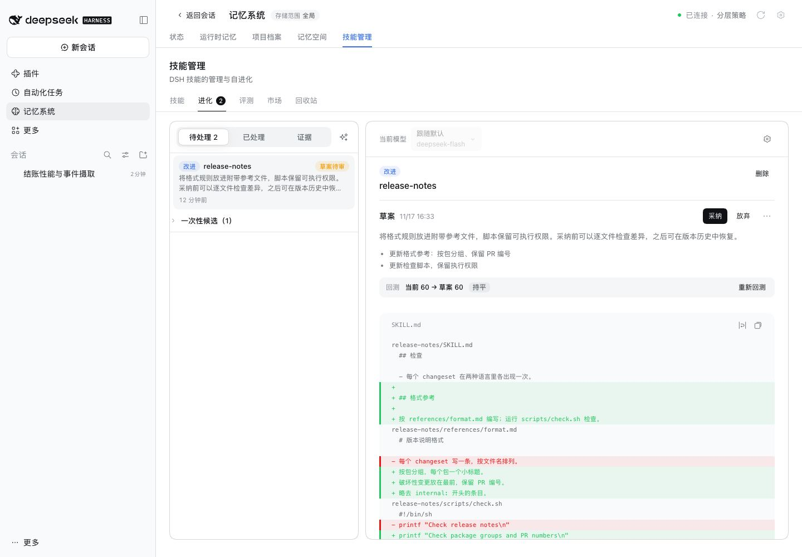

# PR #667: task archive safety / 任务归档保护

The backtest completed and its new task IDs entered DSH's durable archive set. One task was then explicitly restored and continued with a human message; after Host restart it remained outside the archive set and visible in the default sidebar. The image shows that retained conversation beside the completed backtest. / 回测新任务已持久归档，主动恢复并人工续聊的任务在重启后仍保留；图中左侧为保留的会话，右侧为已完成的回测。

Setup limit: rc.3 does not automatically account these background roots in the workspace sidebar. The isolated fixture used public `workspace.attachSession`, `workspaceRegistry.unarchiveSession` and `agents.resume` APIs, then submitted a synthetic human message. No DSH source was modified. Historical blank roots are not automatically swept or made visible by this PR. / 截图夹具通过官方 API 登记、恢复和续聊测试任务；本 PR 不新增历史空壳扫描或侧栏登记。

The title and file diff also include #671 and #668. Real Host regressions, rather than this image, establish that repeated automatic reviews do not grow the parent Subagent catalog. / 标题与附带文件差异分别包含 #671、#668；自动审查不增加主会话子 Agent 列表由回归断言验证。

Validation: independent `pnpm run verify`: **3,807 passed / 14 conditional skips**. Focused rc.3 task/idle/archive suites: **96 passed / 1 legacy-only skip**. Combined candidate plus title and Hindsight suites: **102 passed / 1 skip**. Tests: [`task-session-cleanup`](../../../tests/task-session-cleanup.spec.ts), [`task-agent-session-host`](../../../tests/task-agent-session-host.spec.ts), [`idle-review-tool-access-host`](../../../tests/idle-review-tool-access-host.spec.ts).

Date / 日期: 2026-11-17. Published DSH 0.2.2-rc.3, Node 24, isolated Chrome WebUI, fictional Lumen data and a loopback scripted model; no live API or personal data.

WebUI screenshots use a local combined preview of #667 `95c6c263`, #668 `2b04bdab`, #669 `5133e704`, #671 `f89a7727` and #672 `6428a694`. They do not imply these PRs are merged. Each code revision was also verified independently. / WebUI 截图来自上述五个候选的本地组合，不表示 PR 已合并；三个修订分支均另行通过完整验证。

Harness / 验证入口: [`serve-e2e.mjs`](../../../scripts/serve-e2e.mjs), `--docs-demo`, `MNEMON_E2E_DSH=<published DSH>/lib/bin.js`. The model is scripted: screenshots verify UI/state, not answer quality. / 模型为脚本夹具，截图验证界面与状态，不作为回答质量证明。

## Screenshots / 截图

