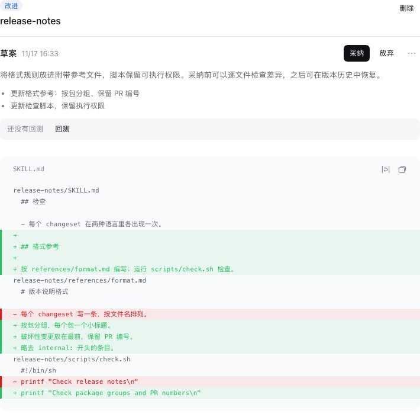

# PR #668: supporting-file draft / 附带文件草案

The real Skills evolution page displays changes to `SKILL.md`, `references/format.md` and `scripts/check.sh` together, before adoption. The draft was recorded through the real Skills Source `draft-record` management operation in the disposable demo. / 截图为真实技能进化页，展示采纳前主文件、参考文件及脚本的差异；草案通过隔离环境中的真实 Source 管理操作写入。

The browser also completed a current-versus-draft scripted backtest. File-byte recovery is validated on disk, not inferred from the screenshot. Complete snapshots of editable regular files preserve binary bytes and modes, independently of the bounded model preview; over-budget or damaged required snapshots refuse mutation. Legacy text-only versions do not delete unrecorded files. / 浏览器回测完成；二进制、较大文本和执行权限的恢复由磁盘回归验证，旧文本版本保留未记录文件。

Validation: independent `pnpm run verify`: **3,814 passed / 14 conditional skips**. Focused Skills service and new snapshot tests: **110 passed**, including **9** snapshot/mode regressions. [`bundle-version-safety.spec.ts`](../../../plugins/dsh-mnemon-source-skills/tests/bundle-version-safety.spec.ts) covers cold restore, a deleted binary, 40 KiB text, more than 40 files, executable modes, limits, missing/corrupt backups and legacy versions.

Date / 日期: 2026-11-17. Published DSH 0.2.2-rc.3, Node 24, isolated Chrome WebUI, fictional Lumen data and a loopback scripted model; no live API or personal data.

WebUI screenshots use a local combined preview of #667 `95c6c263`, #668 `2b04bdab`, #669 `5133e704`, #671 `f89a7727` and #672 `6428a694`. They do not imply these PRs are merged. Each code revision was also verified independently. / WebUI 截图来自上述五个候选的本地组合，不表示 PR 已合并；三个修订分支均另行通过完整验证。

Harness / 验证入口: [`serve-e2e.mjs`](../../../scripts/serve-e2e.mjs), `--docs-demo`, `MNEMON_E2E_DSH=<published DSH>/lib/bin.js`. The model is scripted: screenshots verify UI/state, not answer quality. / 模型为脚本夹具，截图验证界面与状态，不作为回答质量证明。

## Screenshots / 截图

