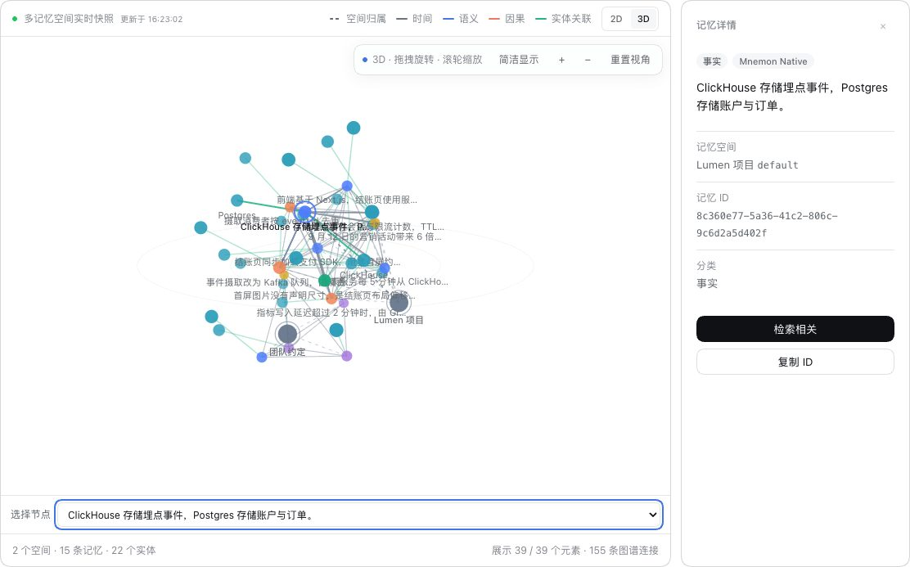
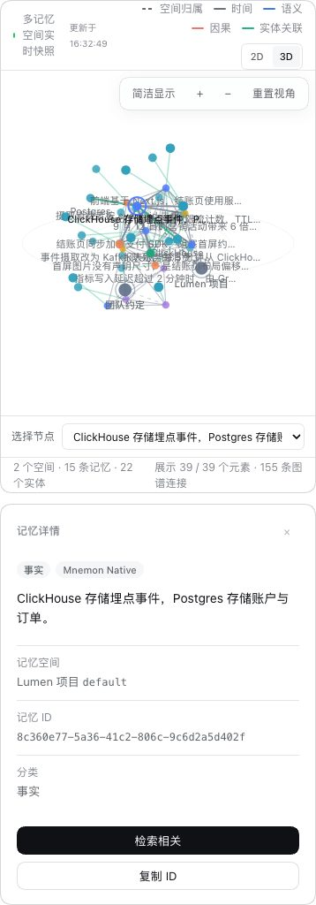

# PR #669: accessible 3D selection / 3D 键盘选点

In the real WebUI, 2D was the default. After choosing 3D, Tab from the canvas reached the native node selector; keyboard typing selected the ClickHouse memory and opened the existing details panel. Closing details cleared selection and switching back to 2D succeeded. / 默认 2D；切换 3D 后由 Canvas 按 Tab 进入选择器，键入节点名打开详情；关闭详情和返回 2D 正常。

Wide viewport: 1440 × 1000. Narrow interaction check: 390 × 844, no horizontal document overflow; the details panel follows the graph. The narrow element screenshot uses the same 390px width with a taller viewport to show the whole graph and details without sticky-header occlusion. / 窄屏检查为 390 × 844；截图用相同宽度、增高视口完整呈现图谱与下方详情，避免固定页头遮挡。

Validation: independent `pnpm run verify`: **3,802 passed / 14 conditional skips**; **33** Memory Spaces client tests pass. [`client.spec.tsx`](../../../plugins/dsh-mnemon-source-memory-spaces/tests/client.spec.tsx) covers selection, clearing, inspector and 2D/3D persistence. No Provider or stored-memory format change.

Date / 日期: 2026-11-17. Published DSH 0.2.2-rc.3, Node 24, isolated Chrome WebUI, fictional Lumen data and a loopback scripted model; no live API or personal data.

WebUI screenshots use a local combined preview of #667 `95c6c263`, #668 `2b04bdab`, #669 `5133e704`, #671 `f89a7727` and #672 `6428a694`. They do not imply these PRs are merged. Each code revision was also verified independently. / WebUI 截图来自上述五个候选的本地组合，不表示 PR 已合并；三个修订分支均另行通过完整验证。

Harness / 验证入口: [`serve-e2e.mjs`](../../../scripts/serve-e2e.mjs), `--docs-demo`, `MNEMON_E2E_DSH=<published DSH>/lib/bin.js`. The model is scripted: screenshots verify UI/state, not answer quality. / 模型为脚本夹具，截图验证界面与状态，不作为回答质量证明。

## Screenshots / 截图

