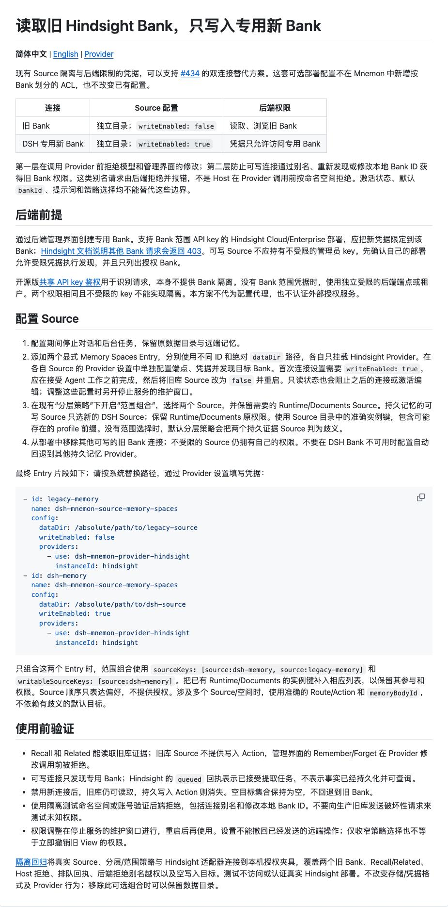

# PR #672: isolation guide preview / 隔离指南预览

This is GitHub's rendered Chinese guide at `6428a6940f8b4237fda7d309e399909d2ed636d4`, not a new product settings screen. It shows the read-only legacy Source, separately credentialed DSH Source, backend requirements and configuration. / 截图来自 GitHub 渲染的中文指南，展示旧库只读、新库专用连接及配置前提，不是新增设置界面。

No product code or defaults change. The real Source/adapter regression uses a loopback authorization fixture; it does not certify a live Hindsight deployment or introduce a Host per-bank ACL. / 不改变产品默认行为；隔离回归验证本机授权夹具中的接入行为，不认证真实 Hindsight 服务，也不新增 Host 按 Bank 划分的 ACL。

Reproduce by opening [`hindsight-bank-isolation.md`](../../zh-CN/guides/hindsight-bank-isolation.md) in GitHub Preview. Guide and executable scenario: [`hindsight-source-isolation.spec.ts`](../../../tests/hindsight-source-isolation.spec.ts). The scenario passed again on published rc.3 in the combined **102 passed / 1 legacy-only skip** run. No live credentials or remote writes were used.

## Screenshots / 截图

