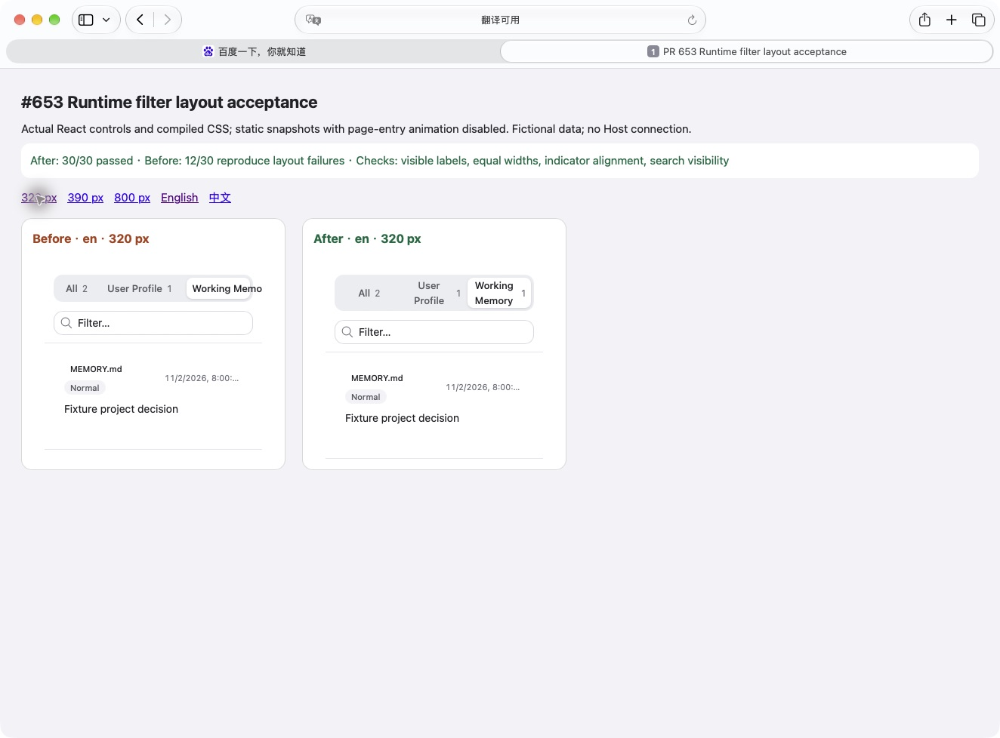
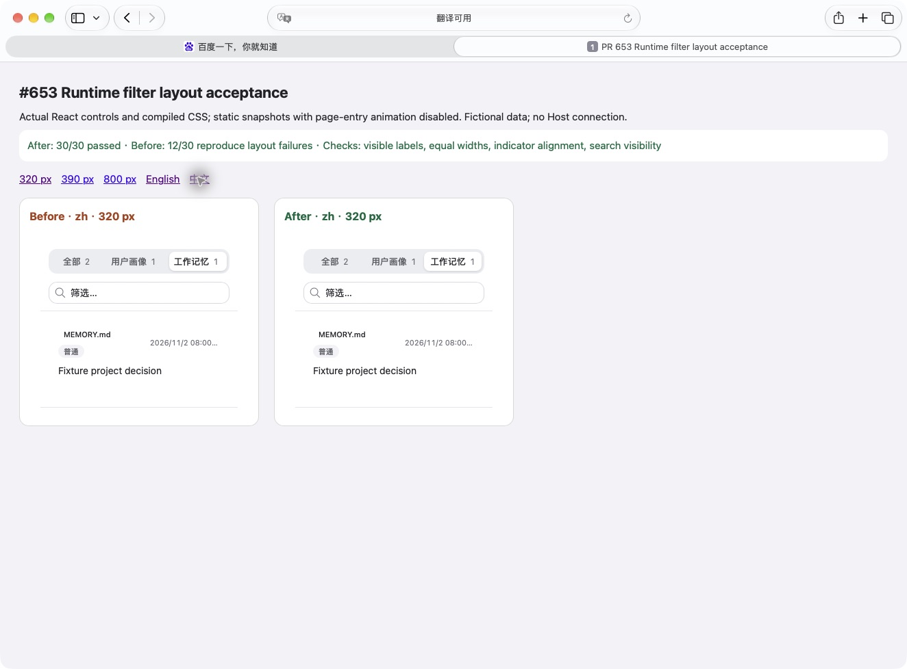

# Runtime narrow-layout validation / Runtime 窄屏验证

The Runtime scope filter in PR #653 could use unequal columns or clip the English Working Memory label at narrow widths. The fix allows labels to wrap inside equal-width buttons and lets the search field move to a separate toolbar row when necessary. It changes only Runtime presentation CSS; filter handlers, search behavior, permissions, configuration and storage are unchanged.

PR #653 的 Runtime 范围筛选在窄屏下可能出现按钮不等宽、英文工作记忆标签裁切及选中滑块错位。本次修复让标签在等宽按钮内换行，并允许搜索框在空间不足时另起一行。仅修改 Runtime 展示样式，筛选事件、搜索行为、权限、配置与存储逻辑保持不变。

## Browser evidence / 浏览器证据

Safari rendered the actual RuntimePage React markup with compiled Core and Runtime styles and the published DSH Input styles. The comparison uses fictional entries, two locales, three selected scopes, and five viewport widths: 320, 390, 600, 800 and 1200 pixels. Page-entry animation is disabled only in the screenshot fixture. This is a component layout check, not an end-to-end Host or model test.

Safari 使用实际 RuntimePage 的 React 渲染结果、编译后的 Core/Runtime 样式及已发布的 DSH Input 样式进行对比。数据为虚构条目，覆盖中英文、三个选中范围以及 320、390、600、800、1200 像素五种视口宽度。仅在截图夹具中禁用页面进入动画。这是组件布局验证，不是 Host 或模型端到端测试。

| Check / 检查 | Before / 修复前 | After / 修复后 |
| --- | --- | --- |
| Equal button widths, visible labels, aligned indicator and visible search / 等宽按钮、标签完整、滑块对齐、搜索框可见 | 18/30 passed; 12 failed / 18 项通过，12 项失败 | 30/30 passed / 30 项全部通过 |
| 320px English / 320px 英文 | Last label clipped / 最后一项标签裁切 | Labels visible in at most two lines / 标签最多两行完整显示 |
| 320px Chinese / 320px 中文 | Unequal columns and indicator offset / 列宽不均、滑块偏移 | Equal columns; single-line labels / 等宽、单行标签 |
| 1200px desktop / 1200px 桌面 | Reference dimensions / 基准尺寸 | Same button dimensions and search position / 按钮尺寸与搜索位置相同 |

React interaction checks also exercised all three filters and text search in both locales with writing enabled and disabled. Existing functional suites remain the regression coverage for editing, deletion and permission handling.

React 交互检查另行覆盖中英文、允许写入与只读状态下的三个筛选项和文本搜索；编辑、删除与权限处理继续由现有功能测试覆盖。

