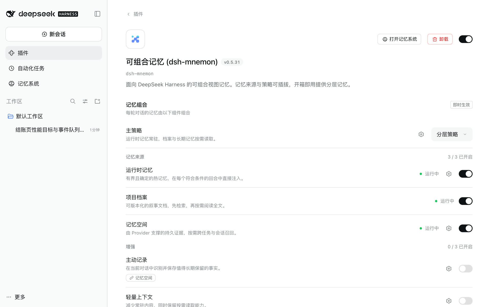

# 文档中心

**简体中文** | [English](../en/README.md) | [项目首页](../../README.zh-CN.md)

dsh-mnemon 为 DeepSeek Harness 提供三类记忆：每一轮都会用到的**运行时记忆**、问题需要时才检索的**项目档案**，以及存放在你所选 Provider 上的长期证据**记忆空间**。主策略决定它们如何参与每一轮对话，主策略与增强都在插件页中选择。从默认的分层策略开始即可，日常使用无需管理插件。

## 使用记忆系统

| 要完成的事 | 指南 |
|---|---|
| 从零安装并启动：网页、桌面版或命令行，到第一条记忆 | [安装与启动](./guides/installation.md) |
| 保存并用上第一批记忆 | [入门指南](./guides/getting-started.md) |
| 熟悉对话、记忆系统与插件页 | [界面指南](./guides/ui-guide.md) |
| 了解每个组件与策略能做什么 | [能力地图](./guides/capabilities.md) |
| 选择并接入长期记忆后端 | [Provider 指南](./guides/memory-providers.md) |
| 管理技能，让它们从对话中改进，测试它们并安装更多技能 | [技能管理](./guides/skills.md) |
| 备份、迁移存储或排查故障 | [运维指南](./guides/operations.md) |
| 升级已有安装 | [兼容性与升级](./reference/compatibility.md) |

## 查阅具体约定

| 问题 | 参考 |
|---|---|
| 有哪些设置，在哪里编辑、保存在哪里？ | [配置参考](./reference/configuration.md) |
| 数据保存在哪，怎样共享和归档？ | [存储模型](./reference/storage-model.md) |
| 读取、写入和整理何时发生？ | [生命周期与流程](./reference/workflows.md) |
| 提供哪些工具、命令、RPC 通道与界面区域？ | [接口参考](./reference/interfaces.md) |

## 制作扩展

| 要完成的事 | 开发文档 |
|---|---|
| 理解 Source、Strategy、View、归属与界面区域 | [架构设计](./development/architecture.md) |
| 开发 Source、Strategy、增强或 Provider | [插件开发](./development/extensions.md) |
| 让皮肤适配 Mnemon 背景与透明度 | [皮肤开发](./development/skin-integration.md) |
| 构建、测试与真实 WebUI 截图 | [开发与验证](./development/README.md) |
| 为独立包管理版本和发布 | [发布流程](./development/releasing.md) |
| 参与贡献：规则与验证脚本 | [贡献指南](../../CONTRIBUTING.zh-CN.md) · [脚本](../../scripts/README.md)（英文） |

## 最新变化

- [v0.5.56](https://github.com/omdsh-dev/dsh-mnemon/releases/tag/v0.5.56) · 统一 Mnemon Web UI 的 DSH 提示气泡，运行时记忆调用缺少参数时给出字段说明与示例。
- [v0.5.55](https://github.com/omdsh-dev/dsh-mnemon/releases/tag/v0.5.55) · 缩小前端体积，支持最多 24 小时的闲时复盘等待，并让会话冻结快照在项目档案和记忆空间的日常更新中保持稳定。
- [v0.5.51](https://github.com/omdsh-dev/dsh-mnemon/releases/tag/v0.5.51)：支持项目档案与记忆空间独立全局共享、可选 BM25 索引召回及空闲审查稳定性修复。
- [v0.5.50](https://github.com/omdsh-dev/dsh-mnemon/releases/tag/v0.5.50)：重新整理设置层级，优化窄窗口布局和记忆空间图谱，并减少技能页的重复读取。
- [v0.5.49](https://github.com/omdsh-dev/dsh-mnemon/releases/tag/v0.5.49)：按需记忆召回、DSH 0.2.2-rc.5 静默托管空闲审查及水位线重试恢复。
- [v0.5.48](https://github.com/omdsh-dev/dsh-mnemon/releases/tag/v0.5.48)：修复可选策略激活与 Cordis 根上下文兼容，减少后台任务干扰，并增加可选 3D 记忆概览。

[更新日志](../../CHANGELOG.zh-CN.md) · [版本历史](./releases/README.md) · [路线图](./roadmap.md)

指南描述当前版本。产品媒体统一保存在 [docs/assets](../assets/README.md)（[WebUI](../assets/webui/README.md)、[技能管理](../assets/skills/README.md)、[安装引导](../assets/install/README.md)）。内部 Host RPC 不属于对外插件 SDK。
